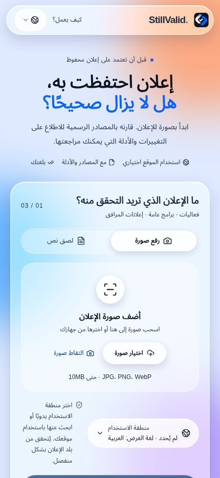
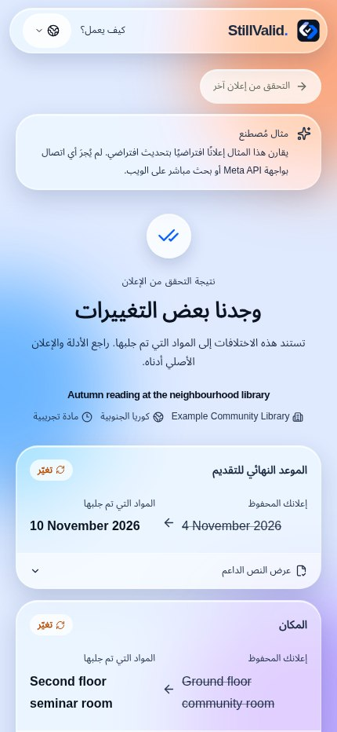

<div dir="rtl">

# StillValid

### هل لا يزال الإعلان الذي حفظته صالحًا؟

قارن صورة الإعلان أو نصه بالمصادر الرسمية الحالية، واطّلع على التغييرات والاقتباسات وما يحتاج إلى تأكيد. لا يلزم تثبيت أو تسجيل حساب.

[افتح التطبيق](https://stillvalid-beta.vercel.app) · [English](README.en.md) · [한국어](README.ko.md) · [日本語](README.ja.md) · [README](README.md)

**Languages / 言語 / 언어 / اللغات:**

[English](README.en.md) · [한국어](README.ko.md) · [日本語](README.ja.md) · [简体中文](README.zh.md) · [Español](README.es.md) · [Français](README.fr.md) · [Deutsch](README.de.md) · [Português](README.pt.md) · [العربية](README.ar.md) · [Русский](README.ru.md)

## مثال للاستخدام

مثال اصطناعي: يحدد إعلان مكتبة افتراضي الموعد النهائي في 4 نوفمبر، ويحدد تحديث افتراضي 10 نوفمبر. يعرض التطبيق القيمتين والاقتباسات. في الفحص الحقيقي يجب أيضًا التحقق من المصدر وهوية الإعلان والأدلة، وإلا فقد تتطلب النتيجة مراجعة. المثال لا يجري بحثًا مباشرًا أو يستدعي النموذج، ولا يثبت تغير موعد حقيقي.

## شاشات التطبيق

لقطات من واجهة الإنتاج الفعلية في 5 نوفمبر 2026 بتوقيت كوريا، عبر Chromium بعرض هاتف. النتيجة مثال اصطناعي معلن وليست فحصًا حقيقيًا أو صورة ملتقطة بجهاز iPhone. الواجهة بالعربية وتبقى القيم الأصلية للمثال بالإنجليزية.

<p align="center"></p>

## طريقة الاستخدام

1. التقط صورة أو اختر صورة واحدة، أو ألصق نصًا حتى 18,000 حرف. يمكنك القص والتدوير في المتصفح، ويمكن لـ SAM اقتراح مناطق الإعلانات في الصورة.
2. راجع العنوان والجهة والإصدار والبلد. لتصحيح تاريخ أو مكان مستخرج، عدّل النص الأصلي وأعد قراءته.
3. تحقق من رابط HTTPS الدقيق للجهة المصدرة أو أدخله؛ عند عدم وجود رابط يبحث التطبيق عن مصادر مرشحة.
4. راجع القيم والاقتباسات. عند الحاجة إلى مراجعة، اقرأ الأسباب وافتح المصدر الرسمي.
5. يمكنك البحث عن المكان في Google Maps أو نسخ الملخص أو إعادة الفحص أو حذف النتيجة.

## الميزات والحدود

- صور JPEG وPNG وWebP حتى 10 MiB؛ فتح HEIC/HEIF يعتمد على المتصفح. يقترح SAM مناطق متعددة داخل صورة واحدة ولا يعالج صورًا متعددة دفعة واحدة.
- يقرأ HTML والنص وطبقة النص في PDF حتى 5 MB و20 صفحة؛ لا يجري OCR لملفات PDF الممسوحة. يجلب حتى ثلاثة مرشحين ويقارن حتى مصدرين ذوي صلة.
- عشر لغات للواجهة والعربية من اليمين لليسار. لا تترجم التواريخ والأسماء والأماكن والاقتباسات. منطقة الاستخدام الاختيارية من 249 بلدًا/منطقة مستقلة عن بلد الإعلان.
- يرسل رابط الخرائط نص المكان المختار فقط عند الضغط؛ لا يتحقق من الموقع ولا يضمن فتح التطبيق الأصلي.

## فهم النتيجة

- تغيّر: تحقق تغيير واحد على الأقل ولا يوجد مانع عام من إصدار النتيجة.
- متطابق: تتطابق الحقول المفحوصة، وهذا لا يضمن بقاء كل التفاصيل دون تغيير.
- أُلغي أو انتهى الموعد: يلزم تصريح إلغاء حالي وصريح أو تاريخ ووقت صريحان وصالحان.
- تحتاج إلى مراجعة أو غير متاحة: تمنع الهوية أو المصدر أو الأدلة أو التعارض أو فشل الجلب نتيجة موثوقة.

## حالة التحقق

- نجح آخر دمج في فحص الأنواع و205 اختبارات وحدات و7 اختبارات لأداة التقييم والبناء؛ ونجحت 7 مجموعات اختبارات متصفح باستجابات ثابتة في الإصدار السابق.
- أبلغ مستخدم عن تجربة تصوير بـ iPhone استغرقت نحو ثلاث دقائق وانتهت بالمراجعة. ما زالت اختبارات iPhone وAndroid وHEIC والانتقال إلى تطبيق الخرائط غير مكتملة للإصدار الحالي.
- لم يكتمل تقييم عشرة إعلانات حقيقية بمراجع بشرية. القياسات السابقة محدودة ولم يُعد قياس سرعة النموذج الفعلية بعد آخر تحسين.

- دعم عشر لغات للواجهة لا يثبت دقة التحقق من الحقائق في كل لغة.

## الخصوصية وحدود الاستخدام

بموجب شروط Meta قد يستخدم النموذج الافتراضي muse-spark-1.3-contributor المدخلات لتحسين نماذج Meta. حذف النتيجة من StillValid لا يحذف بيانات مزود الخدمة. لا تُخزّن ملفات الصور الأصلية بصورة دائمة؛ تنتمي النتائج والاقتباسات إلى جلسة مجهولة وتنتهي صلاحيتها بعد 24 ساعة ويمكن حذفها. المفاتيح على الخادم فقط. الحد الافتراضي 300 استدعاء يوميًا بتوقيت UTC، و3 أعمال متزامنة و10 بدايات في الدقيقة إجمالًا؛ وهو ليس حدًا ماليًا.

## ملاحظات المطور

- المتصفح ← واجهات Next.js ← نماذج Meta / مصادر HTTPS ← Redis أو SQLite ← مدقق حتمي. تستخدم القراءة والمقارنة Chat Completions مع JSON صارم، ويستخدم البحث Responses + web_search، والكشف الاختياري sam-3.1.
- يجب أن توجد القيم في اقتباسات المصدر الأصلي. يتطلب التأكيد نطاقًا رسميًا مسجّلًا وفحص الجهة والعنوان والإصدار والنطاق وعلامات الأرشفة أو السحب. لا تُختلق السنوات والأوقات والمناطق الزمنية؛ صياغات الإلغاء المدعومة محدودة بالإنجليزية والكورية.
- الرابط المباشر يتجاوز البحث. مهلة المصدر الإجمالية 15 ثانية، وكل طلب 12 ثانية، مع 3 إعادة توجيه كحد أقصى؛ HTML/النص 600,000 بايت، النص المستخرج 22,000 حرف، PDF خمسة ملايين بايت/20 صفحة. الفشل لا يعني عدم التغيير.
- تُعاد قراءة واضحة للمدخل والبلد نفسيهما من ذاكرة علامة التبويب لمدة 10 دقائق؛ لا تُخزّن حداثة المصادر أو النتيجة النهائية مؤقتًا. يبدأ الفحص المبكر بعد 350 مللي ثانية ويُلغى عند تغيير الإعلان أو المنطقة أو الرابط؛ ويمكن إعادة استخدامه عند تغيير اللغة فقط.
- أولوية النموذج: متغير المرحلة ثم META_MODEL ثم muse-spark-1.3-contributor. القيمة الافتراضية لـ SAM_MODEL هي sam-3.1 والجهد minimal. القيمة `none` تحذف المعامل ولا تعني انعدام التفكير. راجع إشعار الخصوصية باللغات العشر قبل تغيير النموذج.

## ملاحظات تاريخية

عينات صغيرة من إصدارات سابقة باستخدام إعلانات عامة أعيد تركيبها؛ الصور المشابهة للصور الفوتوغرافية ليست صور iPhone فعلية. لا تمثل السرعة الحالية أو الدقة العامة.

| الملاحظة | النتيجة |
|---|---|
| `muse-spark-1.3-contributor` · Seoul + Smithsonian · 4 runs | median 24.3 s; Seoul `changed` 2/2, Smithsonian `review` 2/2 |
| `muse-spark-1.3` · minimal · 4 runs | median 26.8 s |

[Validation record](docs/validation.md#2026-11-04-production-with-muse-spark-13-contributor-f671f3b)

## واجهة API والإعدادات

| API | النتيجة |
|---|---|
| `GET /api/status`, `GET /api/demo` | الحالة والأمثلة الاصطناعية |
| `POST /api/extract`, `POST /api/locate` | القراءة وتحديد المنطقة الاختياري |
| `POST /api/checks` | فحص عبر تدفق NDJSON |
| `GET /api/checks/{id}`, `DELETE /api/checks/{id}` | قراءة أو حذف نتيجة الجلسة |
| `DELETE /api/session` | حذف نتائج الجلسة |

| Variable | النتيجة |
|---|---|
| `META_API_KEY`, `META_MODEL`, `META_EXTRACTION_MODEL`, `META_SEARCH_MODEL`, `META_COMPARISON_MODEL` | مفتاح الخادم؛ نموذج مشترك لمراحل Spark مع تجاوزات لكل مرحلة |
| `SAM_MODEL`, `DAILY_MODEL_CALL_LIMIT` | نموذج SAM؛ الحد اليومي للاستدعاءات (الافتراضي 300) |
| `UPSTASH_REDIS_REST_URL`, `UPSTASH_REDIS_REST_TOKEN` | بيانات Redis REST قابلة للكتابة أو زوج KV_REST كامل |
| `VERIFIED_SOURCE_HOSTS`, `DATABASE_PATH` | نطاقات موثوقة إضافية؛ مسار SQLite |

## التشغيل المحلي

يلزم Node.js 24 وnpm. تعمل الأمثلة دون مفتاح؛ للفحص المباشر اضبط META_API_KEY بأمان في .env.local. استخدم SQLite لخادم واحد وRedis REST قابلًا للكتابة للاستضافة. لا تنشر المفاتيح.

```bash
git clone https://github.com/ZOOGOM/stillvalid.git
cd stillvalid
npm ci
cp .env.example .env.local
npm run dev
```

## الاختبارات والمراجع

تستخدم اختبارات المتصفح بيانات ثابتة دون استدعاء النموذج، ولا تغني عن اختبار الأجهزة أو إثبات التوافق الكامل مع إتاحة الوصول. قد تترتب تكلفة على التقييم المباشر وفحص النشر الاختياري.

```bash
npm run check
npm run build
npm run test:browser
npm run test:browser-maps
npm run test:browser-locate
npm run test:browser-stream
npm run test:browser-prefill
npm run test:browser-early
npm run test:browser-image
```

[Validation / 검증 기록](docs/validation.md) · [Evaluation / 평가](docs/evaluation.md) · [Deployment / 배포](docs/deployment.md) · [Acceptance / 확인표](docs/acceptance.md) · [Performance / 성능](docs/performance.md) · [README screenshot provenance](docs/screenshots/readme/README.md) · [.env.example](.env.example) · [MIT](LICENSE)

## الترخيص

الشفرة الأصلية بترخيص MIT. تحتفظ المكتبات والنماذج والمحتويات الخارجية بشروطها. يبقى تذييل التطبيق Copyright 2026 Zoogom. All rights reserved.

</div>
