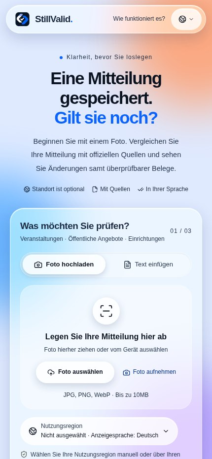
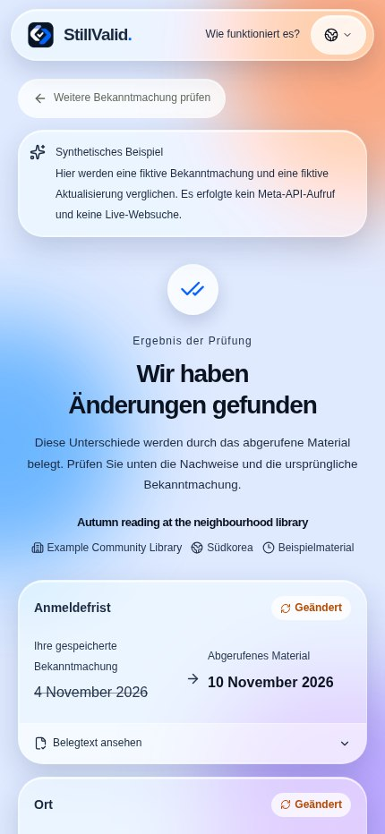

<div>

# StillValid

### Ist der gespeicherte Hinweis noch aktuell?

Vergleiche ein Foto oder einen Text mit aktuellen offiziellen Quellen und sieh Änderungen, Originalzitate und offene Fragen. Ohne Installation oder Registrierung.

[App öffnen](https://stillvalid-beta.vercel.app) · [English](README.en.md) · [한국어](README.ko.md) · [日本語](README.ja.md) · [README](README.md)

**Languages / 言語 / 언어 / اللغات:**

[English](README.en.md) · [한국어](README.ko.md) · [日本語](README.ja.md) · [简体中文](README.zh.md) · [Español](README.es.md) · [Français](README.fr.md) · [Deutsch](README.de.md) · [Português](README.pt.md) · [العربية](README.ar.md) · [Русский](README.ru.md)

## Anwendungsbeispiel

Synthetisches Beispiel: Ein fiktiver Bibliothekshinweis nennt den 4. November als Frist, eine fiktive Aktualisierung den 10. November. Die App zeigt beide Werte und Belege. Bei einer echten Prüfung müssen Quelle, Identität und Belege zusätzlich verifiziert werden; andernfalls kann das Gesamtergebnis eine Prüfung erfordern. Das Beispiel nutzt weder Live-Suche noch Modellaufruf und belegt keine tatsächliche Friständerung.

## Einblicke in die App

Aufnahmen der echten Produktionsoberfläche vom 5. November 2026 (KST), in Chromium mit mobiler Breite. Das Ergebnis ist ein gekennzeichnetes synthetisches Beispiel, keine echte Prüfung und kein iPhone-Foto. Die Oberfläche ist deutsch; die Originalwerte des Beispiels bleiben englisch.

<p align="center"></p>

## So funktioniert die Nutzung

1. Fotografiere oder wähle ein Bild oder füge bis zu 18.000 Zeichen ein. Im Browser zuschneiden und drehen; SAM kann Bereiche in einem Foto vorschlagen.
2. Prüfe Titel, Institution, Ausgabe und Land. Für eine korrigierte Frist oder einen Ort bearbeite den Originaltext und lies ihn erneut ein.
3. Bestätige oder gib die genaue HTTPS-Seite der herausgebenden Stelle ein; ohne Link werden Quellenkandidaten gesucht.
4. Vergleiche Werte und Zitate. Bei Prüfbedarf öffne die Gründe und kontrolliere die offizielle Quelle.
5. Optional: Ort in Google Maps suchen, Zusammenfassung kopieren, erneut prüfen oder Ergebnis löschen.

## Funktionen und Grenzen

- JPEG, PNG und WebP bis 10 MiB; HEIC/HEIF hängt von der Browserdekodierung ab. SAM kann mehrere Bereiche in einem Foto anbieten, verarbeitet aber keine mehreren Fotos als Stapel.
- HTML, Klartext und PDF-Textschicht (höchstens 5 MB/20 Seiten); kein OCR für gescannte PDFs. Bis zu drei Kandidaten abrufen, bis zu zwei passende Quellen vergleichen.
- Zehn Anzeigesprachen, Arabisch von rechts nach links. Daten, Namen, Orte und Zitate werden nicht übersetzt. Die optionale Nutzungsregion aus 249 Ländern/Regionen ist unabhängig vom Land des Hinweises.
- Der Maps-Link sendet erst beim Anklicken den gewählten Ortstext; er verifiziert den Ort nicht und garantiert keine native App-Öffnung.

## Ergebnisse verstehen

- Geändert: mindestens eine Änderung ist verifiziert und es gibt keinen allgemeinen Prüfblocker.
- Stimmt überein: geprüfte Felder stimmen; das garantiert nicht, dass alle Details unverändert sind.
- Abgesagt oder Frist abgelaufen: erfordert eine ausdrückliche aktuelle Absage bzw. einen gültigen ausdrücklichen Zeitpunkt.
- Prüfung nötig oder nicht verfügbar: Identität, Quelle, Beleg, Widerspruch oder Abruffehler verhindern eine verlässliche Gesamtaussage.

## Validierungsstand

- Die letzte Integration bestand Typprüfung, 205 Unit-Tests, 7 Auswertungstests und Build; sieben Browser-Suiten bestanden in der vorherigen Version mit Testantworten.
- Ein gemeldeter iPhone-Kameraablauf dauerte etwa drei Minuten und endete mit Prüfbedarf. Aktuelle umfassende iPhone-/Android-, HEIC- und Karten-App-Tests fehlen.
- Die zehn Fälle umfassende Bewertung realer Hinweise mit menschlichen Referenzen ist unvollständig. Historische Stichproben sind klein; die Live-Modelllaufzeit nach der letzten Optimierung wurde nicht erneut gemessen.

- Zehn Anzeigesprachen belegen nicht die Genauigkeit der Faktenprüfung in jeder Sprache.

## Datenschutz und Nutzungslimits

Nach den Meta-Bedingungen kann das Standardmodell muse-spark-1.3-contributor Eingaben zur Modellverbesserung verwenden. Das Löschen in StillValid löscht keine beim Anbieter gespeicherten Daten. Originalbilddateien werden nicht dauerhaft gespeichert; Ergebnisse und Zitate gehören einer anonymen Sitzung, verfallen nach 24 Stunden und sind löschbar. Schlüssel bleiben auf dem Server. Standard: 300 Modellaufrufe pro UTC-Tag, global drei gleichzeitige Arbeiten und zehn Starts pro Minute; dies ist keine Geldobergrenze.

## Entwicklernotizen

- Browser → Next.js-API → Meta-Modelle / HTTPS-Quellen → Redis oder SQLite → deterministischer Prüfer. Lesen und Vergleich: Chat Completions mit strengem JSON; Suche: Responses + web_search; optionale Bereichssuche: sam-3.1.
- Werte müssen in Originalzitaten stehen. Für eine Bestätigung braucht es eine registrierte offizielle Domain sowie Prüfungen von Institution, Titel, Ausgabe, Abschnitt und Archiv-/Rücknahmemarkern. Fehlende Jahre, Uhrzeiten und Zeitzonen werden nicht erfunden; Absagen werden nur für bestimmte englische und koreanische Formulierungen erkannt.
- Eine direkte URL überspringt die Suche. Quellbudget: insgesamt 15 s, je Anfrage 12 s und höchstens drei Weiterleitungen; HTML/Text 600.000 Byte, extrahierter Text 22.000 Zeichen, PDF 5.000.000 Byte/20 Seiten. Ein Fehler bedeutet nicht „unverändert“.
- Ein klares Leseergebnis für gleiche Eingabe und gleiches Land wird zehn Minuten im Tab-Speicher wiederverwendet; Quellenaktualität und Endurteil werden nicht gecacht. Die Vorabprüfung wartet 350 ms und wird bei Änderung von Hinweis, Region oder Link abgebrochen; ein reiner Sprachwechsel kann sie wiederverwenden.
- Modellpriorität: Stufenvariable → META_MODEL → muse-spark-1.3-contributor. SAM_MODEL ist standardmäßig sam-3.1; minimale Schlussfolgerung. `none` lässt den Parameter weg und bedeutet nicht „ohne Denken“. Vor Modellwechsel die Datenschutzhinweise aller zehn Sprachen prüfen.

## Historische Beobachtungen

Kleine Stichproben älterer Versionen mit rekonstruierten öffentlichen Hinweisen; fotoartige Bilder sind keine physischen iPhone-Fotos. Sie belegen weder aktuelle Laufzeit noch allgemeine Genauigkeit.

| Beobachtung | Ergebnis |
|---|---|
| `muse-spark-1.3-contributor` · Seoul + Smithsonian · 4 runs | median 24.3 s; Seoul `changed` 2/2, Smithsonian `review` 2/2 |
| `muse-spark-1.3` · minimal · 4 runs | median 26.8 s |

[Validation record](docs/validation.md#2026-11-04-production-with-muse-spark-13-contributor-f671f3b)

## API und Konfiguration

| API | Ergebnis |
|---|---|
| `GET /api/status`, `GET /api/demo` | Status und synthetische Beispiele |
| `POST /api/extract`, `POST /api/locate` | Lesen und optionale Bereichssuche |
| `POST /api/checks` | Prüfung als NDJSON-Stream |
| `GET /api/checks/{id}`, `DELETE /api/checks/{id}` | Sitzungsergebnis lesen oder löschen |
| `DELETE /api/session` | Alle Ergebnisse der Sitzung löschen |

| Variable | Ergebnis |
|---|---|
| `META_API_KEY`, `META_MODEL`, `META_EXTRACTION_MODEL`, `META_SEARCH_MODEL`, `META_COMPARISON_MODEL` | Serverschlüssel; gemeinsames Modell für drei Spark-Stufen, Stufenvariablen überschreiben |
| `SAM_MODEL`, `DAILY_MODEL_CALL_LIMIT` | SAM-Modell; tägliches Aufruflimit (Standard 300) |
| `UPSTASH_REDIS_REST_URL`, `UPSTASH_REDIS_REST_TOKEN` | Schreibbare Redis-REST-Zugangsdaten oder vollständiges KV_REST-Paar |
| `VERIFIED_SOURCE_HOSTS`, `DATABASE_PATH` | Zusätzliche verifizierte Domains; SQLite-Pfad |

## Lokal ausführen

Node.js 24 und npm sind erforderlich. Beispiele funktionieren ohne Schlüssel; für Live-Prüfungen META_API_KEY sicher in .env.local setzen. SQLite für einen Server, schreibbares Redis REST für Hosting. Schlüssel nicht veröffentlichen.

```bash
git clone https://github.com/ZOOGOM/stillvalid.git
cd stillvalid
npm ci
cp .env.example .env.local
npm run dev
```

## Tests und Referenzen

Browser-Tests nutzen Testdaten ohne Modellaufrufe und ersetzen keine Gerätetests oder vollständige Barrierefreiheitsprüfung. Live-Evaluation und der optionale Deployment-Probe können Kosten verursachen.

```bash
npm run check
npm run build
npm run test:browser
npm run test:browser-maps
npm run test:browser-locate
npm run test:browser-stream
npm run test:browser-prefill
npm run test:browser-early
npm run test:browser-image
```

[Validation / 검증 기록](docs/validation.md) · [Evaluation / 평가](docs/evaluation.md) · [Deployment / 배포](docs/deployment.md) · [Acceptance / 확인표](docs/acceptance.md) · [Performance / 성능](docs/performance.md) · [README screenshot provenance](docs/screenshots/readme/README.md) · [.env.example](.env.example) · [MIT](LICENSE)

## Lizenz

Der Originalcode steht unter MIT. Für Bibliotheken, Modelle und externe Inhalte gelten eigene Bedingungen. Die Fußzeile bleibt Copyright 2026 Zoogom. All rights reserved.

</div>
