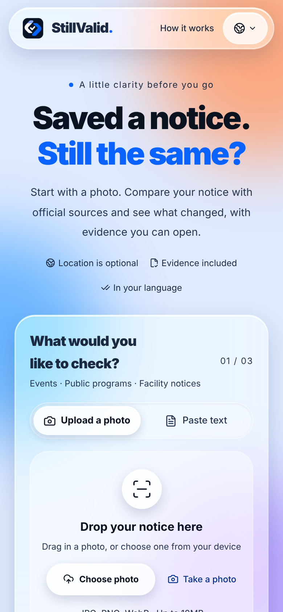
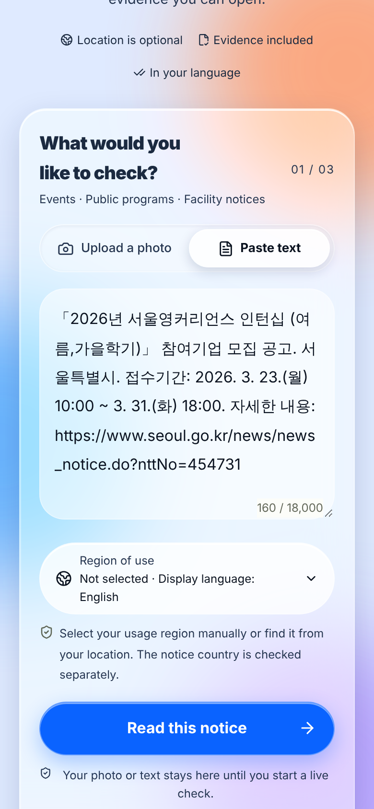
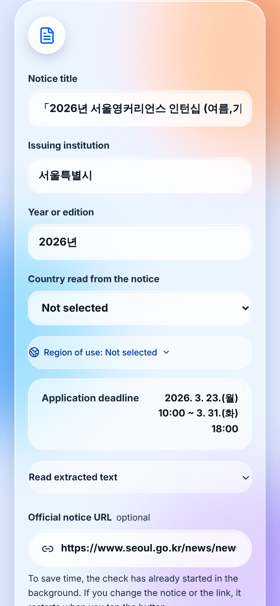
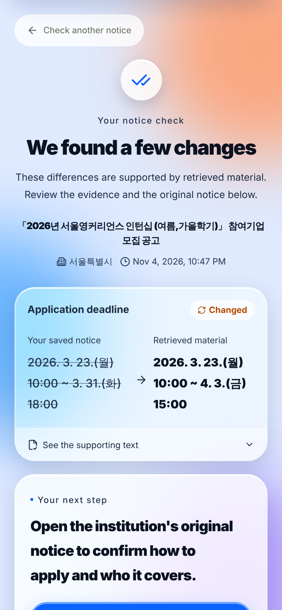
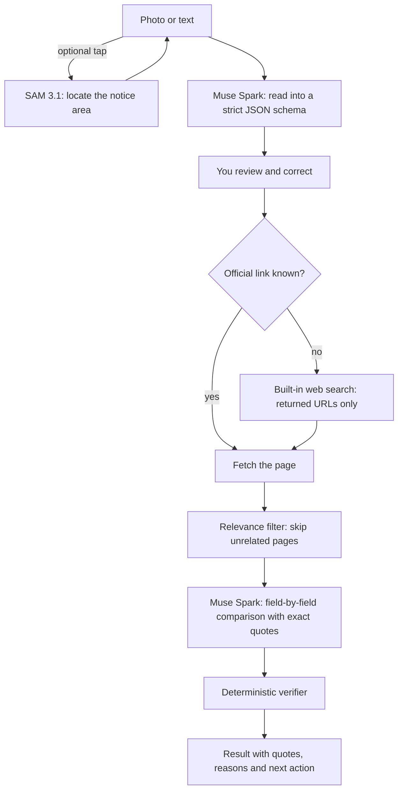

<div align="center">

# StillValid

**Saved a notice. Still the same?**

A mobile-first web app that compares a saved notice (photo, screenshot or text) with the current official source and shows what changed, with the exact quotes, the time it was checked and the next step to take.

[English](README.en.md) · [한국어](README.ko.md) · [Default README](README.md)

App: [stillvalid-beta.vercel.app](https://stillvalid-beta.vercel.app) · Alias: [stillvalid-zoogom.vercel.app](https://stillvalid-zoogom.vercel.app)

</div>

> Korean working name: **지금도 맞나요**. Built for the Meta Global AI Developer Hackathon, Indie developer track, theme "Build for Your World".

## Screenshots

Real screens of the running app ([stillvalid-beta.vercel.app](https://stillvalid-beta.vercel.app)), captured at phone width on 2026-11-04 with the English display language. The example is a Seoul Metropolitan Government notice (text reconstructed from the earlier public notice) checked against the official page, which gave a 31 March deadline a later date. The notice's own Korean text and the official values are kept as written; only the interface is translated.

| 1. Start | 2. Paste or add the notice | 3. Review what was read | 4. Result |
|:---:|:---:|:---:|:---:|
|  |  |  |  |

Step 3 shows the official link that was found in the notice text and filled in for you to check, and the note that the check has already started in the background. Step 4 shows the saved value (struck through) against the retrieved value, with the verified "Changed" label; "See the supporting text" opens the quotes from both sides.

---

## Contents

1. [What it does](#1-what-it-does)
2. [Current status, stated plainly](#2-current-status-stated-plainly)
3. [Features](#3-features)
4. [How to use it](#4-how-to-use-it)
5. [How it works](#5-how-it-works)
6. [The verification algorithm](#6-the-verification-algorithm)
7. [Speed and reliability](#7-speed-and-reliability)
8. [Meta models used](#8-meta-models-used)
9. [Privacy, security and limits](#9-privacy-security-and-limits)
10. [Measured results](#10-measured-results)
11. [Run it yourself](#11-run-it-yourself)
12. [Configuration](#12-configuration)
13. [API](#13-api)
14. [Testing](#14-testing)
15. [Project layout](#15-project-layout)
16. [Known limitations and next steps](#16-known-limitations-and-next-steps)
17. [License](#17-license)

---

## 1. What it does

People photograph posters, school letters, application notices and event flyers, then come back days or weeks later. Deadlines, venues and conditions may have changed, and finding the official page takes time, especially for a notice in another language. StillValid does that comparison:

1. You give it a photo (or a screenshot, or pasted text) of a notice.
2. It reads the notice and shows you what it understood, so you can correct it.
3. It finds the official page (or uses the link you give it) and reads the page itself.
4. It compares field by field and shows each change with the exact quote from the notice and from the official page.
5. A deterministic checker, not the language model, decides what may be called "confirmed". Everything it cannot confirm is shown as **needs review**, with the reason.

It is meant for students, parents, newcomers, travellers and anyone who relies on a saved public notice and wants to see the evidence before acting. Intended users are described here; adoption and impact have not been measured.

**What it does not do:** it does not decide whether *you* are eligible, give medical or legal judgments, or issue emergency instructions. A missing change on the official page is never reported as "nothing changed".

## 2. Current status, stated plainly

| Area | Status |
|---|---|
| Web app, ten display languages, real Meta model calls, hosted storage | Working in production (`stillvalid-beta.vercel.app`). |
| Automated tests | 192 unit and behaviour tests and six browser scripts pass locally. |
| Production checks done | Session isolation and deletion, duplicate-request reuse, cancellation, concurrency limit (a 4th simultaneous check is refused). |
| Speed target (median 15 s, 90th percentile 30 s) | **Not met.** Measured medians are 24–27 s with an official link on four runs. See [section 10](#10-measured-results). |
| Accuracy on real notices with human-checked answers | **Not measured.** The ten-notice evaluation is prepared but has not been run. |
| Real iPhone Safari and Android Chrome testing | **Not done.** Only emulated mobile viewports and automated accessibility checks were run. |
| 24-hour expiry on hosted storage | **Not yet verified** (the time-to-live is configured; a real expiry check is scheduled). |

Nothing in this document is a claim of general accuracy. Numbers are single observations unless stated otherwise.

## 3. Features

**Input**
- Photo from camera or gallery (JPEG, PNG, WebP, up to 10 MB), or pasted text up to 18,000 characters.
- Crop, rotate and preview in the browser before anything is sent. The image is re-encoded in the browser, which strips most metadata.
- HEIC/HEIF is converted where the browser can decode it (recent Safari); elsewhere you get a clear message and an alternative.
- A hint appears for small photos (short side under 500 px or under 0.3 megapixels). A reading the model marks as uncertain (cropped, blurry, sparse) is flagged on the review screen.
- **Find the notice automatically (optional, SAM 3.1):** on a photo of a notice board it proposes the notice area. One area is cropped directly; several are shown as numbered choices; you can undo or crop by hand.

**Reading and review**
- Extracts the title, issuing institution, edition or year, notice country (only if written on the notice) and the explicit deadline, event date, location, status, cost and eligibility.
- Every value must be an exact excerpt of the notice text, not a normalised or translated date, and not an inferred time. Missing facts stay missing.
- You review and edit everything before it is compared. The usage region you chose and the country read from the notice are kept separate, and a disagreement must be confirmed.

**Official sources**
- **Printed link:** if the notice shows a public body's page address (for example a `go.kr` or `gov` page), it is placed in the link field with a note asking you to check it. Home pages only, social, blog, ticket and shortener links are never offered.
- **Search:** without a link, Meta's built-in web search proposes candidates. Only URLs that the search actually returned or cited are used; the search summary is never treated as evidence. The prompt asks for the issuer's own and government pages before blogs, social media, aggregators and ticket sellers.
- **Direct link:** paste an official HTTPS page and the search step is skipped.
- **Reads:** HTML pages (tables keep their cell structure), plain text, and PDF **text layers** (up to 5 MB and 20 pages). Scanned PDFs are reported, never guessed at.
- Blocked, script-only, scanned or oversized sources are told apart from each other. A failed fetch is never replaced by a model guess.

**Result**
- One of: **changed**, **matches** what was retrieved, **cancelled**, **deadline passed**, **needs review**, or **unavailable**.
- Before and after values, the supporting quotes, source URLs, the time checked, what could not be confirmed and a suggested next action.
- Per-source reasons (for example "page is for a different edition", "no matching quote", "script-only page").
- A candidate list so you can correct a wrong link or pick another source.
- **Maps:** a location value has a plain Google Maps search link that sends only the place text, and only when you tap it. It does not verify the place.
- Copy a summary, start a fresh check, delete one result or all results of the session.

**Languages and region**
- Ten display languages: English, Simplified Chinese, Spanish, French, German, Japanese, Korean, Portuguese, Arabic (full right-to-left layout) and Russian. They cover screens, results, errors, settings and copied summaries.
- Switching language changes only the display. Values and quotes are never translated, the verdict does not change and no extra model call is made.
- An optional usage region from 249 countries and regions. It is independent of the notice country, the language and the time zone. GPS and IP never set it. "Find my region" asks for location once, after your tap and browser permission, and works out the country inside the browser from a bundled boundary dataset; coordinates are never sent or stored.

**Recovery and speed**
- Real progress, elapsed time and a cancel button. The browser stops waiting after fixed deadlines and keeps your input.
- A result that has been received is kept even if the connection then breaks or never closes; a broken stream recovers the saved result without a new model call.
- **Background check:** the check starts right after reading, while you review the fields, and is used only if nothing was changed when you tap the button ([details](#7-speed-and-reliability)).

## 4. How to use it

1. **Open the app** at [stillvalid-beta.vercel.app](https://stillvalid-beta.vercel.app). No installation or sign-up.
2. **Optional settings:** choose a display language and, if you like, a usage region. Remembering the region is opt-in.
3. **Add the notice:** take or choose a photo, or paste the text. Crop so the notice fills the frame and the text is sharp. For a board with several notices, tap **Find the notice automatically** and pick the right one.
4. **Tap read.** Wait for the review screen (a few seconds for text, roughly 5–25 s for a photo).
5. **Check what was read.** Fix the title, institution, edition and any value that is wrong. A banner appears if the photo looked blurry or cropped.
6. **Add the official link if you know it** (or accept a printed one that was filled in). It makes the check faster and the match more reliable.
7. **Tap check.** The result shows what changed, with quotes from both sides. If the result says **needs review**, open the reasons and either correct the link, choose another candidate or confirm on the official page yourself.
8. **Optional:** open the location in Google Maps, copy the summary, or delete the result.

Tips: use the issuing body's own page rather than a blog or social post (blogs are not accepted as official evidence); add the edition or year if the notice has one; if the result is unavailable, try a different link rather than retyping the notice.

## 5. How it works



The browser talks to Next.js API routes. The routes call the Meta Model API (Chat Completions for reading and comparison, the Responses API for web search and notice location), retrieve public HTTPS pages with a hardened fetcher, and keep session-owned results in Upstash Redis (hosted) or SQLite (local). Keys stay on the server.

**Client-side image preparation.** The photo is decoded in the browser and scaled so its longest side is at most 2,400 px. It is encoded as JPEG, trying quality 0.92, 0.80, 0.68 and 0.55 until the encoded size is at most about 3.8 MB. Re-encoding removes most EXIF data. Inputs above 10 MB are refused, and unsupported types get an explanation instead of a generic error.

**Locating a notice (SAM 3.1, opt-in).** One call asks SAM 3.1 for the concept "document" through the Responses API with confidence enabled; if nothing is found, a second prompt "poster" is tried. Box tokens in the reply (`x1, y1, x2, y2, w, h, c`) are parsed, boxes under 3% of the image are dropped, up to six remain in reading order, and a 2% margin is added when cropping. One box is cropped directly; several appear as numbered choices; you can undo. Locating a region is not the same as reading it correctly, and the app does not treat it that way.

**Reading.** Chat Completions with a strict JSON schema. For photos the model transcribes the text into `originalText` and extracts fields; for pasted text it does not echo the text. A field is kept only if its quote occurs verbatim in the original text and contains its value. The model also classifies an image as a notice, not a notice (rejected with an explanation) or uncertain. Only a fast failure (under 20 s) is retried once; a slow failure is reported, not repeated.

**Finding sources.** Without a link, one Responses call with built-in web search (`search_context_size: low`) returns candidates; at most three are used, and a printed `https` link found in the notice text is tried first. Candidates on a registered official domain are ordered ahead of the others.

**Fetching.** Up to three candidates are fetched concurrently, but they are decided in priority order exactly as a sequential loop would, stopping once two related sources are in hand; unneeded requests are aborted. Every request is checked ([section 9](#9-privacy-security-and-limits)). A page is turned into text with table cells kept (separated by ` | `); PDFs are read through their text layer. The text goes through a relevance filter: a page that shares no distinctive words with the notice (common words such as "notice", "apply", "공고", "모집" do not count) is not sent to the model and is reported as unrelated.

**Comparing.** For each related source, one Chat Completions call returns, per field, a relation (`changed`, `same`, `unclear`), the notice's "before" quote and the source's "after" quote, plus an identity quote and the document's role. Comparisons run in parallel with a 100 s ceiling each. Once a comparison on an official source has succeeded, the others get 30 more seconds and are then reported as unfinished; an unfinished source keeps the result in review.

**Verifying and presenting.** The verifier ([section 6](#6-the-verification-algorithm)) re-checks every model claim in code and produces the final status. Display text comes from fixed dictionaries in ten languages, not from the model.

## 6. The verification algorithm

The language model proposes; code decides. A change is shown as **confirmed** only if all of these hold for that field:

1. **Exact quotes.** The "before" quote occurs in the notice text and the "after" quote occurs in the source text, after whitespace and punctuation-spacing normalisation. A quote that the model made up fails.
2. **Registered authority.** The source's registered domain is on the verified list (a built-in list of public institutions such as `go.kr`, `gov.uk`, `si.edu`, plus any `VERIFIED_SOURCE_HOSTS` the operator sets). Pages in resident-content paths (free boards, Q&A, petitions, comments, forums) are never treated as the issuer's own notice, whatever the host. A registered domain alone is never enough.
3. **Same notice.** Institution, title, edition or year, section and identifiers must match. The checker looks for another edition's or another section's scope in the quoted passage, page-level archive or withdrawal markers, and heading text that belongs to a different programme. Generic site labels and menu words do not count as identity. Reasons are recorded as fixed codes (for example identity, edition, section, archive).
4. **Dates.** Ambiguous numeric dates such as `03/04/2026`, missing years, missing times or time zones are preserved as written and never filled in. A deadline counts as passed only for an explicit, valid timestamp earlier than the check time.
5. **Cancellation.** It needs an exact, current assertion about the same event. The grammar accepts a limited set of English and Korean cancellation statements; conditional, negated, historical or other-event wording does not count, and any other wording stays in review.

The overall status is decided in this order:

- **unavailable** if no source could be read;
- **needs review** if nothing was verified, or any of these is true: identity failed, an unverified field exists, a notice field was not matched, a source is incomplete (search failed, fetch failed, comparison unfinished), two verified sources disagree, or evidence is missing;
- otherwise **cancelled**, **deadline passed**, **changed** (some field verified as changed) or **matches** (all checked fields agree).

Because the rule is "anything uncertain becomes review", the app prefers to say "I can't confirm" over a wrong "confirmed". It does not hide real changes by sending everything to review either: a verified change on a registered official page is reported as changed, with its quotes.

## 7. Speed and reliability

**Where the time goes** (production, one reading and one comparison with an official link): reading a dense photo about 16–20 s (a short notice about 4 s), fetching 0.2–1.7 s, comparing 8–25 s. A search adds about 10–15 s when no link is known.

What was done about it:

- **Minimal reasoning effort** for reading, comparison and search. The search request uses `reasoning: { effort: "minimal" }` on Responses.
- **Background check.** After reading, the check starts while you review the fields: with the link when it is known (typed, or printed on the notice), otherwise including the source search. It is used only if the notice, region, language and link are unchanged when you tap; otherwise it is dropped and a normal check runs. It does not start when the reading is uncertain or the notice country differs from the chosen region, and starts at most once per reading. It moves model time into your review time; it does not make the model faster.
- **Overlapping fetching and comparing**: an accepted source starts comparison while later candidates still load, with the same priority, maximum two related sources and 30 s grace. Fetch and comparison timing can overlap and must not be added.
- Blank white photo margins and explicitly marked page chrome are reduced; printed text and notice sections are retained. Stable per-step cache keys and numeric cached/reasoning-token metrics help measure prompt reuse. See [performance](docs/performance.md).
- A lower-priced model variant for all steps (see [section 8](#8-meta-models-used)).

**Reliability**
- The check streams newline-delimited JSON with a heartbeat every 10 s. The browser stops after 150 s (reading), 200 s (checking) or 80 s (locating), or after 45 s without any bytes, and keeps your input.
- Once a result has been received it is final: later errors or a stream that never closes do not remove it, and a fresh check is possible at once.
- A broken stream recovers the stored result with `GET /api/checks/{id}` without another model call.
- A request key makes duplicate submissions reuse the stored result.
- Cancelling stops the work and deletes the result.

## 8. Meta models used

| Step | Model | API | Notes |
|---|---|---|---|
| Read a photo or text | `muse-spark-1.3-contributor` | Chat Completions, strict `json_schema` | `reasoning_effort: minimal` |
| Find official sources | `muse-spark-1.3-contributor` | Responses with built-in `web_search` | Minimal reasoning; only returned or cited URLs are used |
| Compare with the source | `muse-spark-1.3-contributor` | Chat Completions, strict `json_schema` | `reasoning_effort: minimal`, output budget 12,000 tokens |
| Locate the notice (opt-in) | `sam-3.1` | Responses, concept prompt | Boxes parsed from tokens |

The lower-priced `muse-spark-1.3-contributor` variant was chosen by the owner for cost. **Under Meta's terms for that variant, what you submit may be used to improve Meta's models.** The in-app privacy notice says so in all ten languages. `META_MODEL` (server-only) changes all three Spark steps together; `META_EXTRACTION_MODEL`, `META_SEARCH_MODEL` and `META_COMPARISON_MODEL` override one step. Resolution is the step variable, then `META_MODEL`, then `muse-spark-1.3-contributor`; values are trimmed, and changing a variable needs a new deployment. Every Production build first runs a read-only model-catalog check (public model IDs only, no inference) and fails if a selected ID is unavailable, so the previous deployment keeps serving. Before switching models, review the privacy notice in all ten languages, because it describes the contributor configuration.

Other models were measured for the reading step only: `muse-spark-1.2` read in 2.0–4.5 s and `muse-spark-1.1` in 2.4–7.9 s, but both misread a character in a Korean title in most runs, which can break the identity check. They are not used. No faster mode is named in the model list the deployment can see.

## 9. Privacy, security and limits

**Data**
- Original image files are not stored by StillValid. Results and the quotes they need belong to an anonymous session cookie, last 24 hours and can be deleted one by one or all at once. Expiry is enforced before reads and cleaned up regularly.
- Starting a live check sends your input to the Meta Model API. What Meta keeps or learns follows Meta's terms, and for the default model variant may include model improvement. Deleting a result in StillValid does not delete anything Meta holds.
- Location coordinates stay in the browser.
- Logs hold call durations, outcomes and token counts only; no notice text, URLs, cookies or IP addresses.

**Fetching safety**
- Only `https` on port 443, no credentials in the URL, no `localhost`, `.local`, `.internal`, `.test`, `.onion` and similar names, no private or reserved IP addresses.
- DNS is resolved first and the connection is pinned to the public addresses found. Redirects are followed manually (at most 3) and every hop is checked again. Retrieval fails closed behind a generic forward proxy.
- Limits: 12 s per request, 600 KB of HTML or text, 5 MB and 20 pages for a PDF, PDF worker released on every path.

**Server**
- Writes need the same origin and the HTTP-only anonymous session cookie. Content-Security-Policy, HSTS with preload, frame denial, `nosniff`, referrer and permissions policies are set.
- Keys are server-only and never use a public prefix.

**Usage limits** (all in `src/lib/limits.ts`; these are request ceilings, not money caps; the provider's own spend limit is separate)
- 3 simultaneous model jobs and 10 starts per rolling minute (a 4th simultaneous check is refused with HTTP 429).
- Per session per hour: 60 extractions and 40 checks. Per network (keyed IP hash on Vercel) per hour: 200 starts.
- Daily model calls: 300 by default (`DAILY_MODEL_CALL_LIMIT`). The default was raised from 100 for testing and can be set lower for public use.

## 10. Measured results

All measurements are production observations on 2026-11-04 with real Meta calls. Notice photos were reconstructed from public pages as camera-style images, not physical photos. Four runs per setting are a small sample: they are not accuracy or latency guarantees.

**Reading effort, official link given** (Seoul notice and a Smithsonian fellowship, photo, two runs each; end-to-end time from reading to result):

| Setting | Median | Seoul result |
|---|---|---|
| Model default | 45.6 s | `needs review` 2 of 2 |
| `low` | 34.6 s | `changed` 1 of 2 |
| `minimal` | 26.8 s | `changed` 2 of 2 (verified quotes) |
| `minimal` + `muse-spark-1.3-contributor` | 24.3 s | `changed` 2 of 2, title read correctly 2 of 2 |

**Background check** (text input): the wait after tapping the button was 3.9 s with a printed link (10 s of review) and 7.9 s with no link (15 s of review), against about 22–45 s when the check starts at the tap. This hides model time behind review time; it does not shorten the model.

**Production behaviour checks:** another session gets 404 when it reads or deletes a result; a repeated request key returns the saved result in about 0.2 s with no model call; cancelling ends the stream and the result is gone; a 4th simultaneous check returns HTTP 429.

**Not yet measured:** accuracy on human-checked real notices (0 of 10 so far), the 15 s / 30 s speed target, real-device behaviour, search success rate, and quality of each display language on real results. The evaluation tooling and the ten task slots are in [`docs/evaluation.md`](docs/evaluation.md) and [`docs/acceptance.md`](docs/acceptance.md); full dated records are in [`docs/validation.md`](docs/validation.md).

## 11. Run it yourself

Requires Node.js 24 and npm.

```bash
git clone https://github.com/ZOOGOM/stillvalid.git
cd stillvalid
npm ci
cp .env.example .env.local
# put META_API_KEY into .env.local for live checks
npm run dev
```

Open `http://localhost:3000`. Without a key you can explore three clearly labelled synthetic examples (deadline and location change, explicit cancellation, a different edition). Local development uses SQLite when no Redis is configured.

```bash
npm run check        # type check, unit tests, evaluation-harness tests
npm run build        # production build
npm start            # production server
npm run verify:meta  # read-only model availability check (needs a key)
```

**Deploy:** push to a GitHub repository connected to Vercel, add Upstash Redis through the Vercel Marketplace and set the environment variables below. A Dockerfile and `compose.yaml` run a single Node server with SQLite. GitHub Pages alone cannot host this app because the protected API routes need a server. See [`docs/deployment.md`](docs/deployment.md).

## 12. Configuration

| Variable | Purpose |
|---|---|
| `META_API_KEY` (alias `MODEL_API_KEY`) | Server-only Meta key |
| `META_MODEL` | Model for all three Spark steps; default `muse-spark-1.3-contributor` |
| `META_EXTRACTION_MODEL`, `META_SEARCH_MODEL`, `META_COMPARISON_MODEL` | Optional per-step overrides (higher priority than `META_MODEL`); leave unset for a single switch. `SAM_MODEL` controls the notice locator separately |
| `META_REASONING_EFFORT_EXTRACTION`, `_COMPARISON`, `_SEARCH` | `minimal`, `low`, `medium`, `high`, `xhigh`, `max`, or `none`; unset means minimal for all three steps |
| `META_SEARCH_MAX_TOOL_CALLS` | Optional 1..5 built-in search-tool call cap; unset by default to preserve amendment/cancellation discovery |
| `UPSTASH_REDIS_REST_URL`, `UPSTASH_REDIS_REST_TOKEN` (or `KV_REST_API_URL`, `KV_REST_API_TOKEN`) | Hosted storage; use a writable token, never mix pairs |
| `APP_URL` | Exact external HTTPS origin in production |
| `DAILY_MODEL_CALL_LIMIT` | Global model calls per UTC day (default 300) |
| `IP_RATE_LIMIT_SECRET` | Optional key for the IP-derived limit (32+ random characters) |
| `VERIFIED_SOURCE_HOSTS` | Extra institution domains you have verified, comma-separated |
| `DATABASE_PATH` | SQLite file for single-server runs |
| `STILLVALID_VERIFY_DEPLOYMENT` | `1` for one reviewed deployment to run the hosting probe |

Never commit keys, and never prefix a secret with `NEXT_PUBLIC_`.

## 13. API

| Route | Purpose |
|---|---|
| `GET /api/status` | Readiness, deployed commit, `model` (the comparison model) and `models` (extraction, search, comparison). These show configuration, not completed inference |
| `POST /api/extract` | Read a photo or text; returns the notice, readability and timing |
| `POST /api/locate` | SAM 3.1 notice area (opt-in) |
| `POST /api/checks` | Run a check; streams `created`, `phase`, `ping`, `result` or `error` as NDJSON |
| `GET /api/checks/{id}` | Saved result for the owning session |
| `DELETE /api/checks/{id}` | Delete (or cancel) a result |
| `DELETE /api/session` | Delete every result of the session |
| `GET /api/demo` | Synthetic examples, no model call |

## 14. Testing

```bash
npm test                 # 192 unit and behaviour tests
npm run test:live-harness
# with the app running and Chromium installed:
CHROMIUM_PATH=/usr/bin/chromium npm run test:browser
npm run test:browser-maps
npm run test:browser-locate
npm run test:browser-stream
npm run test:browser-prefill
npm run test:browser-early
```

Tests cover fabricated quotes, different institutions and editions, section mismatches, archive notices, ambiguous dates, negated and conditional cancellation, unsafe URLs and redirects, PDF limits, request sizes, session isolation, deletion, expiry, duplicate requests, limits, stream failures, result recovery, SAM choice and undo, printed-link suggestion and the background check. Browser scripts use fixed responses and make no model calls. Mocked responses and emulated viewports are not live-model or real-device evidence, and automated accessibility checks do not establish WCAG conformance.

## 15. Project layout

```text
src/app/            Next.js app and API routes (checks, extract, locate, session, status, demo)
src/components/     app.tsx (the whole UI), image.ts (browser image preparation)
src/lib/meta.ts     Meta calls, per-step models, retries, SAM parsing
src/lib/compare.ts  Deterministic verifier and result assembly
src/lib/source.ts   Safe fetching, HTML/text/PDF to text
src/lib/relevance.ts, priority.ts, printed-url.ts, maps.ts
src/lib/limits.ts, abuse.ts, store.ts, redis-store.ts, sqlite-store.ts
src/lib/ui-*.ts, result-i18n.ts, languages.ts   Ten-language dictionaries
tests/              Unit and behaviour tests, PDF fixtures
scripts/            Browser checks, live evaluation harness, hosting probe
docs/               Acceptance, deployment, evaluation, validation, submission copy
```

## 16. Known limitations and next steps

- Accuracy on real notices has not been measured; a ten-task evaluation with human-checked answers is the main open item.
- Median time is about 24–27 s with a link, above the 15 s goal. Reading a dense photo is the slowest step.
- The official-domain list is limited, and the identity and section checks are conservative: legitimate notices can end in review, especially on script-rendered pages or when headings differ from the notice title.
- Search without a link can return unofficial or unreadable pages; the result then stays in review.
- Cancellation grammar covers limited English and Korean wording.
- Scanned PDFs are not OCR'd. Very long pages can exceed size or time limits.
- Ten display languages are dictionaries, not a measured per-language accuracy claim. Traditional Chinese is not included.
- Real iPhone and Android testing, HEIC on Safari and the hand-off to a maps app remain to be checked on devices.
- Out of scope for now: accounts, payments, notifications, app stores and worldwide notice collection.

## 17. License

Original code is [MIT](LICENSE). Third-party libraries, models, notice content and images keep their own licenses and terms.

The running app's footer reads "Copyright 2026 Zoogom. All rights reserved." The source code itself is released under the MIT license in [LICENSE](LICENSE).
