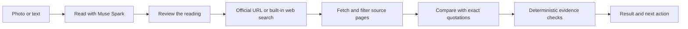

# StillValid

### Saved a notice. Still the same?

Compare a notice photo or pasted text with current official-source material. See **what changed, the supporting quotes, and what still needs confirmation** before you act.

[**Open the app**](https://stillvalid-beta.vercel.app) · [한국어](README.ko.md) · [Project overview](README.md) · [Deployment guide](docs/deployment.md)

Built for the Meta Global AI Developer Hackathon — **Indie developer**, “Build for Your World.” No installation or account is required.

## See the app

**Actual production UI, captured on 5 November 2026 (KST).** The result below is the app's visibly labelled **synthetic example**, not a live verification of a real notice. These are Chromium mobile-width screenshots, not photographs of an iPhone. [Capture details](docs/screenshots/readme/README.md).

<p align="center">
  
  
</p>

**Start with a notice → inspect a result with before/after values.** Try the three built-in examples on the home page—changed details, cancellation, and a different edition—without a model call.

## Check a notice in five steps

1. **Add a photo or text.** Take a photo, choose one image from your device, or paste up to 18,000 characters. Crop and rotate for legibility. On a noticeboard photo, the optional SAM locator can suggest one or several notice regions; choose the one to read.
2. **Read and review.** Check the title, institution, edition and notice country. Correct these directly. To fix a date, place or other extracted value, edit the original text and read it again. A blurry or incomplete reading asks for extra review.
3. **Check the source link.** A recognised public-institution page printed in the notice may be suggested. Confirm it or paste the issuer's exact HTTPS page. Without a link, the app searches for candidates.
4. **Compare and open the evidence.** Inspect each before/after value and expand its supporting text. “Needs review” means the app could not establish a reliable overall conclusion; read the reasons and check the source yourself.
5. **Act or follow up.** Open a source, search a location in Google Maps, copy a summary, check again with fresh sources, or delete the result.

> **For a quicker check:** use a sharp, tightly framed image and the issuer's exact notice URL. A direct URL skips search; it does not bypass identity or evidence verification.

<details>
<summary><strong>View text input and supporting quotes</strong></summary>

The input is illustrative text. The evidence card is from the built-in synthetic example; it is not the result of running that input through a model.

<p align="center">
  
  
</p>

</details>

## What is available today?

| Capability | Current behaviour |
|---|---|
| Photo input | JPEG, PNG and WebP up to 10 MB; browser-side preview, crop, rotate and JPEG re-encoding. HEIC/HEIF works only where the browser can decode it; otherwise the app explains how to use JPEG. |
| Optional notice locator | SAM 3.1 proposes regions in **one photo**, with numbered choices, undo and manual crop. This is not batch processing of several uploaded photos. |
| Source discovery | Meta built-in web search or a supplied official URL. Actual returned/cited URLs are ranked for registered authority and notice relevance before selecting up to three pages. |
| Source reading | HTML, plain text and PDF text layers. PDF limits: 5 MB / 20 pages. Scanned PDFs are not OCR'd; blocked, script-only, oversized and timed-out pages get distinct explanations. |
| Evidence comparison | Up to two related sources; field-level changes, original quotations, source links, time checked and reasons for uncertainty. |
| Maps | Live-result location cards can open a Google Maps **text search**. No map API key or embedded map. App/web hand-off depends on the device; a map result does not verify the venue. Only the chosen place text is sent when you tap. |
| Languages | English, Korean, Simplified Chinese, Spanish, French, German, Japanese, Portuguese, Arabic and Russian. Arabic uses RTL. Original values and quotes remain untranslated. |
| Optional region | 249 country/region choices, independent of language and notice country. “Find my region” requires an explicit tap and browser permission; coordinates are processed locally. Region choices do not imply worldwide notice coverage. |
| Recovery and control | Progress, elapsed time, cancellation, saved-result recovery, summary copying, rechecking, individual deletion and session-wide deletion. |

<details>
<summary><strong>View language and region settings</strong></summary>

<p align="center"></p>

Language changes update the UI and copied summary without translating evidence or rerunning the same factual check. Region memory is opt-in and can be cleared. Location detection never sets the notice's country.

</details>

## Understand the result

| Status | What it means | What to do |
|---|---|---|
| **Changed** | At least one change passed the evidence checks and there is no overall review blocker. | Read both quotations and confirm the current official instructions. |
| **Matches** | The checked fields agree with the retrieved material. | Check coverage and the time checked; this is not a guarantee that every detail is unchanged. |
| **Cancelled** | An explicit current cancellation for the same notice passed verification. | Open the source before changing plans. |
| **Deadline passed** | A verified, explicit timestamp is earlier than the check time. | Confirm the deadline and any current extension. |
| **Needs review** | Identity, source authority, wording, coverage or conflicting/incomplete evidence prevents a reliable overall conclusion. | Inspect the reasons, correct the source or contact the issuer. |
| **Unavailable** | No usable source was retrieved. | Try the issuer's exact page or confirm manually. |

A field can have verified evidence while the **overall result still needs review**. Not finding a change is not proof that nothing changed.

### When a check needs help

| What you see | What to try |
|---|---|
| The page contains the information, but the result says “review” | Check the institution, edition and exact quoted wording. A value being present does not establish that it belongs to this notice or comes from an official source. |
| The source cannot be read | Use the notice's own page instead of a portal/listing, or a PDF with selectable text. Login walls, script-only pages and scanned PDFs are not bypassed. |
| The check is slow | Supply the exact official URL; check progress and timing. Cancel if needed. Repeatedly starting the same slow check can use more of the shared allowance. |
| HEIC will not open, or a map opens in the browser | Try JPEG for unsupported image decoding. Map app/web selection is controlled by the device and browser, not guaranteed by StillValid. |

## How the evidence is checked



SAM 3.1 can locate the notice before reading when requested. The Spark stages use `muse-spark-1.3-contributor` by default; extraction/comparison use Chat Completions with strict JSON schemas, and source search uses Responses with built-in web search.

The model proposes comparisons; [`compare.ts`](src/lib/compare.ts) verifies them:

- **Quotes must exist** in the notice and source, with only permitted spacing normalisation. Search snippets and model guesses cannot substitute for fetched evidence.
- **Authority and identity must match.** A registered official domain is necessary for confirmation, but insufficient on its own. Title, institution, edition and section scope are checked; resident-content paths, other editions and archive/withdrawal markers can prevent verification.
- **Dates stay as written.** Missing years, times and time zones are not invented; ambiguous numeric dates stay uncertain.
- **Cancellation needs a current assertion.** Negated, conditional, historical or other-event statements do not qualify. Supported cancellation grammar is limited to certain English and Korean wording.
- **Incomplete evidence stays visible.** Failed retrievals, unfinished comparisons, missing fields and conflicting sources can keep the result in review.

These checks constrain model output; they do not establish general accuracy or replace the issuing institution.

## Speed: what improved, and what is unproven

| Improvement | What it saves |
|---|---|
| Early check after a 350 ms delay | Overlaps checking with your review. Editing the notice, region or source cancels the outdated request; changing only display language can reuse it. Already-sent provider calls may still be billed. |
| One clear reading cached in tab memory | Identical input and country can reuse extraction for 10 minutes. Reset/unmount clears it; uncertain readings are not cached. **Current sources and final validity checks are not cached.** |
| Bounded source retrieval | A 15-second aggregate budget covers DNS, redirects and retrieval; each network request also has a 12-second limit. Timeouts are reported, not treated as “unchanged.” |
| Earlier parallel comparison | The first two eligible pages can begin comparison as they arrive while final source selection retains priority order. Exact redirect duplicates share a comparison. |
| Smaller unnecessary input | Blank white margins and marked page navigation are reduced while notice text is retained; stable prompt-cache keys and minimal reasoning apply to the Spark stages. |

**There is no guaranteed completion time.** Previous small-sample tests varied substantially; the newest request-efficiency changes have passed offline regression checks but have not had a new live-model latency study. The median 15-second / p90 30-second goals are not established as achieved. [Performance details](docs/performance.md) · [Dated validation record](docs/validation.md).

The app keeps input on timeout. A received result survives a late stream failure, and a stored result can be recovered without rerunning the model. Browser ceilings are 150 seconds for reading, 200 seconds for checking and 80 seconds for locating; these are failure limits, not expected wait times.

## Privacy, limits and current validation

**The default contributor model may use submitted inputs to improve Meta's models under its terms.** The app explains this in all ten display languages. Deleting a StillValid result does not delete provider-held data.

- StillValid does not persist original image files. Session-owned results and required text/quotes have a 24-hour expiry policy and can be deleted. The reading cache is tab-memory only. [Storage implementation](src/lib/redis-store.ts).
- Model keys stay server-side. Source retrieval validates HTTPS, public addresses and every redirect, with DNS-to-connection pinning. Notice/source text, credentials, cookies and raw IP addresses are not written to application diagnostic logs.
- Default ceilings: **300 model calls per UTC day**, 3 concurrent jobs per session, 10 starts per minute per session, 60 extractions and 40 checks per session/hour, and 200 starts per network/hour. These are request limits, **not a money cap**. [Limit definitions](src/lib/limits.ts).

| Evidence | Status as of 5 November 2026 (KST) |
|---|---|
| Automated checks on the application revision used here | Type checking, **205 unit tests**, **7 evaluation-harness tests**, build and **7 browser suites** passed in the preceding release checks. |
| Screenshots in this guide | Current production UI; built-in synthetic results; **0 model calls** for this documentation update. |
| Physical devices | One earlier user-reported iPhone camera/result flow exists. Comprehensive current iPhone/Android, Safari HEIC and map-app/back-navigation checks remain incomplete. |
| Accuracy and latency | Controlled historical observations exist; the complete 10-case real-notice evaluation and representative latency study remain unfinished. Ten display languages do not establish ten-language verification accuracy. |

Script-only pages, scanned PDFs, ambiguous identity and unsupported cancellation wording can remain unverified. This app does not decide eligibility, provide emergency guidance or perform medical/legal judgement. [Acceptance checklist](docs/acceptance.md) · [Evaluation method](docs/evaluation.md).

## Run and develop

Node.js **24** and npm are required.

```bash
git clone https://github.com/ZOOGOM/stillvalid.git
cd stillvalid
npm ci
cp .env.example .env.local
npm run dev
```

Open `http://localhost:3000`. Synthetic examples work without a Meta key. For live checks, add `META_API_KEY` securely to `.env.local`. Local single-server storage can use SQLite; Vercel requires a complete writable Redis REST configuration. Never commit keys.

<details>
<summary><strong>Environment variables and model selection</strong></summary>

| Variable | Purpose |
|---|---|
| `META_API_KEY` / `MODEL_API_KEY` | Server-only Meta credential. |
| `META_MODEL` | One switch for the three Spark stages; default `muse-spark-1.3-contributor`. |
| `META_EXTRACTION_MODEL`, `META_SEARCH_MODEL`, `META_COMPARISON_MODEL` | Optional overrides: **stage variable → META_MODEL → default**. Leave unset for a single switch. |
| `SAM_MODEL` | Separate locator model; default `sam-3.1`. |
| `META_REASONING_EFFORT_EXTRACTION`, `META_REASONING_EFFORT_SEARCH`, `META_REASONING_EFFORT_COMPARISON` | Default `minimal`. The app's `none` setting **omits the parameter**; it does not request a provider “no thinking” mode. |
| `META_SEARCH_MAX_TOOL_CALLS` | Optional 1–5 search-tool cap; unset by default to avoid limiting amendment/cancellation discovery. |
| `UPSTASH_REDIS_REST_URL`, `UPSTASH_REDIS_REST_TOKEN` | Writable hosted storage. A complete `KV_REST_API_URL` / `KV_REST_API_TOKEN` pair is also supported; never mix pairs. |
| `APP_URL` | Exact external origin. |
| `DAILY_MODEL_CALL_LIMIT` | Calls per UTC day; default 300. |
| `IP_RATE_LIMIT_SECRET` | Optional dedicated secret for the network-derived limit. |
| `VERIFIED_SOURCE_HOSTS` | Additional independently verified institution domains. |
| `DATABASE_PATH` | SQLite path for a single server. |
| `STILLVALID_VERIFY_DEPLOYMENT` | Opt-in hosting probe; `1` performs a real paid extraction. Keep `0` unless deliberately testing it. |

Environment changes need redeployment. Review the ten-language privacy notice before changing model variants. `/api/status` exposes the deployed SHA, effective models and reasoning settings—not proof that an inference succeeded. See [.env.example](.env.example) and [deployment](docs/deployment.md).

</details>

<details>
<summary><strong>Checks, API and code map</strong></summary>

```bash
npm run check                 # types + unit tests + evaluation fixtures
npm run build
npm start
# With the local server running and Chromium installed:
npm run test:browser
npm run test:browser-maps
npm run test:browser-locate
npm run test:browser-stream
npm run test:browser-prefill
npm run test:browser-early
npm run test:browser-image
```

Set `CHROMIUM_PATH` if Chromium is not at `/usr/bin/chromium`. These browser suites use fixtures and make no model calls. They do not replace physical-device testing or establish full accessibility conformance. `npm run verify:meta` is a read-only model-catalog check requiring a key; live evaluation and the opt-in hosting probe can incur model costs.

| API | Purpose |
|---|---|
| `GET /api/status`, `GET /api/demo` | Configuration readiness; synthetic examples. |
| `POST /api/extract`, `POST /api/locate` | Read input; optionally locate a notice. |
| `POST /api/checks` | Stream `created`, `phase`, `ping`, `result` or `error` as NDJSON. |
| `GET /api/checks/{id}`, `DELETE /api/checks/{id}` | Read or delete/cancel a session-owned result. |
| `DELETE /api/session` | Delete the session's results. |

Start in [`app.tsx`](src/components/app.tsx), [`meta.ts`](src/lib/meta.ts), [`compare.ts`](src/lib/compare.ts), [`source-planning.ts`](src/lib/source-planning.ts), [`source.ts`](src/lib/source.ts) and [`request-efficiency.ts`](src/lib/request-efficiency.ts). Storage adapters, limits and language dictionaries live under `src/lib`; tests and browser scripts live under `tests` and `scripts`.

Vercel's Git integration builds pushes to connected branches. GitHub Pages alone cannot run the protected server routes. A Dockerfile and Compose configuration are also included. [Deployment guide](docs/deployment.md).

</details>

## License

Original source code is [MIT](LICENSE). Third-party libraries, models and external content retain their own terms. The app footer remains **Copyright 2026 Zoogom. All rights reserved.**
