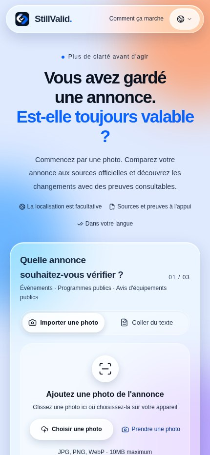
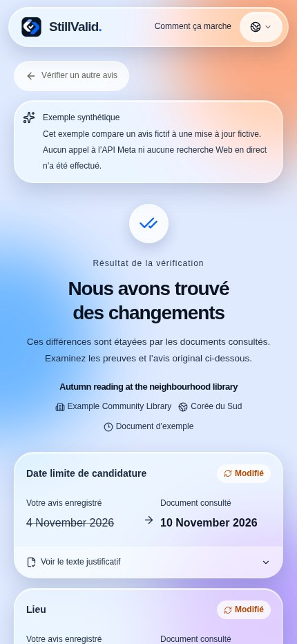

<div>


# StillValid

[](https://dev.meta.ai/docs/models) [](https://dev.meta.ai/docs/models) [](https://dev.meta.ai/docs) [](https://cerebralvalley.ai/e/meta-ai-developer-hackathon)

### Votre annonce enregistrée est-elle toujours valable ?

Comparez une photo ou un texte avec les sources officielles actuelles et consultez les changements, les citations et les points à vérifier. Sans installation ni compte.

[Ouvrir l’application](https://stillvalid-beta.vercel.app) · [English](README.en.md) · [한국어](README.ko.md) · [日本語](README.ja.md) · [README](README.md)

**Languages / 言語 / 언어 / اللغات:**

[English](README.en.md) · [한국어](README.ko.md) · [日本語](README.ja.md) · [简体中文](README.zh.md) · [Español](README.es.md) · [Français](README.fr.md) · [Deutsch](README.de.md) · [Português](README.pt.md) · [العربية](README.ar.md) · [Русский](README.ru.md)

## Pourquoi StillValid

- **Le modèle propose, le code décide.** Chaque changement doit s’appuyer sur des citations exactes présentes à la fois dans l’annonce et sur une page officielle ; un vérificateur déterministe dans [`compare.ts`](src/lib/compare.ts) renvoie tout le reste en « à vérifier ».
- **Sources officielles uniquement.** Blogs, réseaux sociaux et extraits de recherche ne comptent jamais comme preuves. Un lien `go.kr`/`gov` imprimé sur l’annonce est pré-rempli ; sinon la recherche web intégrée de Meta propose de vraies pages.
- **Construit de bout en bout avec les modèles Meta.** Muse Spark lit, cherche et compare ; SAM 3.1 repère l’annonce sur un panneau chargé ; les résultats s’affichent en dix langues sans appel supplémentaire au modèle.

**Vidéo de démonstration :** en cours de production ; le lien sera ajouté ici et dans le formulaire de soumission.

## Exemple

Exemple synthétique : un avis fictif de bibliothèque indique une date limite au 4 novembre, puis une mise à jour fictive au 10 novembre. Les deux valeurs et leurs citations sont affichées. En situation réelle, la source, l’identité et les preuves doivent aussi être vérifiées ; sinon le résultat peut nécessiter une vérification. Cet exemple ne lance ni recherche réelle ni appel au modèle et ne prouve aucun changement réel.

## Aperçu des écrans

Captures de l’interface de production le 5 novembre 2026 (KST), dans Chromium à largeur mobile. Le résultat est un exemple synthétique clairement indiqué, pas une vérification réelle ni une photo prise sur iPhone. L’interface est en français et les valeurs originales de l’exemple restent en anglais.

<p align="center"></p>

## Mode d’emploi

1. Prenez ou sélectionnez une photo, ou collez jusqu’à 18 000 caractères. Recadrez ou tournez dans le navigateur ; SAM peut suggérer des zones dans une photo.
2. Vérifiez le titre, l’organisme, l’édition et le pays. Pour corriger une date ou un lieu extrait, modifiez le texte d’origine puis relancez sa lecture.
3. Confirmez ou saisissez la page HTTPS exacte de l’organisme ; sans lien, des sources candidates sont recherchées.
4. Lisez les valeurs et citations. Si une vérification est nécessaire, consultez les raisons et la source officielle.
5. Vous pouvez rechercher le lieu sur Google Maps, copier le résumé, relancer la vérification ou supprimer le résultat.

## Fonctions et limites

- JPEG, PNG et WebP jusqu’à 10 Mio ; HEIC/HEIF dépend du navigateur. SAM peut proposer plusieurs zones dans une photo, sans traitement de plusieurs photos en lot.
- Lecture HTML, texte et couche textuelle PDF (5 Mo et 20 pages maximum), sans OCR des PDF scannés. Jusqu’à trois candidats sont récupérés et deux sources pertinentes comparées.
- Dix langues d’affichage ; arabe de droite à gauche. Les dates, noms, lieux et citations ne sont pas traduits. La région facultative parmi 249 pays/régions reste distincte du pays de l’annonce.
- Le lien Maps envoie uniquement le texte du lieu choisi lors du clic ; il ne vérifie pas l’adresse et ne garantit pas l’ouverture de l’application native.

## Comprendre le résultat

- Modifié : au moins une modification est vérifiée et aucun blocage général ne subsiste.
- Correspond : les champs contrôlés concordent ; cela ne garantit pas que tous les détails sont inchangés.
- Annulé ou délai dépassé : une annulation actuelle explicite ou une date et heure explicites valides sont nécessaires.
- À vérifier ou indisponible : identité, source, preuves, conflit ou échec empêchent une conclusion fiable.

## État de la validation

- La dernière intégration a réussi le contrôle de types, 205 tests unitaires, 7 tests du banc d’évaluation et la compilation ; sept suites navigateur ont réussi avec des réponses simulées sur la version précédente.
- Un parcours utilisateur photographié sur iPhone a été rapporté : environ trois minutes, résultat à vérifier. Les contrôles complets actuels iPhone/Android, HEIC et passage à l’application de cartes restent incomplets.
- L’évaluation de dix annonces réelles avec références humaines reste inachevée. Les observations historiques sont limitées et la latence réelle après la dernière optimisation n’a pas été remesurée.

- Les dix langues concernent l’affichage ; elles ne démontrent pas la précision de la vérification factuelle dans chaque langue.

## Confidentialité et limites

Selon les conditions de Meta, le modèle par défaut muse-spark-1.3-contributor utilise les entrées pour entraîner les futurs modèles de Meta. Supprimer un résultat StillValid ne supprime pas les données détenues par le fournisseur. Les images originales ne sont pas conservées ; résultats et citations appartiennent à une session anonyme, expirent après 24 heures et peuvent être supprimés. Les clés restent côté serveur. Limites par défaut : 300 appels par jour UTC, 3 tâches simultanées et 10 démarrages par minute au total ; ce n’est pas un plafond financier.

## Notes de développement

- Navigateur → API Next.js → modèles Meta / sources HTTPS → Redis ou SQLite → vérificateur déterministe. Lecture et comparaison : Chat Completions avec JSON strict ; recherche : Responses + web_search ; localisation facultative : sam-3.1.
- Les valeurs doivent figurer dans les citations originales. Une confirmation exige un domaine officiel enregistré et vérifie institution, titre, édition, section et marques d’archivage/retrait. Les années, heures et fuseaux manquants ne sont pas inventés ; la grammaire d’annulation est limitée à certaines expressions anglaises et coréennes.
- Une URL directe évite la recherche. Budget de récupération par source : 15 s au total, 12 s par requête et trois redirections maximum ; HTML/texte 600 000 octets, texte extrait 22 000 caractères, PDF 5 000 000 octets/20 pages. Un échec ne signifie pas « aucun changement ».
- Une lecture claire de même entrée et pays est réutilisable 10 minutes en mémoire de l’onglet ; la fraîcheur des sources et le verdict final ne sont pas mis en cache. La vérification anticipée attend 350 ms et est annulée si avis, région ou lien changent ; la langue seule peut réutiliser le contrôle.
- Priorité du modèle : variable par étape → META_MODEL → muse-spark-1.3-contributor. SAM_MODEL vaut sam-3.1 par défaut ; effort minimal. `none` omet le paramètre et ne signifie pas « sans raisonnement ». Vérifiez l’avis de confidentialité dans les dix langues avant de changer de modèle.

## Observations historiques

Petits échantillons de versions précédentes : entrées reconstruites à partir d’avis publics, images non prises physiquement sur iPhone. Ils ne représentent ni la latence actuelle ni une précision générale.

| Observation | Résultat |
|---|---|
| `muse-spark-1.3-contributor` · Seoul + Smithsonian · 4 runs | median 24.3 s; Seoul `changed` 2/2, Smithsonian `review` 2/2 |
| `muse-spark-1.3` · minimal · 4 runs | median 26.8 s |

[Validation record](docs/validation.md#2026-11-04-production-with-muse-spark-13-contributor-f671f3b)

## API et configuration

| API | Résultat |
|---|---|
| `GET /api/status`, `GET /api/demo` | État et exemples synthétiques |
| `POST /api/extract`, `POST /api/locate` | Lecture et localisation facultative |
| `POST /api/checks` | Vérification en flux NDJSON |
| `GET /api/checks/{id}`, `DELETE /api/checks/{id}` | Lire ou supprimer un résultat de la session |
| `DELETE /api/session` | Supprimer les résultats de la session |

| Variable | Résultat |
|---|---|
| `META_API_KEY`, `META_MODEL`, `META_EXTRACTION_MODEL`, `META_SEARCH_MODEL`, `META_COMPARISON_MODEL` | Clé serveur ; modèle commun aux trois étapes Spark, surcharges par étape |
| `SAM_MODEL`, `DAILY_MODEL_CALL_LIMIT` | Modèle SAM ; limite quotidienne d’appels (300 par défaut) |
| `UPSTASH_REDIS_REST_URL`, `UPSTASH_REDIS_REST_TOKEN` | Identifiants Redis REST en écriture ou paire KV_REST complète |
| `VERIFIED_SOURCE_HOSTS`, `DATABASE_PATH` | Domaines vérifiés supplémentaires ; chemin SQLite |

## Exécution locale

Node.js 24 et npm sont nécessaires. Les exemples fonctionnent sans clé ; pour les vérifications réelles, configurez META_API_KEY en sécurité dans .env.local. SQLite convient à un serveur unique ; le service hébergé exige Redis REST en écriture. Ne publiez pas les clés.

```bash
git clone https://github.com/ZOOGOM/stillvalid.git
cd stillvalid
npm ci
cp .env.example .env.local
npm run dev
```

## Tests et références

Les tests navigateur utilisent des données simulées sans appel au modèle. Ils ne remplacent pas les tests sur appareil et ne garantissent pas une conformité complète en accessibilité. Les évaluations réelles et la sonde de déploiement facultative peuvent être facturées.

```bash
npm run check
npm run build
npm run test:browser
npm run test:browser-maps
npm run test:browser-locate
npm run test:browser-stream
npm run test:browser-prefill
npm run test:browser-early
npm run test:browser-image
```

[Validation / 검증 기록](docs/validation.md) · [Evaluation / 평가](docs/evaluation.md) · [Deployment / 배포](docs/deployment.md) · [Acceptance / 확인표](docs/acceptance.md) · [Performance / 성능](docs/performance.md) · [README screenshot provenance](docs/screenshots/readme/README.md) · [.env.example](.env.example) · [MIT](LICENSE)

## Licence

Le code original est sous licence MIT. Les bibliothèques, modèles et contenus externes conservent leurs propres conditions. Le pied de page reste Copyright 2026 Zoogom. All rights reserved.

</div>
