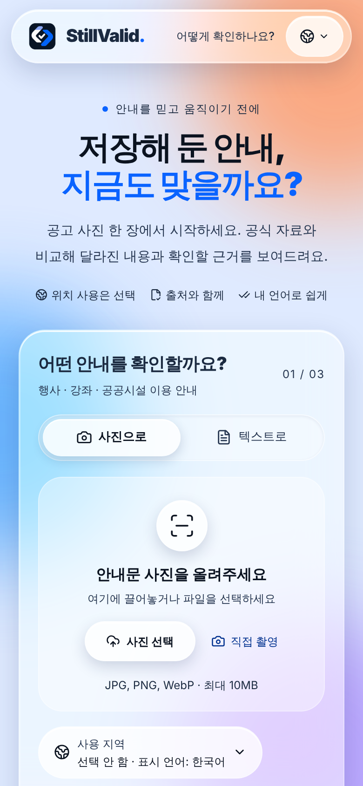
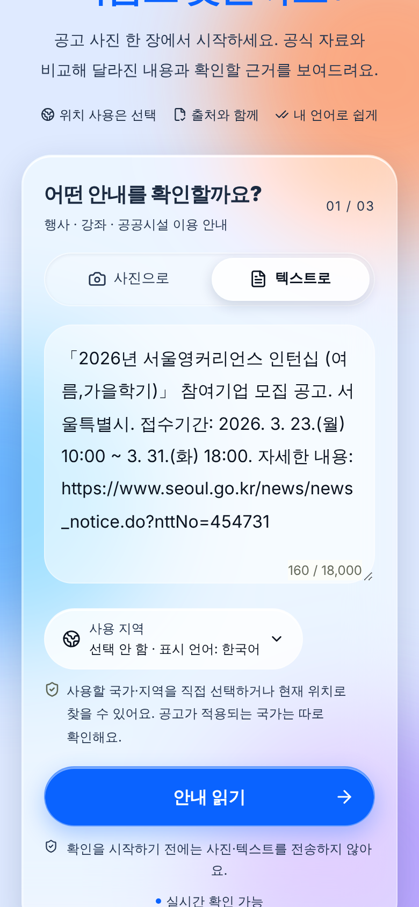
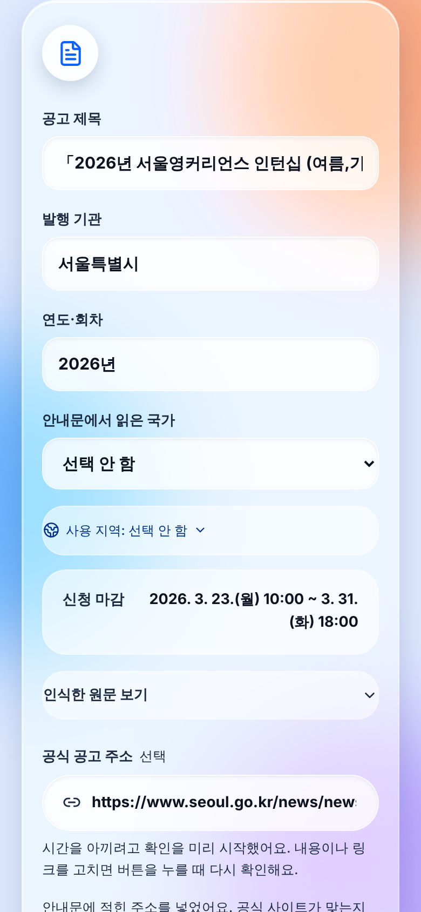
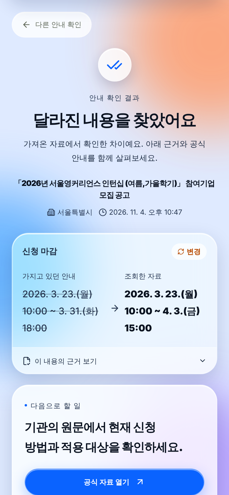
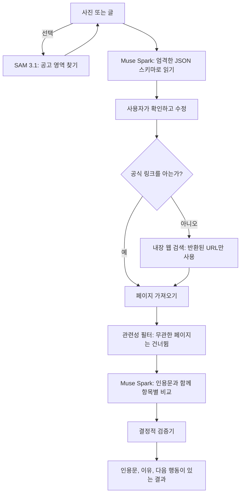

<div align="center">

# StillValid (지금도 맞나요)

**저장해 둔 공고, 지금도 그대로일까요?**

저장해 둔 공고(사진, 캡처, 글)를 현재 공식 자료와 비교해서, 무엇이 바뀌었는지를 원문 인용, 확인한 시각, 다음에 할 일과 함께 보여 주는 모바일 중심 웹앱입니다.

[English](README.en.md) · [한국어](README.ko.md) · [기본 README](README.md)

앱: [stillvalid-beta.vercel.app](https://stillvalid-beta.vercel.app) · 보조 주소: [stillvalid-zoogom.vercel.app](https://stillvalid-zoogom.vercel.app)

</div>

> Meta Global AI Developer Hackathon 출품작입니다(개인 Indie 부문, 주제 "Build for Your World").

## 화면

실제 운영 중인 앱([stillvalid-beta.vercel.app](https://stillvalid-beta.vercel.app))을 2026-11-04에 휴대폰 너비로 한국어 화면에서 찍은 사진입니다. 예시는 서울특별시 공고(이전에 공개된 공고 글을 재구성)를 공식 페이지와 비교한 것이며, 공식 페이지에서는 3월 31일이던 마감이 더 늦은 날짜로 바뀌어 있었습니다. 값은 공고와 공식 페이지에 적힌 그대로이고, 앱의 화면 문구만 선택한 언어로 보입니다.

| 1. 시작 | 2. 공고 넣기 | 3. 읽은 내용 확인 | 4. 결과 |
|:---:|:---:|:---:|:---:|
|  |  |  |  |

3단계에는 공고 글에서 찾아 확인하라고 미리 채워 준 공식 링크와, 확인을 이미 백그라운드에서 시작했다는 안내가 보입니다. 4단계에는 저장해 둔 값(취소선)과 가져온 값을 비교하고 검증된 "바뀜" 표시가 붙은 모습이 보이며, "이 내용의 근거 보기"를 열면 양쪽 인용문이 나옵니다.

---

## 목차

1. [무엇을 하나요](#1-무엇을-하나요)
2. [현재 상태 (있는 그대로)](#2-현재-상태-있는-그대로)
3. [기능](#3-기능)
4. [사용 방법](#4-사용-방법)
5. [동작 원리](#5-동작-원리)
6. [검증 알고리즘](#6-검증-알고리즘)
7. [속도와 안정성](#7-속도와-안정성)
8. [사용하는 Meta 모델](#8-사용하는-meta-모델)
9. [개인정보, 보안, 사용 한도](#9-개인정보-보안-사용-한도)
10. [측정 결과](#10-측정-결과)
11. [직접 실행하기](#11-직접-실행하기)
12. [설정](#12-설정)
13. [API](#13-api)
14. [시험](#14-시험)
15. [프로젝트 구성](#15-프로젝트-구성)
16. [알려진 한계와 다음 단계](#16-알려진-한계와-다음-단계)
17. [라이선스](#17-라이선스)

---

## 1. 무엇을 하나요

사람들은 포스터, 가정통신문, 신청 안내, 행사 전단을 사진으로 찍어 두었다가 며칠이나 몇 주 뒤에 다시 봅니다. 그 사이에 마감일, 장소, 조건이 바뀌었을 수 있고, 공식 페이지를 찾아 하나하나 대조하는 데는 시간이 듭니다. 외국어 공고라면 더 어렵습니다. StillValid는 그 대조를 대신합니다.

1. 공고 사진(또는 캡처, 붙여 넣은 글)을 넣습니다.
2. 앱이 공고를 읽고 이해한 내용을 보여 줍니다. 틀린 부분은 직접 고칩니다.
3. 공식 페이지를 찾거나, 알려 주신 링크를 열어 페이지 본문을 직접 읽습니다.
4. 항목별로 비교해서 바뀐 내용을 공고의 인용문과 공식 페이지의 인용문과 함께 보여 줍니다.
5. "확인됨"이라고 말할 수 있는지는 언어 모델이 아니라 **정해진 규칙의 검증 코드**가 정합니다. 확인하지 못한 것은 이유와 함께 **확인 필요**로 보여 줍니다.

학생, 학부모, 새로 이주한 사람, 여행자처럼 저장해 둔 공개 공고를 믿고 움직여야 하는 사람이 행동하기 전에 근거를 보게 하는 것이 목적입니다. 대상 사용자는 이렇게 가정한 것이며, 실제 사용자 수나 효과는 측정하지 않았습니다.

**하지 않는 일:** 사용자가 자격이 되는지 판단하지 않고, 의료나 법률 판단을 내리지 않으며, 긴급 안내를 하지 않습니다. 공식 페이지에서 바뀐 내용을 못 찾았다고 해서 "바뀐 것이 없다"고 말하지도 않습니다.

## 2. 현재 상태 (있는 그대로)

| 영역 | 상태 |
|---|---|
| 웹앱, 10개 표시 언어, 실제 Meta 모델 호출, 호스팅 저장소 | 운영에서 동작 중(`stillvalid-beta.vercel.app`) |
| 자동 시험 | 단위·동작 시험 192개와 브라우저 시험 6종이 로컬에서 통과 |
| 운영에서 확인한 것 | 세션 격리와 삭제, 같은 요청의 결과 재사용, 취소, 동시 처리 한도(동시에 4번째 확인은 거부) |
| 속도 목표(중앙값 15초, 90번째 백분위 30초) | **달성하지 못함.** 공식 링크가 있을 때 중앙값은 24~27초(4회 측정). [10장](#10-측정-결과) 참고 |
| 사람이 정답을 확인한 실제 공고 정확도 | **측정하지 못함.** 10건 평가는 준비되어 있으나 실행하지 않음 |
| 실제 iPhone Safari·Android Chrome 확인 | **하지 못함.** 에뮬레이션 화면과 자동 접근성 검사만 실행 |
| 호스팅 저장소의 24시간 만료 | **아직 확인하지 못함.** 만료 시간은 설정되어 있고 실제 만료 확인이 예약되어 있음 |

이 문서의 어떤 내용도 일반적인 정확도를 주장하지 않습니다. 따로 적지 않은 수치는 모두 1회 관찰입니다.

## 3. 기능

**입력**
- 카메라나 앨범의 사진(JPEG, PNG, WebP, 최대 10MB), 또는 붙여 넣은 글(최대 18,000자)
- 보내기 전에 브라우저에서 자르기, 회전, 미리보기. 사진은 브라우저에서 다시 인코딩해 대부분의 메타데이터를 제거합니다.
- HEIC/HEIF는 브라우저가 해독할 수 있으면(최근 Safari) 변환하고, 아니면 안내 문구와 대안을 보여 줍니다.
- 작은 사진(짧은 변 500px 미만 또는 0.3메가픽셀 미만)에는 안내가 뜨고, 모델이 "불확실"(잘림, 흐림, 글이 적음)로 표시한 읽기에는 검토 화면에 경고가 붙습니다.
- **공고 자동으로 찾기(선택, SAM 3.1):** 게시판 사진에서 공고 영역을 제안합니다. 하나면 바로 자르고, 여러 개면 번호 선택지로 보여 주며, 되돌리기와 직접 자르기가 가능합니다.

**읽기와 검토**
- 제목, 발행 기관, 회차 또는 연도, 공고 국가(공고에 적힌 경우만), 명시된 마감, 행사일, 장소, 상태, 비용, 자격을 추출합니다.
- 모든 값은 공고 본문의 정확한 발췌여야 합니다. 날짜를 바꿔 쓰거나 번역하거나 시각을 추정하지 않으며, 없는 사실은 없는 채로 둡니다.
- 비교 전에 모든 내용을 직접 확인하고 고칠 수 있습니다. 선택한 사용 지역과 공고에서 읽은 국가는 따로 다루고, 서로 다르면 확인해야 진행됩니다.

**공식 자료**
- **공고에 인쇄된 링크:** 공고에 공공기관의 페이지 주소(예: `go.kr`, `gov`)가 적혀 있으면 링크 칸에 미리 넣고 "맞는지 확인해 주세요" 안내를 보여 줍니다. 홈페이지 주소만 있거나 SNS, 블로그, 예매, 단축 주소는 넣지 않습니다.
- **검색:** 링크가 없으면 Meta의 내장 웹 검색이 후보를 제안합니다. 검색이 실제로 반환하거나 인용한 URL만 쓰고, 검색 요약문은 근거로 쓰지 않습니다. 검색 지시문은 블로그, SNS, 모음 사이트, 예매 사이트보다 발행 기관의 페이지와 정부 페이지를 먼저 찾도록 합니다.
- **직접 링크:** 공식 HTTPS 페이지를 붙여 넣으면 검색 단계를 건너뜁니다.
- **읽는 형식:** HTML(표는 셀 구조 유지), 일반 텍스트, PDF **텍스트층**(최대 5MB, 20쪽). 스캔 PDF는 추측하지 않고 "읽을 수 없음"으로 알려 줍니다.
- 차단된 곳, 스크립트로만 만든 페이지, 스캔 PDF, 너무 큰 자료는 서로 구분해서 알려 주며, 가져오지 못했다고 모델의 추측으로 대신하지 않습니다.

**결과**
- **바뀜**, 가져온 자료와 **일치**, **취소**, **마감 지남**, **확인 필요**, **확인 불가** 중 하나로 나옵니다.
- 이전·이후 값, 근거 인용문, 출처 URL, 확인 시각, 확인하지 못한 범위, 다음에 할 일을 보여 줍니다.
- 출처별 이유를 보여 줍니다(예: "다른 회차의 페이지", "맞는 인용문 없음", "스크립트 전용 페이지").
- 잘못 연결된 링크를 고치거나 다른 후보를 고를 수 있도록 후보 목록을 보여 줍니다.
- **지도:** 장소 값에 Google 지도 검색 링크가 있습니다. 누를 때만 장소 글자를 보내며, 장소를 검증하지는 않습니다.
- 요약 복사, 다시 확인, 결과 하나 삭제, 세션 전체 삭제

**언어와 지역**
- 10개 표시 언어: 영어, 중국어 간체, 스페인어, 프랑스어, 독일어, 일본어, 한국어, 포르투갈어, 아랍어(전체 오른쪽에서 왼쪽 배치), 러시아어. 화면, 결과, 오류, 설정, 복사한 요약에 적용됩니다.
- 언어를 바꿔도 표시만 바뀝니다. 값과 인용문은 번역하지 않고, 판정도 그대로이며, 모델을 다시 부르지 않습니다.
- 249개 국가·지역 중 선택하는 사용 지역(선택 사항). 공고 국가, 언어, 시간대와 독립적이며 GPS나 IP로 정하지 않습니다. "현재 위치로 지역 찾기"는 버튼을 누르고 브라우저 권한을 허용한 뒤 한 번만 위치를 요청하고, 브라우저 안에 내장된 경계 자료로 국가를 계산합니다. 좌표는 서버로 보내거나 저장하지 않습니다.

**복구와 속도**
- 실제 진행 상황, 경과 시간, 취소 버튼. 브라우저는 정해진 시간이 지나면 기다리기를 멈추고 입력을 보존합니다.
- 이미 받은 결과는 그 뒤에 연결이 끊기거나 끝나지 않아도 유지됩니다. 스트림이 끊기면 저장된 결과를 모델 호출 없이 복구합니다.
- **백그라운드 확인:** 읽기가 끝나면 사용자가 항목을 확인하는 동안 확인을 미리 시작하고, 버튼을 눌렀을 때 아무것도 바뀌지 않았을 때만 그 결과를 씁니다([자세히](#7-속도와-안정성)).

## 4. 사용 방법

1. **앱을 엽니다.** [stillvalid-beta.vercel.app](https://stillvalid-beta.vercel.app) 설치나 가입은 필요 없습니다.
2. **선택 설정:** 표시 언어를 고르고, 원하면 사용 지역을 고릅니다. 지역 기억은 선택입니다.
3. **공고를 넣습니다.** 사진을 찍거나 고르거나 글을 붙여 넣습니다. 공고가 화면을 채우고 글자가 또렷하게 자릅니다. 여러 공고가 붙은 게시판이면 **공고 자동으로 찾기**를 눌러 맞는 것을 고릅니다.
4. **읽기를 누릅니다.** 검토 화면이 나올 때까지 기다립니다(글은 몇 초, 사진은 대략 5~25초).
5. **읽은 내용을 확인합니다.** 제목, 기관, 회차, 틀린 값을 고칩니다. 사진이 흐리거나 잘렸다면 안내가 뜹니다.
6. **공식 링크를 알면 넣습니다**(또는 자동으로 들어간 링크를 확인합니다). 확인이 빨라지고 일치 여부가 더 믿을 만해집니다.
7. **확인을 누릅니다.** 바뀐 내용이 양쪽 인용문과 함께 나옵니다. **확인 필요**라면 이유를 열어 링크를 고치거나 다른 후보를 고르거나 공식 페이지에서 직접 확인합니다.
8. **선택:** 장소를 Google 지도에서 열고, 요약을 복사하고, 결과를 삭제합니다.

요령: 블로그나 SNS 글보다 발행 기관의 공식 페이지를 쓰세요(블로그는 공식 근거로 인정되지 않습니다). 공고에 회차나 연도가 있으면 입력하세요. 결과가 확인 불가일 때는 공고를 다시 입력하기보다 다른 링크를 시도하세요.

## 5. 동작 원리



브라우저는 Next.js API 경로와 통신합니다. API 경로는 Meta Model API(읽기와 비교는 Chat Completions, 웹 검색과 공고 위치 찾기는 Responses API)를 호출하고, 강화된 가져오기 코드로 공개 HTTPS 페이지를 읽고, 세션 소유의 결과를 Upstash Redis(호스팅) 또는 SQLite(로컬)에 보관합니다. 키는 서버에만 있습니다.

**브라우저의 사진 준비.** 사진을 브라우저에서 해독해 긴 변이 최대 2,400px이 되도록 줄이고, JPEG 품질 0.92, 0.80, 0.68, 0.55 순으로 시도해서 인코딩 크기가 약 3.8MB 이하가 되면 멈춥니다. 다시 인코딩하면서 대부분의 EXIF가 사라집니다. 10MB를 넘는 입력은 거부하고, 지원하지 않는 형식은 일반 오류 대신 설명을 보여 줍니다.

**공고 위치 찾기(SAM 3.1, 선택).** Responses API로 SAM 3.1에 "document" 개념을 신뢰도 포함으로 한 번 요청하고, 아무것도 못 찾으면 "poster"로 한 번 더 시도합니다. 응답의 상자 토큰(`x1, y1, x2, y2, w, h, c`)을 해석해서, 이미지의 3% 미만 상자는 버리고, 최대 6개를 읽는 순서로 남기며, 자를 때 2% 여백을 더합니다. 상자가 하나면 바로 자르고, 여러 개면 번호 선택지로 보여 주며, 되돌릴 수 있습니다. 영역을 찾는 것과 글을 정확히 읽는 것은 다른 일이며, 앱은 둘을 같게 취급하지 않습니다.

**읽기.** 엄격한 JSON 스키마를 쓰는 Chat Completions입니다. 사진은 모델이 글을 `originalText`로 옮겨 적고 항목을 추출하며, 붙여 넣은 글은 모델이 글을 다시 출력하지 않습니다. 항목은 인용문이 원문에 그대로 있고 그 안에 값이 들어 있을 때만 남깁니다. 모델은 이미지를 공고, 공고 아님(설명과 함께 거부), 불확실로 분류합니다. 20초 안에 끝난 빠른 실패만 한 번 다시 시도하고, 느린 실패는 반복하지 않고 알립니다.

**출처 찾기.** 링크가 없으면 내장 웹 검색(`search_context_size: low`)을 쓰는 Responses 호출 한 번으로 후보를 받습니다. 최대 3개를 쓰고, 공고 본문에 적힌 `https` 링크가 있으면 먼저 시도합니다. 등록된 공식 도메인의 후보를 앞에 놓습니다.

**가져오기.** 후보 최대 3개를 동시에 가져오되, 순차 반복과 똑같이 우선순위 순서로 판단하고, 관련 있는 출처 2개를 얻으면 멈추며 필요 없어진 요청은 중단합니다. 모든 요청은 검사를 거칩니다([9장](#9-개인정보-보안-사용-한도)). 페이지는 표의 셀을 보존한 텍스트(셀 구분 ` | `)로 바꾸고, PDF는 텍스트층으로 읽습니다. 그 뒤 관련성 필터를 거칩니다. 공고와 특징적인 단어가 하나도 겹치지 않는 페이지(공통 단어인 "notice", "apply", "공고", "모집" 등은 세지 않음)는 모델에 보내지 않고 "관련 없음"으로 알립니다.

**비교.** 관련 있는 출처마다 Chat Completions 한 번으로 항목별 관계(`changed`, `same`, `unclear`), 공고의 "이전" 인용문과 출처의 "이후" 인용문, 동일성 인용문과 문서 역할을 받습니다. 비교는 병렬로 하고 각각 100초 상한이 있습니다. 공식 출처의 비교가 성공하면 나머지는 30초만 더 기다리고 그 뒤에는 "미완료"로 알립니다. 미완료 출처가 있으면 결과는 확인 필요로 남습니다.

**검증과 표시.** 검증기([6장](#6-검증-알고리즘))가 모델의 모든 주장을 코드로 다시 확인해서 최종 상태를 만듭니다. 화면 문구는 모델이 아니라 10개 언어의 고정 사전에서 나옵니다.

## 6. 검증 알고리즘

언어 모델은 제안하고, 코드가 결정합니다. 어떤 항목이 **확인됨**으로 보이려면 다음이 모두 성립해야 합니다.

1. **정확한 인용문.** "이전" 인용문이 공고 본문에, "이후" 인용문이 출처 본문에 있어야 합니다(공백과 문장부호 주변 띄어쓰기는 정규화). 모델이 지어낸 인용문은 통과하지 못합니다.
2. **등록된 공식 도메인.** 출처의 등록 도메인이 검증 목록에 있어야 합니다(`go.kr`, `gov.uk`, `si.edu` 같은 공공기관 내장 목록과 운영자가 정한 `VERIFIED_SOURCE_HOSTS`). 주민이 쓴 글이 올라오는 경로(자유게시판, 질의응답, 청원, 댓글, 포럼)는 호스트와 상관없이 발행 기관 자신의 공고로 취급하지 않습니다. 등록 도메인만으로는 절대 충분하지 않습니다.
3. **같은 공고.** 기관, 제목, 회차 또는 연도, 구역, 식별자가 맞아야 합니다. 인용 구절에 다른 회차나 다른 구역의 범위가 있는지, 페이지 단위의 보관·철회 표시가 있는지, 다른 프로그램의 제목 문구인지를 확인합니다. 일반적인 사이트 이름과 메뉴 단어는 동일성으로 치지 않습니다. 이유는 고정된 코드(예: 동일성, 회차, 구역, 보관)로 기록합니다.
4. **날짜.** `03/04/2026` 같은 모호한 숫자 날짜, 없는 연도, 없는 시각과 시간대는 적힌 그대로 두고 채우지 않습니다. 마감이 지났다고 하려면 명시적이고 유효한 시각이 확인 시각보다 앞서야 합니다.
5. **취소.** 같은 행사에 대한 정확하고 현재형인 주장이 있어야 합니다. 문법은 영어와 한국어의 제한된 취소 표현만 받아들이며, 조건부, 부정, 과거, 다른 행사의 표현은 인정하지 않고 그 밖의 표현은 확인 필요로 남깁니다.

전체 상태는 이 순서로 정합니다.

- 읽을 수 있는 출처가 없으면 **확인 불가**
- 확인된 것이 없거나 다음 중 하나라도 해당하면 **확인 필요**: 동일성 실패, 검증되지 않은 항목이 있음, 공고 항목이 맞춰지지 않음, 출처가 불완전함(검색 실패, 가져오기 실패, 비교 미완료), 검증된 두 출처가 서로 다름, 증거가 없음
- 그렇지 않으면 **취소**, **마감 지남**, **바뀜**(어떤 항목이 바뀜으로 검증됨), **일치**(확인한 모든 항목이 같음)

규칙이 "불확실하면 확인 필요"이므로, 앱은 틀린 "확인됨"보다 "확인할 수 없어요"를 택합니다. 반대로 모든 것을 확인 필요로 보내 진짜 변경을 가리지도 않습니다. 등록된 공식 페이지에서 검증된 변경은 인용문과 함께 **바뀜**으로 알려 줍니다.

## 7. 속도와 안정성

**시간이 어디에 쓰이나** (운영, 공식 링크가 있을 때 읽기 1회와 비교 1회): 빽빽한 사진 읽기 약 16~20초(짧은 공고는 약 4초), 가져오기 0.2~1.7초, 비교 8~25초. 링크가 없으면 검색이 약 10~15초 더 듭니다.

대응한 것:

- 읽기와 비교에 **최소 추론 강도**(`reasoning_effort: minimal`)를 씁니다. 검색은 모델 기본값을 유지합니다.
- **백그라운드 확인.** 읽기가 끝나면 사용자가 항목을 확인하는 동안 확인을 시작합니다. 링크를 알면 그 링크로(직접 입력했거나 공고에 인쇄된 경우), 모르면 출처 검색까지 포함해서 합니다. 버튼을 눌렀을 때 공고, 지역, 언어, 링크가 그대로일 때만 그 결과를 쓰고, 아니면 버리고 평소처럼 새로 확인합니다. 읽기가 불확실하거나 공고 국가가 선택한 지역과 다르면 시작하지 않고, 읽기 한 번에 최대 한 번만 시작합니다. 모델이 일하는 시간을 사용자의 확인 시간으로 옮기는 것이며, 모델 자체를 빠르게 하지는 않습니다.
- **병렬 가져오기와 비교**, 그리고 공식 출처가 성공한 뒤 느린 출처에 주는 30초 유예
- 모든 단계에 더 저렴한 모델 변형 사용([8장](#8-사용하는-meta-모델))

**안정성**
- 확인은 줄바꿈으로 구분한 JSON 스트림이며 10초마다 신호(heartbeat)를 보냅니다. 브라우저는 읽기 150초, 확인 200초, 위치 찾기 80초가 지나거나 45초 동안 바이트가 없으면 기다리기를 멈추고 입력을 보존합니다.
- 결과를 한 번 받으면 최종입니다. 그 뒤의 오류나 끝나지 않는 스트림이 결과를 없애지 않고, 바로 다시 확인할 수 있습니다.
- 끊긴 스트림은 `GET /api/checks/{id}`로 저장된 결과를 모델 호출 없이 복구합니다.
- 요청 키가 같으면 중복 제출은 저장된 결과를 재사용합니다.
- 취소하면 작업을 멈추고 결과를 삭제합니다.

## 8. 사용하는 Meta 모델

| 단계 | 모델 | API | 비고 |
|---|---|---|---|
| 사진·글 읽기 | `muse-spark-1.3-contributor` | Chat Completions, 엄격한 `json_schema` | `reasoning_effort: minimal` |
| 공식 출처 찾기 | `muse-spark-1.3-contributor` | Responses + 내장 `web_search` | 반환되거나 인용된 URL만 사용 |
| 출처와 비교 | `muse-spark-1.3-contributor` | Chat Completions, 엄격한 `json_schema` | `reasoning_effort: minimal`, 출력 한도 12,000토큰 |
| 공고 위치 찾기(선택) | `sam-3.1` | Responses, 개념 프롬프트 | 토큰에서 상자 해석 |

더 저렴한 `muse-spark-1.3-contributor` 변형은 비용 때문에 소유자가 선택했습니다. **이 변형에 대한 Meta의 조건에 따라 사용자가 제출한 내용이 Meta의 모델 개선에 쓰일 수 있습니다.** 앱의 개인정보 안내가 10개 언어로 이를 알립니다. 서버 전용 `META_MODEL`이 세 Spark 단계를 한꺼번에 바꾸고, `META_EXTRACTION_MODEL`, `META_SEARCH_MODEL`, `META_COMPARISON_MODEL`은 단계 하나만 덮어씁니다. 우선순위는 단계별 변수, `META_MODEL`, `muse-spark-1.3-contributor` 순이며 값은 앞뒤 공백을 제거하고, 변수를 바꾸면 새로 배포해야 적용됩니다. 운영 빌드는 먼저 읽기 전용 모델 목록 점검(공개 모델 ID만 확인, 추론 없음)을 하고, 선택한 ID를 쓸 수 없으면 빌드가 실패해서 이전 배포가 계속 서비스됩니다. 모델을 바꾸기 전에는 개인정보 안내가 contributor 구성을 설명하고 있으므로 10개 언어의 안내를 다시 검토하세요.

읽기 단계만 다른 모델로 측정했습니다. `muse-spark-1.2`는 2.0~4.5초, `muse-spark-1.1`은 2.4~7.9초에 읽었지만, 둘 다 한국어 제목의 글자 하나를 대부분의 실행에서 잘못 읽어 동일성 검사를 깨뜨릴 수 있었습니다. 그래서 쓰지 않습니다. 배포가 볼 수 있는 모델 목록에는 더 빠른 모드로 이름 붙은 모델이 없습니다.

## 9. 개인정보, 보안, 사용 한도

**데이터**
- StillValid는 원본 이미지 파일을 저장하지 않습니다. 결과와 필요한 인용문은 익명 세션 쿠키에 속하고 24시간 동안만 있으며, 하나씩 또는 한꺼번에 삭제할 수 있습니다. 만료는 읽기 전에 확인하고 주기적으로 정리합니다.
- 실시간 확인을 시작하면 입력이 Meta Model API로 갑니다. Meta가 무엇을 보관하고 학습하는지는 Meta의 조건을 따르며, 기본 모델 변형은 모델 개선을 포함할 수 있습니다. StillValid에서 결과를 지워도 Meta가 가진 것은 지워지지 않습니다.
- 위치 좌표는 브라우저 밖으로 나가지 않습니다.
- 기록에는 호출 시간, 결과, 토큰 수만 남기고 공고 본문, URL, 쿠키, IP 주소는 남기지 않습니다.

**가져오기 안전**
- 포트 443의 `https`만, 주소에 인증 정보 없음, `localhost`, `.local`, `.internal`, `.test`, `.onion` 등의 이름 금지, 사설·예약 IP 주소 금지
- DNS를 먼저 풀어 찾은 공개 주소에만 연결을 고정합니다. 리다이렉트는 직접(최대 3번) 따라가며 매번 다시 검사하고, 일반 포워드 프록시 뒤에서는 안전하게 실패합니다.
- 한도: 요청당 12초, HTML·텍스트 600KB, PDF 5MB와 20쪽, 모든 경로에서 PDF 작업자를 해제

**서버**
- 쓰기에는 같은 출처와 HTTP 전용 익명 세션 쿠키가 필요합니다. Content-Security-Policy, preload가 있는 HSTS, 프레임 거부, `nosniff`, referrer·permissions 정책을 설정합니다.
- 키는 서버에만 있고 공개 접두사를 쓰지 않습니다.

**사용 한도** (모두 `src/lib/limits.ts`. 요청 상한이며 금액 상한이 아닙니다. 제공자의 지출 한도는 따로입니다)
- 동시 모델 작업 3개, 1분 동안 시작 10번(동시에 4번째 확인은 HTTP 429로 거부)
- 세션당 시간당 읽기 60회와 확인 40회, 네트워크(Vercel에서는 IP 해시 키)당 시간당 시작 200회
- 하루 모델 호출은 기본 300회(`DAILY_MODEL_CALL_LIMIT`). 기본값은 시험을 위해 100에서 올렸으며, 공개 사용 때는 더 낮게 정할 수 있습니다.

## 10. 측정 결과

모든 측정은 2026-11-04 운영에서 실제 Meta 호출로 한 관찰입니다. 공고 사진은 공개 페이지를 카메라로 찍은 것처럼 재구성한 이미지이며 실물 사진이 아닙니다. 설정마다 4회씩이라 표본이 작아서 정확도나 속도를 보장하지 않습니다.

**읽기 추론 강도, 공식 링크 있음** (서울시 공고와 Smithsonian 연구비 공고, 사진, 각 2회, 읽기부터 결과까지):

| 설정 | 중앙값 | 서울 공고 결과 |
|---|---|---|
| 모델 기본값 | 45.6초 | 확인 필요 2/2 |
| `low` | 34.6초 | 바뀜 1/2 |
| `minimal` | 26.8초 | 바뀜 2/2 (인용문 검증됨) |
| `minimal` + `muse-spark-1.3-contributor` | 24.3초 | 바뀜 2/2, 제목 정확히 읽음 2/2 |

**백그라운드 확인** (글 입력): 버튼을 누른 뒤 기다린 시간이 인쇄된 링크가 있을 때 3.9초(10초 확인), 링크가 없을 때 7.9초(15초 확인)였고, 버튼을 눌러서 시작할 때는 약 22~45초였습니다. 모델 시간을 확인 시간 뒤로 숨긴 것이며 모델을 짧게 만든 것은 아닙니다.

**운영 동작 확인:** 다른 세션이 결과를 읽거나 지우려 하면 404, 같은 요청 키는 모델 호출 없이 약 0.2초에 저장된 결과를 반환, 취소하면 스트림이 끝나고 결과가 사라짐, 동시에 4번째 확인은 HTTP 429.

**아직 측정하지 못한 것:** 사람이 정답을 확인한 실제 공고의 정확도(지금까지 0/10), 15초/30초 속도 목표, 실기기 동작, 검색 성공률, 실제 결과에서 각 표시 언어의 품질. 평가 도구와 10개 과제 칸은 [`docs/evaluation.md`](docs/evaluation.md), [`docs/acceptance.md`](docs/acceptance.md)에 있고, 날짜별 전체 기록은 [`docs/validation.md`](docs/validation.md)에 있습니다.

## 11. 직접 실행하기

Node.js 24와 npm이 필요합니다.

```bash
git clone https://github.com/ZOOGOM/stillvalid.git
cd stillvalid
npm ci
cp .env.example .env.local
# 실시간 확인에는 .env.local에 META_API_KEY를 넣으세요
npm run dev
```

`http://localhost:3000`을 엽니다. 키가 없으면 합성 예시 3개(마감·장소 변경, 명시적 취소, 다른 회차)를 살펴볼 수 있으며 모두 합성이라고 분명히 표시됩니다. 로컬 개발은 Redis가 없으면 SQLite를 씁니다.

```bash
npm run check        # 타입 검사, 단위 시험, 평가 도구 시험
npm run build        # 운영 빌드
npm start            # 운영 서버
npm run verify:meta  # 읽기 전용 모델 사용 가능 확인(키 필요)
```

**배포:** Vercel에 연결된 GitHub 저장소에 push하고, Vercel Marketplace로 Upstash Redis를 추가한 뒤 아래 환경변수를 설정합니다. `Dockerfile`과 `compose.yaml`로 SQLite를 쓰는 단일 Node 서버도 실행할 수 있습니다. 보호된 API 경로에 서버가 필요하므로 GitHub Pages만으로는 호스팅할 수 없습니다. [`docs/deployment.md`](docs/deployment.md)를 참고하세요.

## 12. 설정

| 변수 | 용도 |
|---|---|
| `META_API_KEY` (별칭 `MODEL_API_KEY`) | 서버 전용 Meta 키 |
| `META_MODEL` | 세 Spark 단계 전체의 모델. 기본값은 `muse-spark-1.3-contributor` |
| `META_EXTRACTION_MODEL`, `META_SEARCH_MODEL`, `META_COMPARISON_MODEL` | 단계별 선택 덮어쓰기(`META_MODEL`보다 우선). 하나로 바꾸려면 비워 두세요. 공고 위치 찾기는 `SAM_MODEL`이 따로 정합니다 |
| `META_REASONING_EFFORT_EXTRACTION`, `_COMPARISON`, `_SEARCH` | `minimal`, `low`, `medium`, `high`, `xhigh`, `max`, `none`. 비우면 읽기와 비교는 minimal, 검색은 모델 기본값 |
| `UPSTASH_REDIS_REST_URL`, `UPSTASH_REDIS_REST_TOKEN` (또는 `KV_REST_API_URL`, `KV_REST_API_TOKEN`) | 호스팅 저장소. 쓰기 가능한 토큰을 쓰고 쌍을 섞지 마세요 |
| `APP_URL` | 운영의 정확한 외부 HTTPS 주소 |
| `DAILY_MODEL_CALL_LIMIT` | UTC 하루 전체 모델 호출 수(기본 300) |
| `IP_RATE_LIMIT_SECRET` | IP 기반 한도용 선택 키(무작위 32자 이상) |
| `VERIFIED_SOURCE_HOSTS` | 직접 검증한 기관 도메인 추가(쉼표로 구분) |
| `DATABASE_PATH` | 단일 서버용 SQLite 파일 |
| `STILLVALID_VERIFY_DEPLOYMENT` | 검토한 배포 한 번에 호스팅 점검을 돌리려면 `1` |

키를 저장소에 올리지 말고, 비밀값에 `NEXT_PUBLIC_` 접두사를 붙이지 마세요.

## 13. API

| 경로 | 용도 |
|---|---|
| `GET /api/status` | 준비 상태, 배포된 커밋, `model`(비교 단계 모델), `models`(읽기·검색·비교). 설정을 보여 줄 뿐 추론이 끝났다는 뜻은 아닙니다 |
| `POST /api/extract` | 사진이나 글 읽기. 공고, 읽기 가능 여부, 시간을 반환 |
| `POST /api/locate` | SAM 3.1 공고 영역(선택) |
| `POST /api/checks` | 확인 실행. NDJSON으로 `created`, `phase`, `ping`, `result`, `error`를 스트리밍 |
| `GET /api/checks/{id}` | 소유 세션의 저장된 결과 |
| `DELETE /api/checks/{id}` | 결과 삭제(또는 취소) |
| `DELETE /api/session` | 세션의 모든 결과 삭제 |
| `GET /api/demo` | 합성 예시. 모델 호출 없음 |

## 14. 시험

```bash
npm test                 # 단위·동작 시험 192개
npm run test:live-harness
# 앱이 실행 중이고 Chromium이 설치되어 있을 때:
CHROMIUM_PATH=/usr/bin/chromium npm run test:browser
npm run test:browser-maps
npm run test:browser-locate
npm run test:browser-stream
npm run test:browser-prefill
npm run test:browser-early
```

시험 범위: 지어낸 인용문, 다른 기관과 회차, 구역 불일치, 보관 공고, 모호한 날짜, 부정·조건부 취소, 위험한 URL과 리다이렉트, PDF 한도, 요청 크기, 세션 격리, 삭제, 만료, 중복 요청, 한도, 스트림 실패, 결과 복구, SAM 선택과 되돌리기, 인쇄된 링크 제안, 백그라운드 확인. 브라우저 시험은 고정 응답을 써서 모델을 호출하지 않습니다. 모의 응답과 에뮬레이션 화면은 실제 모델이나 실기기의 증거가 아니며, 자동 접근성 검사로 WCAG 준수가 입증되지는 않습니다.

## 15. 프로젝트 구성

```text
src/app/            Next.js 앱과 API 경로(checks, extract, locate, session, status, demo)
src/components/     app.tsx(화면 전체), image.ts(브라우저 사진 준비)
src/lib/meta.ts     Meta 호출, 단계별 모델, 재시도, SAM 해석
src/lib/compare.ts  결정적 검증기와 결과 조립
src/lib/source.ts   안전한 가져오기, HTML/텍스트/PDF를 텍스트로
src/lib/relevance.ts, priority.ts, printed-url.ts, maps.ts
src/lib/limits.ts, abuse.ts, store.ts, redis-store.ts, sqlite-store.ts
src/lib/ui-*.ts, result-i18n.ts, languages.ts   10개 언어 사전
tests/              단위·동작 시험, PDF 시험 자료
scripts/            브라우저 시험, 실제 평가 도구, 호스팅 점검
docs/               인수 점검표, 배포, 평가, 검증, 제출 문안
```

## 16. 알려진 한계와 다음 단계

- 실제 공고의 정확도를 측정하지 못했습니다. 사람이 정답을 확인한 10건 평가가 가장 큰 남은 과제입니다.
- 링크가 있을 때 중앙값이 약 24~27초로 목표 15초보다 느립니다. 가장 느린 단계는 빽빽한 사진 읽기입니다.
- 공식 도메인 목록이 제한적이고 동일성·구역 검사가 보수적이라, 정당한 공고도 확인 필요로 끝날 수 있습니다. 특히 스크립트로 그리는 페이지나 제목과 다른 제목의 페이지에서 그렇습니다.
- 링크 없는 검색은 비공식이거나 읽을 수 없는 페이지를 돌려줄 수 있고, 그러면 결과는 확인 필요로 남습니다.
- 취소 문법은 제한된 영어·한국어 표현만 다룹니다.
- 스캔 PDF는 문자 인식을 하지 않습니다. 아주 긴 페이지는 크기나 시간 한도를 넘을 수 있습니다.
- 10개 표시 언어는 사전일 뿐 언어별 정확도를 측정한 주장이 아닙니다. 중국어 번체는 포함하지 않았습니다.
- 실제 iPhone과 Android, Safari의 HEIC, 지도 앱으로의 이동과 복귀는 기기에서 확인해야 합니다.
- 지금은 범위 밖: 계정, 결제, 알림, 앱스토어, 전 세계 공고 수집

## 17. 라이선스

원본 코드는 [MIT](LICENSE)입니다. 제3자 라이브러리, 모델, 공고 내용, 이미지는 각자의 라이선스와 조건을 따릅니다.

실행 중인 앱 하단에는 "Copyright 2026 Zoogom. All rights reserved."라고 표시됩니다. 소스 코드 자체는 [LICENSE](LICENSE)의 MIT 라이선스로 공개합니다.
