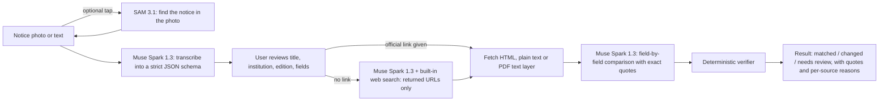

# StillValid

**Saved a notice. Still the same?**

A mobile-first web app that compares notice photos or text with official-source material and links changes to supporting quotes. 한국어 작업명은 **지금도 맞나요**입니다.

**Full guides:** [English (README.en.md)](README.en.md) · [한국어 (README.ko.md)](README.ko.md) — features, how to use, how it works, the verification algorithm, measured results and limits.

## Implementation status

The web app and server adapter include ten display languages, optional usage-region settings, image editing, extraction review, source discovery, evidence comparison, synthetic examples, deletion and failure recovery.

See the [product acceptance checklist](docs/acceptance.md) for the complete user flow, implementation coverage and live release checks. It includes a ten-task real-notice evaluation sheet with unrun tasks clearly marked.

**Live checks require a real Meta API key, shared storage on Vercel, and approved network access.** Provider-contract tests use mocked HTTP responses. The connected Vercel project has a production URL at [stillvalid-beta.vercel.app](https://stillvalid-beta.vercel.app). Actual Redis/model connectivity is checked by the opt-in [hosting-build probe](docs/deployment.md); see that deployment's build logs for its result. Real-notice accuracy and judging readiness remain separate release checks. Examples are visibly synthetic and never presented as live checks.

## Run locally

Requires Node.js 24 and npm.

```bash
npm ci
cp .env.example .env.local
# Add META_API_KEY securely to .env.local for live checks.
npm run dev
```

Open `http://localhost:3000`. Without a key, explore three synthetic examples: deadline/location changes, explicit cancellation and a different event edition.

```bash
npm run verify:meta # Read-only account/model availability check
npm run check       # Type checking and behavioral/security tests
npm run build       # Production build
npm start           # Production server
```

## User flow

1. In settings, choose one display language for the interface and results, and optionally select a usage region from 249 countries and regions. Remembering the region is opt-in and reversible. GPS and IP do not determine the notice country.
2. Upload a JPEG, PNG or WebP (up to 10MB), crop/rotate locally, or paste notice text. Image re-encoding reduces metadata.
3. Review title, institution and recognized details, including the notice country separately from the usage region. Resolve a mismatch or edit the text before comparing.
4. Find source candidates using Meta's built-in web search, or provide an official HTTPS URL.
5. Inspect before/after values, actual source quotes, URLs, time checked and the next confirmation action.
6. Copy a summary, start a fresh check, or delete individual/session-wide results.

Display languages are English (`en`), Simplified Chinese (`zh`), Spanish (`es`), French (`fr`), German (`de`), Japanese (`ja`), Korean (`ko`), Portuguese (`pt`), Arabic (`ar`) and Russian (`ru`). The selection controls the interface, results, errors, settings and copied summaries. Dates, amounts, institution names, addresses, before/after source values and quotes are preserved. Changing language does not change the verdict or make another model call. Arabic uses RTL throughout with original text direction isolated. Traditional Chinese is a later consideration. Notice language is detected independently and is not forced to a country-specific language.

Region and language choices do not change one another or infer nationality, residence or time zone. The 249 choices do not establish worldwide notice coverage. `POST /api/checks` uses `lang` for the chosen display language. The ten-language dictionaries are separate from real Meta language-quality validation, which remains outstanding.

Language preference order is valid `sv_display_lang`, legacy `sv_result_lang`, legacy `sv_lang`, a supported browser-language base code, then English. Legacy keys are removed after the new preference is saved. Chinese uses the `zh-CN` locale and Portuguese uses `pt-BR`.

The optional “find region using current location” button requests location once only after a user action and browser permission on HTTPS. A locally loaded boundary dataset estimates the region in the browser without sending, storing or logging coordinates. Inaccurate positions over 20 km, ocean, unsupported or uncertain borders fall back to manual choice. The center-and-eight-sample method with a 1 km guard is an approximation, not a legal boundary or full-radius guarantee. Detection changes only the usage region; users can correct it or cancel.

## Architecture

```text
Browser → Next.js API routes → Meta Model API
                     ├─ Chat Completions: image/text extraction and structured comparison
                     ├─ Responses: built-in web search and returned candidates
                     ├─ HTTPS retrieval: bounded text and public DNS pinning
                     └─ SQLite (local) / Redis (serverless): session-owned results and limits
```

The default model for reading, source search and comparison is `muse-spark-1.3-contributor` at `https://api.meta.ai/v1`, chosen by the owner for its lower price. Under Meta's terms for that variant, submitted notices may be used to improve Meta's models; the in-app privacy notice says so in all ten languages. Set the server-only `META_MODEL` to change all three Spark steps together. Resolution is the nonblank per-step variable (`META_EXTRACTION_MODEL`, `META_SEARCH_MODEL`, `META_COMPARISON_MODEL`), then nonblank `META_MODEL`, then `muse-spark-1.3-contributor`; values are trimmed. Leave per-step variables unset for a single switch. `/api/status` reports the effective comparison model as `model` and all three effective IDs as `models`. Changing an environment variable requires a new deployment. Before switching to a different model or mixing variants, review the privacy notice in all ten languages and this description against the actual selected models and Meta terms; the current notice describes the contributor configuration. Keys stay on the server. Deterministic quote checks supplement model interpretation; they do not establish general factual accuracy. Unknown authority, ambiguous fields, different editions and conflicting sources remain review states.

Cancellation needs an exact, current assertion for the same notice. A document role or cancellation keyword alone cannot establish it. The current deterministic cancellation grammar accepts limited English and Korean assertions; other or uncertain wording stays in review. Institution/title/edition checks are conservative and can also require review for aliases or unsupported source headings. Only a registered official domain can confirm a change. There, the issuer or edition may come from a dedicated heading or the text around the quoted title. Supported site-name suffixes, generic menu labels, recruitment wording and invitation framing can be ignored when matching that heading; different titles, institutions and editions still require review. Generic listing headings such as "Events" never qualify. Evidence from a section labelled as another programme or edition is rejected, and page-level archive, replacement or withdrawal notices prevent verification even when the identity quote is otherwise sufficient. Section detection uses text and heading heuristics: an unlabelled mixture of programmes can still depend on model interpretation. A fetched page sharing nothing with the notice is reported as unrelated without a model comparison. Numeric dates remain ambiguous even when followed by a time. The ten display languages do not imply validated ten-language fact checking.

## How StillValid uses Meta models



- **Muse Spark 1.3, vision + structured output.** A notice photo is transcribed into `originalText` and fields under a strict JSON schema; every field value must be an exact excerpt of that text.
- **Muse Spark 1.3, Responses API web search.** Without an official link, only URLs that the built-in search actually returned or cited become candidates. With a link, no search call is made.
- **Muse Spark 1.3, evidence comparison.** The model compares the notice with the retrieved text and must quote both sides exactly. Official PDF notices are compared from their own text layer, extracted on the server; scanned PDFs are reported, never OCR'd.
- **SAM 3.1 (opt-in).** "Find the notice automatically" sends the photo once to SAM 3.1 with the concept prompt "document" and crops to the printed notice. It runs only when the user taps it and can be undone. Live, it found the notice in two camera-style test renderings (not physical photos); "poster" found nothing in either.
- **Deterministic verifier.** A change is confirmed only when both quotes appear verbatim, the source is a registered official domain, and the notice's title, institution, edition and section match, with no archive or withdrawal notice. Anything else stays "needs review" and the result says, per source, what was missing. The model's output is evidence to check, not the verdict.
- **Reasoning effort.** Reading and comparison request `minimal` reasoning effort. In a production measurement on 2026-11-04 (two real notice photos with official links, two runs per setting), the median end-to-end time was 45.6 s with the model default, 34.6 s with `low` and 26.8 s with `minimal`, with the same verified outcomes. The sample is small and is not an accuracy measurement; the verifier is unchanged. `META_REASONING_EFFORT_<STEP>` overrides it (see `.env.example`).
- **Printed links.** If the notice text shows a public body's page address (for example `go.kr` or `gov`), it is placed in the editable link field with a note to check it. Bare home pages and social, blog, ticket or shortener links are not offered. The search prompt asks for the issuer's own and government pages before blogs, social media, aggregators and ticket sellers.
- **Background check while you review.** The check starts right after reading, while you review the fields: with the official link when it is known (typed, or printed on the notice), otherwise including the official-source search. It is used only if the notice, region, language and link are unchanged when you tap the button; otherwise it is dropped and a normal check runs. It does not start with an uncertain reading or on a region mismatch. A dropped background check can use model calls that are not shown to you; typing a link after it started drops it. In one production run (a Seoul notice as text, 10 s spent reviewing) the wait after the tap was 3.9 s, against roughly 25–45 s when the check starts at the tap. The model work is the same; it overlaps your review time. With no link (Smithsonian fellowship text, 15 s review) the wait after the tap was 7.9 s, against about 22–42 s measured earlier for the same path. A single run is not a latency guarantee, and a photo that takes about 20 s to read still has that wait.
- **Display languages.** Results can be shown in ten languages without another model call; original values and quotes are never translated.
- **Maps.** Location values have a plain Google Maps search link that sends the shown place text only when tapped. It does not confirm the place or the source.

The existing **Vercel + Upstash Redis** setup deploys from GitHub without an always-on server. The Marketplace-provided `KV_REST_API_URL` and `KV_REST_API_TOKEN` pair is accepted, as is the canonical Upstash REST pair. A local/persistent Node server with SQLite and Docker Compose is also supported. See [deployment and secret setup](docs/deployment.md) for details and remaining verification. GitHub Pages alone cannot execute the protected Meta API routes.

## Validation

Behavioral tests cover supported changes, fabricated evidence, different editions, country mismatch, unknown authority, conflicting sources, negated cancellation, explicit time zones, invalid dates, source encoding, unsafe URLs, request sizes, session isolation, deletion, expiry, idempotency and request ceilings. Provider-contract tests incur no inference charges. Redis Lua behavior is tested with an in-memory Redis emulator; this is separate from the opt-in hosted storage/provider probe.

Browser checks exercise desktop/mobile layouts, country persistence, evidence expansion, language preservation, image editing and HTTP-fixture integration. They require an installed Chromium and a running app:

```bash
CHROMIUM_PATH=/usr/bin/chromium SCREENSHOT_DIR=./test-results/screenshots \
  npm run test:browser
```

HTTP fixtures do not constitute live provider testing. Automated viewport/accessibility checks do not establish real-device coverage or full WCAG conformance. Individual synthetic production observations are recorded in [evaluation](docs/evaluation.md#2026-11-04-synthetic-release-run); they do not establish real-notice accuracy or representative production latency.

The [opt-in live evaluation harness](docs/evaluation.md) runs extraction, checking, anonymous-session isolation and individual deletion against a permitted deployment. It defaults to a dry run and keeps fixture checks separate from human-reviewed real-notice accuracy.

## Privacy and limits

- Original image files are not saved by StillValid. Necessary result quotes are session-owned and available for 24 hours.
- Individual and session-wide deletion are supported. Expiry is enforced before reads and periodically cleaned up.
- Writes require the same origin and an HTTP-only anonymous-session cookie.
- Source requests reject unsafe addresses and pin public DNS results. Retrieval fails closed under a generic forward proxy.
- Extraction and checks share three execution slots and ten starts per rolling minute; deleting a result does not release running work. Per-session limits (60 extractions and 40 checks per hour) and a daily model limit (default 300, raised from 100 for testing) also apply. Anonymous quota exhaustion remains possible; request ceilings are not dollar billing caps.
- On Vercel an additional keyed IP-derived limit covers extraction and checks together (200 starts per fixed hour while testing; see `src/lib/limits.ts`). Its key is `IP_RATE_LIMIT_SECRET` when set, otherwise one derived from the server-only model credential. Shared networks share a limit; it is not an identity or result ownership mechanism. The short-lived counter expires at the hourly window and is independent of result deletion.
- Provider handling follows [Meta's terms and documentation](https://dev.meta.ai/docs/models).

Use permitted public notices or clearly labeled synthetic material. Do not commit keys, student records, private school notices or personal contact details. The app does not determine individual eligibility, give medical/legal judgments or issue emergency instructions.

## License

Original project code is licensed under [MIT](LICENSE). Third-party libraries, models, notice content and images retain their own licenses and terms.
