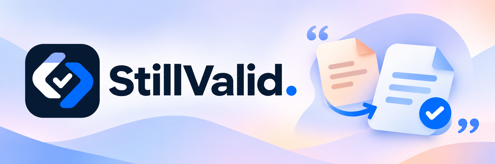
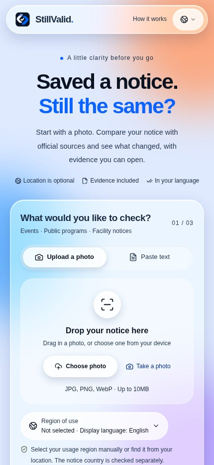
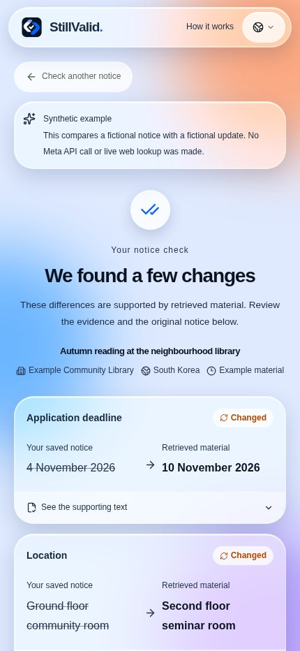
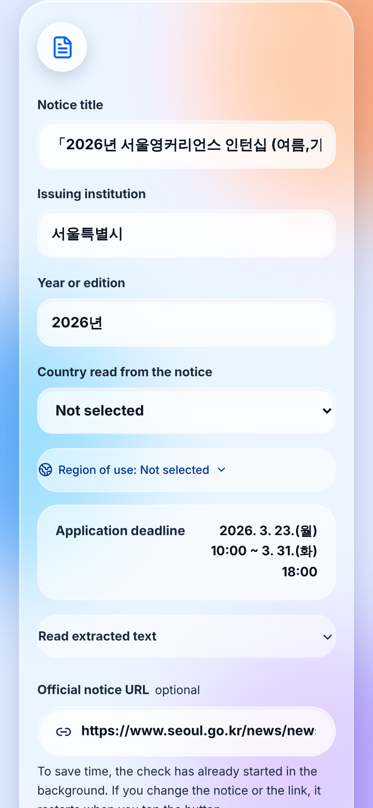
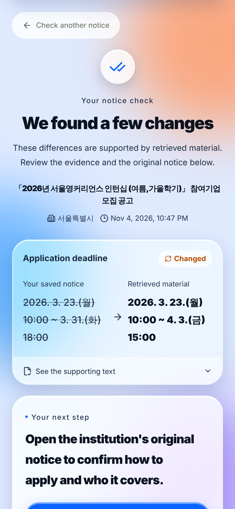
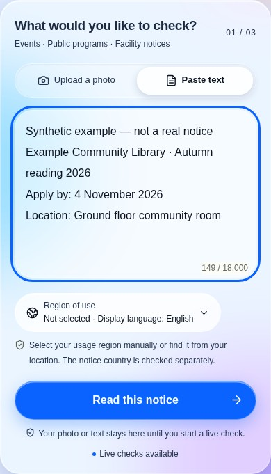
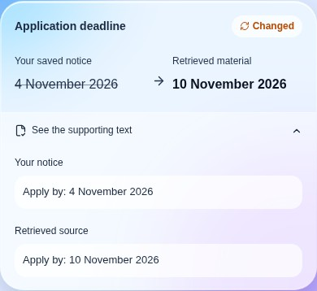
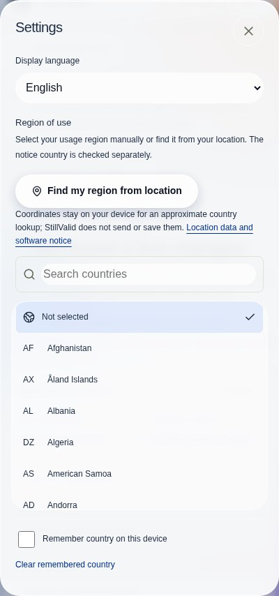
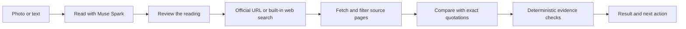

# StillValid

[](https://dev.meta.ai/docs/models) [](https://dev.meta.ai/docs/models) [](https://dev.meta.ai/docs) [](https://cerebralvalley.ai/e/meta-ai-developer-hackathon)

### Saved a notice. Still the same?

Compare a notice photo or pasted text with current official-source material. See **what changed, the supporting quotes, and what still needs confirmation** before you act.

[**Open the app**](https://stillvalid-beta.vercel.app) · [Alternate site](https://stillvalid-zoogom.vercel.app) · [한국어 README](<readme(language)/README.ko.md>) · [日本語 README](<readme(language)/README.ja.md>) · [English README](<readme(language)/README.en.md>) · [Deployment guide](docs/deployment.md)

**Languages / 언어 / 言語 / اللغات:**

[English](<readme(language)/README.en.md>) · [한국어](<readme(language)/README.ko.md>) · [日本語](<readme(language)/README.ja.md>) · [简体中文](<readme(language)/README.zh.md>) · [Español](<readme(language)/README.es.md>) · [Français](<readme(language)/README.fr.md>) · [Deutsch](<readme(language)/README.de.md>) · [Português](<readme(language)/README.pt.md>) · [العربية](<readme(language)/README.ar.md>) · [Русский](<readme(language)/README.ru.md>)

Built for the Meta Global AI Developer Hackathon — **Indie developer**, “Build for Your World.” No installation or account is required.

## Why StillValid

- **The model proposes, code decides.** Every change must be backed by exact quotes that exist in both the notice and an official page; a deterministic verifier in [`compare.ts`](src/lib/compare.ts) returns everything else as "needs review".
- **Official sources only.** Blogs, social posts and search snippets never count as evidence. A `go.kr`/`gov` link printed on the notice is filled in for you; otherwise Meta's built-in web search proposes real pages.
- **Built with Meta models end to end.** Muse Spark reads the notice, searches and compares; SAM 3.1 finds the notice on a crowded board; results show in ten languages without extra model calls.

**Demo video:** being produced; the link will be added here and in the submission form.

## Quick navigation

[Example](#example-a-saved-deadline) · [Validation at a glance](#validation-at-a-glance) · [Screens](#see-the-app) · [How to use](#check-a-notice-in-five-steps) · [Features](#what-is-available-today) · [Results](#understand-the-result) · [Evidence checks](#how-the-evidence-is-checked) · [Developer notes](#developer-notes-the-processing-pipeline) · [Run locally](#run-and-develop)

## Example: a saved deadline

1. **Saved notice:** a fictional library announcement says the deadline is **4 November**.
2. **Retrieved material:** the built-in example supplies a fictional update saying **10 November**.
3. **Result:** StillValid displays the before/after values and the supporting text. In a live check, source authority, identity and evidence must also pass verification; otherwise the overall result can be **needs review**.

This is the app's **synthetic example**, not an actual deadline change. It makes no live lookup or model call.

## Validation at a glance

| Area | Evidence and remaining work |
|---|---|
| Automated checks | The latest integration passed type checking, **205 unit tests**, **7 evaluation-harness tests** and the production build. Seven browser suites passed on the preceding application release using fixtures. |
| Physical devices | One earlier iPhone camera/result flow was reported by a user; comprehensive current iPhone/Android, HEIC and map-app hand-off checks remain incomplete. |
| Real-notice accuracy | The complete ten-case human-reviewed evaluation remains unfinished; individual observations are not an overall accuracy score. |
| Latency | Historical small-sample measurements vary. The latest request-efficiency changes have not been remeasured with live models; completion time is not guaranteed. |

[Detailed validation](docs/validation.md) · [Evaluation method](docs/evaluation.md) · [Acceptance checklist](docs/acceptance.md)

## See the app

**Actual production UI, captured on 5 November 2026 (KST).** The result below is the app's visibly labelled **synthetic example**, not a live verification of a real notice. These are Chromium mobile-width screenshots, not photographs of an iPhone. [Capture details](docs/screenshots/readme/README.md).

<p align="center">
  
  
</p>

**Start with a notice → inspect a result with before/after values.** Try the three built-in examples on the home page—changed details, cancellation, and a different edition—without a model call.

### A historical live-check screen

These screens show an earlier production run comparing **reconstructed text** based on a public Seoul notice with its official page. The earlier deadline in the input was deliberately changed for the test; it does not establish a real historical deadline change. The code and deployment have since changed, so this is not evidence of current performance. [Experiment record](docs/validation.md).

<p align="center">
  
  
</p>

## Check a notice in five steps

1. **Add a photo or text.** Take a photo, choose one image from your device, or paste up to 18,000 characters. Crop and rotate for legibility. On a noticeboard photo, the optional SAM locator can suggest one or several notice regions; choose the one to read.
2. **Read and review.** Check the title, institution, edition and notice country. Correct these directly. To fix a date, place or other extracted value, edit the original text and read it again. A blurry or incomplete reading asks for extra review.
3. **Check the source link.** A recognised public-institution page printed in the notice may be suggested. Confirm it or paste the issuer's exact HTTPS page. Without a link, the app searches for candidates.
4. **Compare and open the evidence.** Inspect each before/after value and expand its supporting text. “Needs review” means the app could not establish a reliable overall conclusion; read the reasons and check the source yourself.
5. **Act or follow up.** Open a source, search a location in Google Maps, copy a summary, check again with fresh sources, or delete the result.

> **For a quicker check:** use a sharp, tightly framed image and the issuer's exact notice URL. A direct URL skips search; it does not bypass identity or evidence verification.

<details>
<summary><strong>View text input and supporting quotes</strong></summary>

The input is illustrative text. The evidence card is from the built-in synthetic example; it is not the result of running that input through a model.

<p align="center">
  
  
</p>

</details>

## What is available today?

| Capability | Current behaviour |
|---|---|
| Photo input | JPEG, PNG and WebP up to 10 MB; browser-side preview, crop, rotate and JPEG re-encoding. HEIC/HEIF works only where the browser can decode it; otherwise the app explains how to use JPEG. |
| Optional notice locator | SAM 3.1 proposes regions in **one photo**, with numbered choices, undo and manual crop. This is not batch processing of several uploaded photos. |
| Source discovery | Meta built-in web search or a supplied official URL. Actual returned/cited URLs are ranked for registered authority and notice relevance before selecting up to three pages. |
| Source reading | HTML, plain text and PDF text layers. PDF limits: 5 MB / 20 pages. Scanned PDFs are not OCR'd; blocked, script-only, oversized and timed-out pages get distinct explanations. |
| Evidence comparison | Up to two related sources; field-level changes, original quotations, source links, time checked and reasons for uncertainty. |
| Maps | Live-result location cards can open a Google Maps **text search**. No map API key or embedded map. App/web hand-off depends on the device; a map result does not verify the venue. Only the chosen place text is sent when you tap. |
| Languages | English, Korean, Simplified Chinese, Spanish, French, German, Japanese, Portuguese, Arabic and Russian. Arabic uses RTL. Original values and quotes remain untranslated. |
| Optional region | 249 country/region choices, independent of language and notice country. “Find my region” requires an explicit tap and browser permission; coordinates are processed locally. Region choices do not imply worldwide notice coverage. |
| Recovery and control | Progress, elapsed time, cancellation, saved-result recovery, summary copying, rechecking, individual deletion and session-wide deletion. |

<details>
<summary><strong>View language and region settings</strong></summary>

<p align="center"></p>

Language changes update the UI and copied summary without translating evidence or rerunning the same factual check. Region memory is opt-in and can be cleared. Location detection never sets the notice's country.

</details>

## Understand the result

| Status | What it means | What to do |
|---|---|---|
| **Changed** | At least one change passed the evidence checks and there is no overall review blocker. | Read both quotations and confirm the current official instructions. |
| **Matches** | The checked fields agree with the retrieved material. | Check coverage and the time checked; this is not a guarantee that every detail is unchanged. |
| **Cancelled** | An explicit current cancellation for the same notice passed verification. | Open the source before changing plans. |
| **Deadline passed** | A verified, explicit timestamp is earlier than the check time. | Confirm the deadline and any current extension. |
| **Needs review** | Identity, source authority, wording, coverage or conflicting/incomplete evidence prevents a reliable overall conclusion. | Inspect the reasons, correct the source or contact the issuer. |
| **Unavailable** | No usable source was retrieved. | Try the issuer's exact page or confirm manually. |

A field can have verified evidence while the **overall result still needs review**. Not finding a change is not proof that nothing changed.

### When a check needs help

| What you see | What to try |
|---|---|
| The page contains the information, but the result says “review” | Check the institution, edition and exact quoted wording. A value being present does not establish that it belongs to this notice or comes from an official source. |
| The source cannot be read | Use the notice's own page instead of a portal/listing, or a PDF with selectable text. Login walls, script-only pages and scanned PDFs are not bypassed. |
| The check is slow | Supply the exact official URL; check progress and timing. Cancel if needed. Repeatedly starting the same slow check can use more of the shared allowance. |
| HEIC will not open, or a map opens in the browser | Try JPEG for unsupported image decoding. Map app/web selection is controlled by the device and browser, not guaranteed by StillValid. |

## How the evidence is checked



SAM 3.1 can locate the notice before reading when requested. The Spark stages use `muse-spark-1.3-contributor` by default; extraction/comparison use Chat Completions with strict JSON schemas, and source search uses Responses with built-in web search.

The model proposes comparisons; [`compare.ts`](src/lib/compare.ts) verifies them:

- **Quotes must exist** in the notice and source, with only permitted spacing normalisation. Search snippets and model guesses cannot substitute for fetched evidence.
- **Authority and identity must match.** A registered official domain is necessary for confirmation, but insufficient on its own. Title, institution, edition and section scope are checked; resident-content paths, other editions and archive/withdrawal markers can prevent verification.
- **Dates stay as written.** Missing years, times and time zones are not invented; ambiguous numeric dates stay uncertain.
- **Cancellation needs a current assertion.** Negated, conditional, historical or other-event statements do not qualify. Supported cancellation grammar is limited to certain English and Korean wording.
- **Incomplete evidence stays visible.** Failed retrievals, unfinished comparisons, missing fields and conflicting sources can keep the result in review.

These checks constrain model output; they do not establish general accuracy or replace the issuing institution.

## Speed: what improved, and what is unproven

| Improvement | What it saves |
|---|---|
| Early check after a 350 ms delay | Overlaps checking with your review. Editing the notice, region or source cancels the outdated request; changing only display language can reuse it. Already-sent provider calls may still be billed. |
| One clear reading cached in tab memory | Identical input and country can reuse extraction for 10 minutes. Reset/unmount clears it; uncertain readings are not cached. **Current sources and final validity checks are not cached.** |
| Bounded source retrieval | A 15-second aggregate budget covers DNS, redirects and retrieval; each network request also has a 12-second limit. Timeouts are reported, not treated as “unchanged.” |
| Earlier parallel comparison | The first two eligible pages can begin comparison as they arrive while final source selection retains priority order. Exact redirect duplicates share a comparison. |
| Smaller unnecessary input | Blank white margins and marked page navigation are reduced while notice text is retained; stable prompt-cache keys and minimal reasoning apply to the Spark stages. |

**There is no guaranteed completion time.** Previous small-sample tests varied substantially; the newest request-efficiency changes have passed offline regression checks but have not had a new live-model latency study. The median 15-second / p90 30-second goals are not established as achieved. [Performance details](docs/performance.md) · [Dated validation record](docs/validation.md).

The app keeps input on timeout. A received result survives a late stream failure, and a stored result can be recovered without rerunning the model. Browser ceilings are 150 seconds for reading, 200 seconds for checking and 80 seconds for locating; these are failure limits, not expected wait times.

## Privacy, limits and current validation

**Under Meta's terms, what you send to the default contributor model (your photo or text and the model's response) is used to train future Meta models.** The app explains this in all ten display languages. Deleting a StillValid result does not delete provider-held data.

- StillValid does not persist original image files. Session-owned results and required text/quotes have a 24-hour expiry policy and can be deleted. The reading cache is tab-memory only. [Storage implementation](src/lib/redis-store.ts).
- Model keys stay server-side. Source retrieval validates HTTPS, public addresses and every redirect, with DNS-to-connection pinning. Notice/source text, credentials, cookies and raw IP addresses are not written to application diagnostic logs.
- Default ceilings: **300 model calls per UTC day**, 3 concurrent jobs globally, 10 starts per minute globally, 60 extractions and 40 checks per session/hour, and 200 starts per network/hour. These are request limits, **not a money cap**. [Limit definitions](src/lib/limits.ts).

| Evidence | Status as of 5 November 2026 (KST) |
|---|---|
| Automated checks on the application revision used here | Type checking, **205 unit tests**, **7 evaluation-harness tests**, build and **7 browser suites** passed in the preceding release checks. |
| Screenshots in this guide | Current production UI; built-in synthetic results; **0 model calls** for this documentation update. |
| Physical devices | One earlier user-reported iPhone camera/result flow exists. Comprehensive current iPhone/Android, Safari HEIC and map-app/back-navigation checks remain incomplete. |
| Accuracy and latency | Controlled historical observations exist; the complete 10-case real-notice evaluation and representative latency study remain unfinished. Ten display languages do not establish ten-language verification accuracy. |

Script-only pages, scanned PDFs, ambiguous identity and unsupported cancellation wording can remain unverified. This app does not decide eligibility, provide emergency guidance or perform medical/legal judgement. [Acceptance checklist](docs/acceptance.md) · [Evaluation method](docs/evaluation.md).

## Developer notes: the processing pipeline

Browser → Next.js routes → Meta Model API / official HTTPS sources → Redis or SQLite → deterministic verdict. Credentials and limits stay on the server; user-facing result text comes from the ten-language dictionaries.

| Stage | Implementation and purpose | Bounds |
|---|---|---|
| Image preparation | The browser scales the longest side to at most 2,400 px and tries JPEG quality `0.92 → 0.80 → 0.68 → 0.55`. Blank white outer margins are trimmed only when the conditions are met. | 10 MiB input limit; 3,800,000-character encoded string limit. Re-encoding removes most EXIF; the original image is not retained as a result. |
| Locate a notice | Optional SAM 3.1 Responses request defaults to `document`, then tries `poster` if no qualifying box is found. One box is applied; multiple boxes offer a choice and undo. | Up to two model calls on the default path, 30 seconds per request. Locating a region does not establish OCR accuracy. |
| Read the notice | Spark Chat Completions uses strict JSON. Photos are transcribed into `originalText`; pasted text is not echoed by the model. Extracted values must appear in a quote from the original. | First attempt 60 seconds; one retry is limited to fast failures, within a 130-second server budget. Image/text output budgets are 6,000/4,500 tokens. |
| Discover sources | Without a supplied URL, Responses `web_search` returns actual result/citation URLs. Candidates are ranked by registered authority and title relevance before up to three are fetched. | Search summaries are not evidence. `META_SEARCH_MAX_TOOL_CALLS` is unset by default. |
| Fetch sources | Up to three requests run concurrently. HTML table cells are preserved, PDF text layers are extracted, and unrelated pages are not sent for comparison. | 15-second aggregate budget, 12 seconds per request, up to three redirects; HTML/text 600,000 bytes, extracted text 22,000 characters; PDF 5,000,000 bytes / 20 pages. Failures remain visible. |
| Compare and verify | Relevant pages in the first two slots can start comparison on arrival; up to two sources are selected in priority order. Spark proposes quotations and relations, then code checks authority, identity, quotes and scope. | 100 seconds and 12,000 output tokens per comparison. Depending on the decisive source outcomes, remaining comparisons get a 30-second grace period; unfinished evidence keeps the result in review. Fetch and comparison timings can overlap. |

### Models and API paths

| Function | Default model | API | Override |
|---|---|---|---|
| Read photo or text | `muse-spark-1.3-contributor` | Chat Completions, strict JSON | `META_EXTRACTION_MODEL` |
| Search for sources | same | Responses + `web_search` | `META_SEARCH_MODEL` |
| Compare fields | same | Chat Completions, strict JSON | `META_COMPARISON_MODEL` |
| Locate a notice, optional | `sam-3.1` | Responses, concept prompt | `SAM_MODEL` |

Spark model resolution is **step variable → META_MODEL → default**, and reasoning defaults to `minimal`. Production builds check the model catalog read-only. Changing a model requires redeployment and review of the privacy notice in all ten languages. Under Meta's terms, inputs to the default contributor model are used to train future Meta models.

### How the verdict is assembled

1. Check that quotations occur in the notice and source and include their respective values.
2. Require a registered official domain for confirmation; resident-content paths such as public boards and Q&A are not treated as issuer notices. A registered domain alone does not establish identity.
3. Compare institution, title, edition and the quoted section. A different event/edition section or page-level archive/withdrawal marker can block verification.
4. Do not fill in ambiguous dates or missing years, times or time zones. Cancellation must be an explicit current assertion about the same event.
5. With no readable source the result is unavailable; unverified fields, missing coverage, source conflict or other blockers can require review. If the checks pass, statuses are considered in cancellation, deadline passed, changed and matched order.

Section detection relies on page structure and text. When different notices share an unlabelled section, model interpretation can still affect scope. See the [validation record](docs/validation.md) for counterexamples and regression coverage.

### Security and recovery design

- Source fetches allow credential-free HTTPS on port 443, block private/reserved addresses and internal hosts, pin connections to DNS results and recheck every redirect. A generic forward proxy fails closed.
- Writes require same-origin requests and an HTTP-only anonymous session. CSP and frame restrictions are in [configuration](next.config.ts). Hosted runs use shared Redis; a single server can use SQLite.
- The **global** work limit is three concurrent jobs and ten starts per minute; session-hour and network-hour limits are separate. A work lease is released when execution ends, not merely when its result is deleted.
- Check responses stream NDJSON with a heartbeat every ten seconds. The browser stops after 45 seconds without bytes. A received result survives later stream errors, and a saved result can be recovered without another model call.

### Historical observations and outstanding work

These are small observations on earlier production versions using **reconstructed public notices**. The photo-like inputs were rendered images, not physical iPhone camera photos. They were not measured after the latest request-efficiency changes and cannot establish general accuracy or current latency. [Original record](docs/validation.md#2026-11-04-production-with-muse-spark-13-contributor-f671f3b).

| Observation | Result | Scope |
|---|---|---|
| Contributor model with official links, Seoul and Smithsonian twice each | Median 24.3 s across four runs | Seoul `changed` 2/2; Smithsonian `review` 2/2 |
| Earlier Spark 1.3 at minimal reasoning, same cases | Median 26.8 s across four runs | Reading through result on an older version; not current latency |
| Earlier model default reasoning, same cases | Median 45.6 s across four runs | Seoul `review` 2/2; historical experiment setting |
| Earlier model `low` reasoning, same cases | Median 34.6 s across four runs | Seoul `changed` 1/2; historical experiment setting |
| Background check, Seoul text once | 3.9 s after click, 19.4 s total | Includes 10 s of user review; it does not mean the model itself ran faster |
| Background check, Smithsonian text without a link once | 7.9 s after click, 26.3 s total, `review` | Includes 15 s review and automatic search |
| Other reading models | Spark 1.2: 2.0–4.5 s; 1.1: 2.4–7.9 s | Four runs each; Seoul title errors helped inform the current choice. Search/comparison were not measured for these models. |

Separately, a user-reported iPhone camera flow took roughly three minutes and returned `review` with a missing retrieved date. That same case has not been remeasured after the later improvements. The completed ten-case accuracy evaluation, representative latency distribution, Android, HEIC and maps hand-off tests remain outstanding.


## Run and develop

Node.js **24** and npm are required.

```bash
git clone https://github.com/ZOOGOM/stillvalid.git
cd stillvalid
npm ci
cp .env.example .env.local
npm run dev
```

Open `http://localhost:3000`. Synthetic examples work without a Meta key. For live checks, add `META_API_KEY` securely to `.env.local`. Local single-server storage can use SQLite; Vercel requires a complete writable Redis REST configuration. Never commit keys.

<details>
<summary><strong>Environment variables and model selection</strong></summary>

| Variable | Purpose |
|---|---|
| `META_API_KEY` / `MODEL_API_KEY` | Server-only Meta credential. |
| `META_MODEL` | One switch for the three Spark stages; default `muse-spark-1.3-contributor`. |
| `META_EXTRACTION_MODEL`, `META_SEARCH_MODEL`, `META_COMPARISON_MODEL` | Optional overrides: **stage variable → META_MODEL → default**. Leave unset for a single switch. |
| `SAM_MODEL` | Separate locator model; default `sam-3.1`. |
| `META_REASONING_EFFORT_EXTRACTION`, `META_REASONING_EFFORT_SEARCH`, `META_REASONING_EFFORT_COMPARISON` | Default `minimal`. The app's `none` setting **omits the parameter**; it does not request a provider “no thinking” mode. |
| `META_SEARCH_MAX_TOOL_CALLS` | Optional 1–5 search-tool cap; unset by default to avoid limiting amendment/cancellation discovery. |
| `UPSTASH_REDIS_REST_URL`, `UPSTASH_REDIS_REST_TOKEN` | Writable hosted storage. A complete `KV_REST_API_URL` / `KV_REST_API_TOKEN` pair is also supported; never mix pairs. |
| `APP_URL` | Exact external origin. |
| `DAILY_MODEL_CALL_LIMIT` | Calls per UTC day; default 300. |
| `IP_RATE_LIMIT_SECRET` | Optional dedicated secret for the network-derived limit. |
| `VERIFIED_SOURCE_HOSTS` | Additional independently verified institution domains. |
| `DATABASE_PATH` | SQLite path for a single server. |
| `STILLVALID_VERIFY_DEPLOYMENT` | Opt-in hosting probe; `1` performs a real paid extraction. Keep `0` unless deliberately testing it. |

Environment changes need redeployment. Review the ten-language privacy notice before changing model variants. `/api/status` exposes the deployed SHA, effective models and reasoning settings—not proof that an inference succeeded. See [.env.example](.env.example) and [deployment](docs/deployment.md).

</details>

<details>
<summary><strong>Checks, API and code map</strong></summary>

```bash
npm run check                 # types + unit tests + evaluation fixtures
npm run build
npm start
# With the local server running and Chromium installed:
npm run test:browser
npm run test:browser-maps
npm run test:browser-locate
npm run test:browser-stream
npm run test:browser-prefill
npm run test:browser-early
npm run test:browser-image
```

The default README and the English guide contain the same content with links adjusted for their locations. After editing either file, compare them before committing:

```bash
node scripts/check-readme-sync.mjs
```

The command reports whether their content matches after resolving relative links; a mismatch exits with a non-zero status. This is a manual check, not an automated CI gate.

Set `CHROMIUM_PATH` if Chromium is not at `/usr/bin/chromium`. These browser suites use fixtures and make no model calls. They do not replace physical-device testing or establish full accessibility conformance. `npm run verify:meta` is a read-only model-catalog check requiring a key; live evaluation and the opt-in hosting probe can incur model costs.

| API | Purpose |
|---|---|
| `GET /api/status`, `GET /api/demo` | Configuration readiness; synthetic examples. |
| `POST /api/extract`, `POST /api/locate` | Read input; optionally locate a notice. |
| `POST /api/checks` | Stream `created`, `phase`, `ping`, `result` or `error` as NDJSON. |
| `GET /api/checks/{id}`, `DELETE /api/checks/{id}` | Read or delete/cancel a session-owned result. |
| `DELETE /api/session` | Delete the session's results. |

Start in [`app.tsx`](src/components/app.tsx), [`meta.ts`](src/lib/meta.ts), [`compare.ts`](src/lib/compare.ts), [`source-planning.ts`](src/lib/source-planning.ts), [`source.ts`](src/lib/source.ts) and [`request-efficiency.ts`](src/lib/request-efficiency.ts). Storage adapters, limits and language dictionaries live under `src/lib`; tests and browser scripts live under `tests` and `scripts`.

Vercel's Git integration builds pushes to connected branches. GitHub Pages alone cannot run the protected server routes. A Dockerfile and Compose configuration are also included. [Deployment guide](docs/deployment.md).

</details>

## License

Original source code is [MIT](LICENSE). Third-party libraries, models and external content retain their own terms. The app footer remains **Copyright 2026 Zoogom. All rights reserved.**
