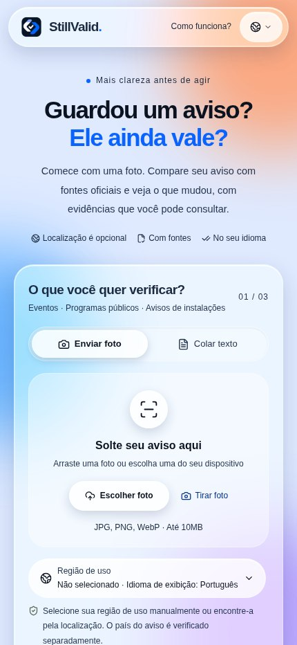
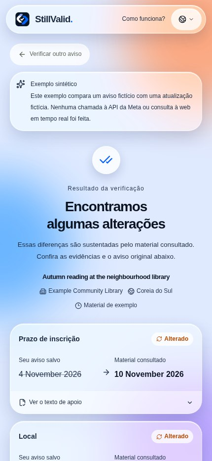

<div>

# StillValid

### O aviso que você guardou continua válido?

Compare uma foto ou texto com fontes oficiais atuais e veja mudanças, citações e o que ainda precisa de confirmação. Sem instalação ou cadastro.

[Abrir o aplicativo](https://stillvalid-beta.vercel.app) · [English](README.en.md) · [한국어](README.ko.md) · [日本語](README.ja.md) · [README](README.md)

**Languages / 言語 / 언어 / اللغات:**

[English](README.en.md) · [한국어](README.ko.md) · [日本語](README.ja.md) · [简体中文](README.zh.md) · [Español](README.es.md) · [Français](README.fr.md) · [Deutsch](README.de.md) · [Português](README.pt.md) · [العربية](README.ar.md) · [Русский](README.ru.md)

## Por que StillValid

- **O modelo propõe, o código decide.** Toda mudança precisa de citações exatas que existam tanto no aviso quanto em uma página oficial; um verificador determinístico em [`compare.ts`](src/lib/compare.ts) devolve todo o resto como “precisa de revisão”.
- **Somente fontes oficiais.** Blogs, redes sociais e resumos de busca nunca contam como evidência. Um link `go.kr`/`gov` impresso no aviso é preenchido automaticamente; caso contrário, a busca web integrada da Meta propõe páginas reais.
- **Construído do início ao fim com modelos da Meta.** O Muse Spark lê, busca e compara; o SAM 3.1 localiza o aviso em um mural cheio; os resultados aparecem em dez idiomas sem chamadas extras ao modelo.

**Vídeo de demonstração:** em produção; o link será adicionado aqui e no formulário de inscrição.

## Exemplo de uso

Exemplo sintético: um aviso fictício de biblioteca informa prazo em 4 de novembro e uma atualização fictícia informa 10 de novembro. O app mostra os valores e as citações. Numa consulta real, fonte, identidade e evidências também precisam ser verificadas; caso contrário, o resultado pode exigir revisão. O exemplo não faz busca ao vivo nem chamada ao modelo e não prova uma alteração real.

## Telas do aplicativo

Capturas da interface real em produção em 5 de novembro de 2026 (KST), no Chromium em largura móvel. O resultado é um exemplo sintético identificado, não uma verificação real nem foto de iPhone. A interface está em português; os valores originais do exemplo continuam em inglês.

<p align="center"></p>

## Como usar

1. Fotografe ou escolha uma imagem, ou cole até 18.000 caracteres. Recorte e gire no navegador; o SAM pode sugerir áreas de avisos em uma foto.
2. Revise título, instituição, edição e país. Para corrigir data ou local extraído, edite o texto original e leia novamente.
3. Confirme ou insira o endereço HTTPS exato da entidade emissora; sem URL, o app procura fontes candidatas.
4. Veja os valores e as citações. Se houver necessidade de revisão, leia os motivos e abra a fonte oficial.
5. Opcionalmente pesquise o local no Google Maps, copie o resumo, verifique novamente ou exclua o resultado.

## Recursos e limites

- JPEG, PNG e WebP até 10 MiB; HEIC/HEIF depende do navegador. O SAM pode sugerir várias áreas em uma foto, mas não processa várias fotos em lote.
- Lê HTML, texto e camada textual de PDF, até 5 MB/20 páginas; não faz OCR de PDF digitalizado. Busca até três candidatas e compara até duas fontes relacionadas.
- Dez idiomas de interface, com árabe da direita para a esquerda. Datas, nomes, locais e citações não são traduzidos. A região opcional entre 249 países/regiões é independente do país do aviso.
- O link do Maps envia apenas o texto do local escolhido ao ser acionado; não verifica o endereço nem garante abrir um aplicativo nativo.

## Entenda o resultado

- Alterado: pelo menos uma mudança foi verificada e não há impedimento geral.
- Correspondente: os campos verificados coincidem; isso não garante que todos os detalhes estejam iguais.
- Cancelado ou prazo encerrado: exige cancelamento atual explícito ou data e horário explícitos válidos.
- Precisa de revisão ou indisponível: identidade, fonte, evidências, conflito ou falha impedem uma conclusão confiável.

## Estado da validação

- A integração mais recente passou na verificação de tipos, 205 testes unitários, 7 testes do avaliador e compilação; sete suítes de navegador passaram com respostas simuladas na versão anterior.
- Um fluxo com câmera de iPhone relatado por uma pessoa levou cerca de três minutos e terminou em revisão. Faltam testes completos atuais de iPhone/Android, HEIC e transição para o app de mapas.
- A avaliação de dez avisos reais com referências humanas está incompleta. Medições históricas têm amostras pequenas; a latência real do modelo após a última otimização ainda não foi medida novamente.

- Os dez idiomas são de interface; isso não comprova a precisão da verificação de fatos em cada idioma.

## Privacidade e limites

Segundo os termos da Meta, o modelo padrão muse-spark-1.3-contributor usa os dados enviados para treinar futuros modelos da Meta. Excluir um resultado no StillValid não exclui dados mantidos pelo provedor. Arquivos de imagem originais não são armazenados permanentemente; resultados e citações pertencem a uma sessão anônima, expiram em 24 horas e podem ser apagados. As chaves ficam no servidor. Padrão: 300 chamadas por dia UTC, três trabalhos simultâneos e dez inícios por minuto globalmente; isso não é um limite financeiro.

## Notas para desenvolvimento

- Navegador → APIs Next.js → modelos Meta / fontes HTTPS → Redis ou SQLite → verificador determinístico. Leitura e comparação usam Chat Completions com JSON estrito; busca usa Responses + web_search; localização opcional usa sam-3.1.
- Valores devem constar em citações originais. Uma confirmação exige domínio oficial registrado e verifica instituição, título, edição, seção e sinais de arquivo/retirada. Anos, horários e fusos ausentes não são inventados; a gramática de cancelamento cobre algumas expressões em inglês e coreano.
- Uma URL direta pula a busca. Orçamento por fonte: 15 s no total, 12 s por requisição e até três redirecionamentos; HTML/texto 600.000 bytes, texto extraído 22.000 caracteres, PDF 5.000.000 bytes/20 páginas. Falha não significa “sem alteração”.
- Uma leitura clara da mesma entrada e país pode ser reutilizada por dez minutos na memória da aba; fontes atuais e resultado final não são armazenados em cache. A verificação antecipada aguarda 350 ms e é cancelada se aviso, região ou link mudarem; só mudar o idioma permite reutilização.
- Prioridade de modelo: variável por etapa → META_MODEL → muse-spark-1.3-contributor. SAM_MODEL padrão sam-3.1; esforço mínimo. `none` omite o parâmetro e não significa “sem raciocínio”. Antes de alterar o modelo, revise a política de privacidade nos dez idiomas.

## Observações históricas

Amostras pequenas de versões anteriores com avisos públicos reconstruídos; imagens semelhantes a fotos não são fotos físicas de iPhone. Não representam latência atual ou precisão geral.

| Observação | Resultado |
|---|---|
| `muse-spark-1.3-contributor` · Seoul + Smithsonian · 4 runs | median 24.3 s; Seoul `changed` 2/2, Smithsonian `review` 2/2 |
| `muse-spark-1.3` · minimal · 4 runs | median 26.8 s |

[Validation record](docs/validation.md#2026-11-04-production-with-muse-spark-13-contributor-f671f3b)

## API e configuração

| API | Resultado |
|---|---|
| `GET /api/status`, `GET /api/demo` | Estado e exemplos sintéticos |
| `POST /api/extract`, `POST /api/locate` | Leitura e localização opcional |
| `POST /api/checks` | Verificação em fluxo NDJSON |
| `GET /api/checks/{id}`, `DELETE /api/checks/{id}` | Ler ou excluir resultado da sessão |
| `DELETE /api/session` | Excluir resultados da sessão |

| Variable | Resultado |
|---|---|
| `META_API_KEY`, `META_MODEL`, `META_EXTRACTION_MODEL`, `META_SEARCH_MODEL`, `META_COMPARISON_MODEL` | Chave no servidor; modelo comum às três etapas Spark, com sobrescritas por etapa |
| `SAM_MODEL`, `DAILY_MODEL_CALL_LIMIT` | Modelo SAM; limite diário de chamadas (padrão 300) |
| `UPSTASH_REDIS_REST_URL`, `UPSTASH_REDIS_REST_TOKEN` | Credenciais Redis REST com escrita ou par KV_REST completo |
| `VERIFIED_SOURCE_HOSTS`, `DATABASE_PATH` | Domínios verificados adicionais; caminho SQLite |

## Executar localmente

É preciso Node.js 24 e npm. Os exemplos funcionam sem chave; para consultas reais, configure META_API_KEY com segurança em .env.local. Use SQLite para um servidor e Redis REST com escrita no serviço hospedado. Não publique chaves.

```bash
git clone https://github.com/ZOOGOM/stillvalid.git
cd stillvalid
npm ci
cp .env.example .env.local
npm run dev
```

## Testes e referências

Os testes de navegador usam dados simulados sem chamadas ao modelo e não substituem testes em dispositivos ou garantia completa de acessibilidade. Avaliações reais e a verificação opcional de implantação podem gerar custos.

```bash
npm run check
npm run build
npm run test:browser
npm run test:browser-maps
npm run test:browser-locate
npm run test:browser-stream
npm run test:browser-prefill
npm run test:browser-early
npm run test:browser-image
```

[Validation / 검증 기록](docs/validation.md) · [Evaluation / 평가](docs/evaluation.md) · [Deployment / 배포](docs/deployment.md) · [Acceptance / 확인표](docs/acceptance.md) · [Performance / 성능](docs/performance.md) · [README screenshot provenance](docs/screenshots/readme/README.md) · [.env.example](.env.example) · [MIT](LICENSE)

## Licença

O código original usa licença MIT. Bibliotecas, modelos e conteúdo externo mantêm seus próprios termos. O rodapé permanece Copyright 2026 Zoogom. All rights reserved.

</div>
