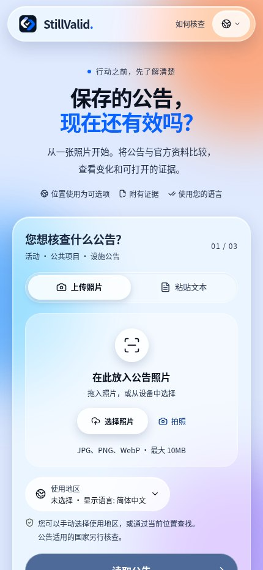
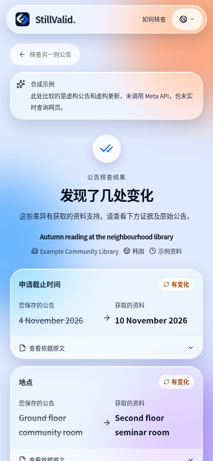

<div>

# StillValid

### 保存的通知，现在还是一样吗？

将通知照片或文字与当前官方资料比较，查看变化、原文依据和仍需确认的事项。无需安装或注册。

[打开应用](https://stillvalid-beta.vercel.app) · [English](README.en.md) · [한국어](README.ko.md) · [日本語](README.ja.md) · [README](README.md)

**Languages / 言語 / 언어 / اللغات:**

[English](README.en.md) · [한국어](README.ko.md) · [日本語](README.ja.md) · [简体中文](README.zh.md) · [Español](README.es.md) · [Français](README.fr.md) · [Deutsch](README.de.md) · [Português](README.pt.md) · [العربية](README.ar.md) · [Русский](README.ru.md)

## 为什么选择 StillValid

- **模型提出，代码裁定。** 每一处变更都必须有同时存在于公告和官方页面中的原文引用支持；[`compare.ts`](src/lib/compare.ts) 中的确定性校验器会把其余情况一律标为“需要复核”。
- **只以官方来源为依据。** 博客、社交媒体和搜索摘要不算证据。公告上印的 `go.kr`/`gov` 链接会自动填入，否则由 Meta 内置网页搜索提出真实页面。
- **全程使用 Meta 模型构建。** Muse Spark 负责读取、搜索和比对，SAM 3.1 在密集的公告板中定位公告，结果以十种语言显示且无需额外模型调用。

**演示视频：** 制作中，完成后将在此处和提交表单中添加链接。

## 使用示例

内置合成示例：虚构的图书馆通知写着11月4日截止，虚构的更新资料写着11月10日。应用显示前后数值及引用；实际检查还必须验证来源、通知身份和证据，否则整体可能需要复核。该示例不进行实时搜索或模型调用，也不证明真实期限发生过变化。

## 应用画面

以下为2026年11月5日（KST）实际线上界面的移动宽度截图。结果是明确标记的合成示例，不是真实通知的实时验证，也不是 iPhone 实机照片。界面为中文，示例原文保持英文。

<p align="center"></p>

## 使用步骤

1. 拍摄或选择一张照片，或粘贴不超过18,000字的文字；可在浏览器中裁剪、旋转。可选的 SAM 功能可建议照片中的通知区域。
2. 检查识别出的标题、机构、期次和国家。要修改日期或地点等提取值，请编辑原文后重新读取。
3. 确认或输入发布机构的准确 HTTPS 页面；没有链接时应用会搜索来源候选。
4. 查看前后数值及两侧引用；如需复核，请阅读原因并自行打开官方来源。
5. 按需在 Google Maps 搜索地点、复制摘要、重新检查或删除结果。

## 功能与限制

- JPEG、PNG、WebP 最多10 MiB；HEIC/HEIF 取决于浏览器能否解码。SAM 可以在一张照片中选择多个候选区域，不支持多张照片批处理。
- 可读取 HTML、纯文本和 PDF 文本层；PDF 最大5 MB、20页。扫描 PDF 不做 OCR。最多获取3个候选、比较2个相关来源。
- 10种界面语言；阿拉伯语采用从右到左布局。日期、名称、地点和引用不翻译。可选的249个国家/地区是使用地区，不等于通知所属国家。
- 地图链接仅在点击时将所选地点文字发送至 Google Maps 搜索；地图结果不验证地点，也不保证打开原生应用。

## 如何理解结果

- 变化：至少一项变化通过验证，且整体没有阻碍结论的原因。
- 一致：已检查项目与取得资料一致，不保证所有细节都未变化。
- 取消或截止：必须有同一通知明确、当前的取消声明或有效的明确截止时间。
- 需要复核或无法确认：身份、来源、证据、冲突或获取失败使结论不完整；请检查原因并联系发布者。

## 验证现状

- 最新集成通过类型检查、205项单元测试、7项评估工具测试及构建；7组浏览器测试在此前版本使用固定响应通过。
- 曾有一次用户报告的 iPhone 拍照流程，约3分钟后结果需要复核。当前 iPhone/Android、HEIC 和地图应用切换的完整实机测试仍未完成。
- 经过人工核对的10项真实通知评估尚未完成。过去的小样本不代表整体准确率；最新优化后的实际模型速度尚未重新测量。

- 界面支持10种语言并不证明每种语言的事实核查精度。

## 隐私与额度

默认的 muse-spark-1.3-contributor 模型根据 Meta 条款会将提交内容用于训练 Meta 未来的模型。删除 StillValid 的结果不会删除提供方持有的数据。原始图片文件不持久保存；结果和必要原文属于匿名会话，设置24小时到期并可删除。密钥只在服务器端。默认上限为 UTC 每天300次模型调用、全局并发3项及每分钟10次启动；调用数不是金额上限。

## 开发者笔记

- 浏览器 → Next.js API → Meta 模型 / 官方 HTTPS 来源 → Redis 或 SQLite → 确定性验证。照片读取和比较使用严格 JSON 的 Chat Completions，搜索使用 Responses + web_search；可选区域检测使用 sam-3.1。
- 字段值与引用必须存在于原文；正式确认需要注册官方域名，并检查机构、标题、期次、段落范围及归档/撤回标志。缺失的年份、时间或时区不会推断；取消语法仅覆盖部分英语和韩语表达。
- 使用已知 URL 可跳过搜索。来源整体获取预算15秒、单次请求12秒、最多3次重定向；HTML/文字600,000字节、提取文字22,000字符，PDF 5,000,000字节/20页。失败不会被视为“没有变化”。
- 清晰读取结果可在标签页内对相同输入和国家复用10分钟；不缓存最新来源或最终判定。先行检查延迟350毫秒，内容、地区或链接变化会取消旧请求。界面语言变化可复用同一检查。
- 模型优先级：阶段变量 → META_MODEL → muse-spark-1.3-contributor；SAM_MODEL 默认 sam-3.1。默认推理强度 minimal；none 表示省略参数，并不代表“无推理”。更改模型前须重新核对10种语言的隐私说明。

## 历史观测

旧版生产环境的小样本，输入根据公开信息重新制作，照片风格图片不是 iPhone 实拍；并非最新速度或总体准确率。

| 观测 | 结果 |
|---|---|
| `muse-spark-1.3-contributor` · Seoul + Smithsonian · 4 runs | median 24.3 s; Seoul `changed` 2/2, Smithsonian `review` 2/2 |
| `muse-spark-1.3` · minimal · 4 runs | median 26.8 s |

[Validation record](docs/validation.md#2026-11-04-production-with-muse-spark-13-contributor-f671f3b)

## API 与配置

| API | 结果 |
|---|---|
| `GET /api/status`, `GET /api/demo` | 状态及合成示例 |
| `POST /api/extract`, `POST /api/locate` | 读取与可选区域检测 |
| `POST /api/checks` | 以 NDJSON 流式执行检查 |
| `GET /api/checks/{id}`, `DELETE /api/checks/{id}` | 读取或删除当前会话的结果 |
| `DELETE /api/session` | 删除会话的所有结果 |

| Variable | 结果 |
|---|---|
| `META_API_KEY`, `META_MODEL`, `META_EXTRACTION_MODEL`, `META_SEARCH_MODEL`, `META_COMPARISON_MODEL` | 服务器端密钥；三个 Spark 阶段的共同模型，阶段变量可覆盖 |
| `SAM_MODEL`, `DAILY_MODEL_CALL_LIMIT` | SAM 模型；每日调用数上限（默认300） |
| `UPSTASH_REDIS_REST_URL`, `UPSTASH_REDIS_REST_TOKEN` | 可写 Redis REST 凭据（或完整的 KV_REST 配对） |
| `VERIFIED_SOURCE_HOSTS`, `DATABASE_PATH` | 额外经验证的机构域名；SQLite 路径 |

## 本地运行

需要 Node.js 24 和 npm。无密钥也可使用合成示例；实时检查需在 .env.local 中安全配置 META_API_KEY。单服务器可用 SQLite，托管环境需要可写 Redis REST。切勿提交密钥。

```bash
git clone https://github.com/ZOOGOM/stillvalid.git
cd stillvalid
npm ci
cp .env.example .env.local
npm run dev
```

## 检查与参考资料

浏览器测试使用固定数据，不调用模型，也不能替代实机或完整无障碍测试。实际评估和可选部署探针可能产生模型费用。

```bash
npm run check
npm run build
npm run test:browser
npm run test:browser-maps
npm run test:browser-locate
npm run test:browser-stream
npm run test:browser-prefill
npm run test:browser-early
npm run test:browser-image
```

[Validation / 검증 기록](docs/validation.md) · [Evaluation / 평가](docs/evaluation.md) · [Deployment / 배포](docs/deployment.md) · [Acceptance / 확인표](docs/acceptance.md) · [Performance / 성능](docs/performance.md) · [README screenshot provenance](docs/screenshots/readme/README.md) · [.env.example](.env.example) · [MIT](LICENSE)

## 许可证

原始源代码采用 MIT 许可证；第三方库、模型和外部内容遵循各自条款。应用页脚保留 Copyright 2026 Zoogom. All rights reserved.

</div>
