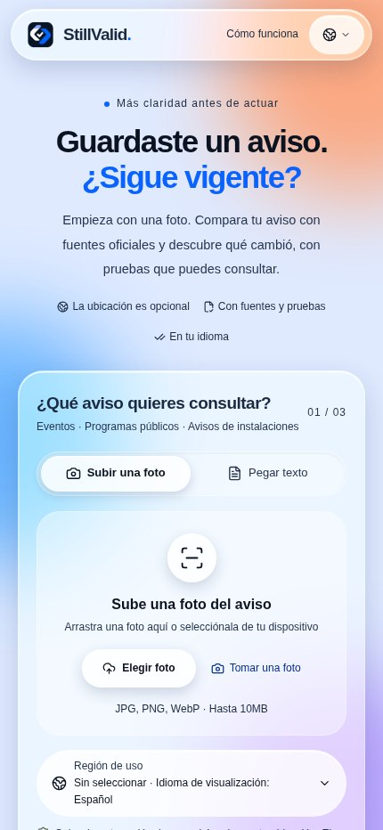
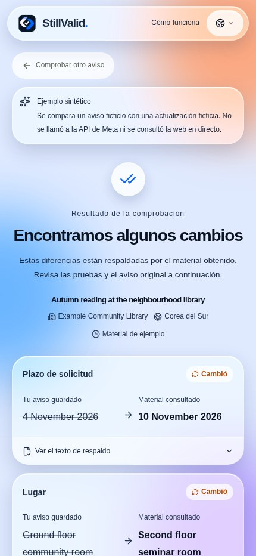

<div>


# StillValid

[](https://dev.meta.ai/docs/models) [](https://dev.meta.ai/docs/models) [](https://dev.meta.ai/docs) [](https://cerebralvalley.ai/e/meta-ai-developer-hackathon)

### ¿Sigue siendo válido el aviso que guardaste?

Compara una foto o texto con información oficial actual y consulta cambios, citas y puntos pendientes de verificar. Sin instalación ni registro.

[Abrir la aplicación](https://stillvalid-beta.vercel.app) · [English](README.en.md) · [한국어](README.ko.md) · [日本語](README.ja.md) · [README](../README.md)

**Languages / 言語 / 언어 / اللغات:**

[English](README.en.md) · [한국어](README.ko.md) · [日本語](README.ja.md) · [简体中文](README.zh.md) · [Español](README.es.md) · [Français](README.fr.md) · [Deutsch](README.de.md) · [Português](README.pt.md) · [العربية](README.ar.md) · [Русский](README.ru.md)

## Por qué StillValid

- **El modelo propone, el código decide.** Cada cambio debe estar respaldado por citas exactas que existan tanto en el aviso como en una página oficial; un verificador determinista en [`compare.ts`](../src/lib/compare.ts) devuelve todo lo demás como «necesita revisión».
- **Solo fuentes oficiales.** Blogs, redes sociales y resúmenes de búsqueda nunca cuentan como evidencia. Un enlace `go.kr`/`gov` impreso en el aviso se rellena automáticamente; si no, la búsqueda web integrada de Meta propone páginas reales.
- **Construido de principio a fin con modelos de Meta.** Muse Spark lee, busca y compara; SAM 3.1 localiza el aviso en un tablón lleno; los resultados se muestran en diez idiomas sin llamadas adicionales al modelo.

**Vídeo de demostración:** [Ver en YouTube](https://youtu.be/72v80uOubrU)

<p align="center"><a href="https://youtu.be/72v80uOubrU"></a></p>

## Ejemplo de uso

Ejemplo sintético: un aviso ficticio de una biblioteca indica el 4 de noviembre como fecha límite y una actualización ficticia indica el 10 de noviembre. La aplicación muestra ambos valores y las citas. En una comprobación real también verifica la fuente, la identidad y las pruebas; si faltan, el resultado puede requerir revisión. El ejemplo no realiza búsquedas ni llamadas al modelo y no demuestra un cambio real.

## Pantallas

Capturas de la interfaz real en producción, el 5 de noviembre de 2026 (KST), en Chromium con ancho móvil. El resultado es un ejemplo sintético identificado, no una verificación real ni una fotografía de iPhone. La interfaz está en español y los valores originales del ejemplo permanecen en inglés.

<p align="center"></p>

## Cómo usarlo

1. Fotografía o elige una imagen, o pega hasta 18.000 caracteres. Puedes recortar y girar en el navegador; SAM puede sugerir áreas de avisos en una foto.
2. Revisa título, entidad, edición y país. Para corregir una fecha o lugar extraído, edita el texto original y vuelve a leerlo.
3. Confirma o introduce la página HTTPS exacta del organismo emisor; sin enlace se buscan candidatos.
4. Consulta valores y citas. Si requiere revisión, lee los motivos y abre la fuente oficial.
5. Opcionalmente busca el lugar en Google Maps, copia el resumen, vuelve a comprobar o elimina el resultado.

## Funciones y límites

- JPEG, PNG y WebP hasta 10 MiB; HEIC/HEIF depende del navegador. SAM puede ofrecer varias áreas dentro de una foto, no procesa varias fotos en lote.
- Lee HTML, texto y la capa textual de PDF (máximo 5 MB y 20 páginas); no hace OCR de PDF escaneados. Obtiene hasta tres candidatos y compara hasta dos fuentes relacionadas.
- Diez idiomas de interfaz; árabe de derecha a izquierda. No traduce fechas, nombres, lugares ni citas. La región opcional entre 249 países/regiones es independiente del país del aviso.
- El enlace de Maps envía solo el texto del lugar elegido al pulsarlo; no verifica la dirección ni garantiza que se abra una aplicación nativa.

## Interpretar el resultado

- Cambio: al menos un cambio se ha verificado y no hay un bloqueo general.
- Coincide: los campos comprobados concuerdan; no garantiza que todos los detalles sigan iguales.
- Cancelado o plazo vencido: exige una cancelación actual explícita o una fecha y hora válidas y explícitas.
- Revisión o no disponible: identidad, fuente, pruebas, conflictos o fallos impiden una conclusión fiable.

## Estado de validación

- La última integración superó tipos, 205 pruebas unitarias, 7 pruebas del evaluador y la compilación; siete suites de navegador pasaron con respuestas simuladas en la versión anterior.
- Una persona informó de un recorrido con cámara de iPhone de unos tres minutos y resultado de revisión. Faltan pruebas completas actuales en iPhone/Android, HEIC y cambio a la aplicación de mapas.
- La evaluación de diez avisos reales con referencias humanas está incompleta. Las mediciones históricas son muestras pequeñas; no se ha remedido la latencia del modelo tras la última optimización.

- Los diez idiomas son de interfaz; no demuestran la precisión de la verificación factual en cada idioma.

## Privacidad y límites de uso

Según las condiciones de Meta, el modelo predeterminado muse-spark-1.3-contributor usa lo enviado para entrenar futuros modelos de Meta. Eliminar resultados en StillValid no borra los datos del proveedor. No se conservan archivos originales de imagen; resultados y citas pertenecen a una sesión anónima, caducan a las 24 horas y se pueden eliminar. Las claves permanecen en el servidor. Límite predeterminado: 300 llamadas por día UTC, 3 trabajos simultáneos y 10 inicios por minuto globales; no es un límite monetario.

## Notas para desarrollo

- Navegador → rutas Next.js → modelos Meta / fuentes HTTPS → Redis o SQLite → verificador determinista. Lectura y comparación usan Chat Completions con JSON estricto; búsqueda usa Responses + web_search y la detección opcional usa sam-3.1.
- Los valores deben estar en citas del original. La confirmación exige un dominio oficial registrado y verifica institución, título, edición, sección y marcas de archivo o retirada. No se inventan años, horas o zonas; la gramática de cancelación admite solo ciertas expresiones inglesas y coreanas.
- Una URL directa omite la búsqueda. El presupuesto total por fuente es 15 s, cada petición 12 s y hasta 3 redirecciones; HTML/texto 600.000 bytes, texto extraído 22.000 caracteres y PDF 5.000.000 bytes/20 páginas. Un error no significa “sin cambios”.
- Una lectura clara de entrada y país idénticos se reutiliza 10 minutos en memoria de la pestaña; no se guardan la vigencia de fuentes ni el resultado final. La comprobación anticipada espera 350 ms y se cancela al cambiar aviso, región o enlace; cambiar solo el idioma permite reutilizarla.
- Prioridad del modelo: variable del paso → META_MODEL → muse-spark-1.3-contributor. SAM_MODEL usa sam-3.1 por defecto; esfuerzo mínimo. `none` omite el parámetro, no implica ausencia de razonamiento. Antes de cambiar modelos, revisa el aviso de privacidad en los diez idiomas.

## Observaciones históricas

Muestras pequeñas de versiones anteriores: entradas reconstruidas a partir de avisos públicos, con imágenes que no son fotos físicas de iPhone. No representan la latencia actual ni la precisión general.

| Observación | Resultado |
|---|---|
| `muse-spark-1.3-contributor` · Seoul + Smithsonian · 4 runs | median 24.3 s; Seoul `changed` 2/2, Smithsonian `review` 2/2 |
| `muse-spark-1.3` · minimal · 4 runs | median 26.8 s |

[Validation record](../docs/validation.md#2026-11-04-production-with-muse-spark-13-contributor-f671f3b)

## API y configuración

| API | Resultado |
|---|---|
| `GET /api/status`, `GET /api/demo` | Estado y ejemplos sintéticos |
| `POST /api/extract`, `POST /api/locate` | Lectura y localización opcional |
| `POST /api/checks` | Comprobación mediante flujo NDJSON |
| `GET /api/checks/{id}`, `DELETE /api/checks/{id}` | Leer o eliminar un resultado de la sesión |
| `DELETE /api/session` | Eliminar todos los resultados de la sesión |

| Variable | Resultado |
|---|---|
| `META_API_KEY`, `META_MODEL`, `META_EXTRACTION_MODEL`, `META_SEARCH_MODEL`, `META_COMPARISON_MODEL` | Clave de servidor; modelo común de las tres etapas Spark, con overrides por etapa |
| `SAM_MODEL`, `DAILY_MODEL_CALL_LIMIT` | Modelo SAM; límite diario de llamadas (300 por defecto) |
| `UPSTASH_REDIS_REST_URL`, `UPSTASH_REDIS_REST_TOKEN` | Credenciales Redis REST con escritura o par KV_REST completo |
| `VERIFIED_SOURCE_HOSTS`, `DATABASE_PATH` | Dominios verificados adicionales; ruta SQLite |

## Ejecución local

Se necesitan Node.js 24 y npm. Los ejemplos funcionan sin clave; para comprobaciones reales configura META_API_KEY de forma segura en .env.local. SQLite sirve para un solo servidor; el alojamiento necesita Redis REST con escritura. No publiques claves.

```bash
git clone https://github.com/ZOOGOM/stillvalid.git
cd stillvalid
npm ci
cp .env.example .env.local
npm run dev
```

## Pruebas y referencias

Las pruebas de navegador usan datos simulados sin llamadas al modelo y no sustituyen pruebas en dispositivos ni garantizan accesibilidad completa. La evaluación real y la sonda de despliegue opcional pueden tener coste.

```bash
npm run check
npm run build
npm run test:browser
npm run test:browser-maps
npm run test:browser-locate
npm run test:browser-stream
npm run test:browser-prefill
npm run test:browser-early
npm run test:browser-image
```

[Validation / 검증 기록](../docs/validation.md) · [Evaluation / 평가](../docs/evaluation.md) · [Deployment / 배포](../docs/deployment.md) · [Acceptance / 확인표](../docs/acceptance.md) · [Performance / 성능](../docs/performance.md) · [README screenshot provenance](../docs/screenshots/readme/README.md) · [.env.example](../.env.example) · [MIT](../LICENSE)

## Licencia

El código original es MIT. Las bibliotecas, modelos y contenido externo mantienen sus propias condiciones. El pie de página conserva Copyright 2026 Zoogom. All rights reserved.

</div>
