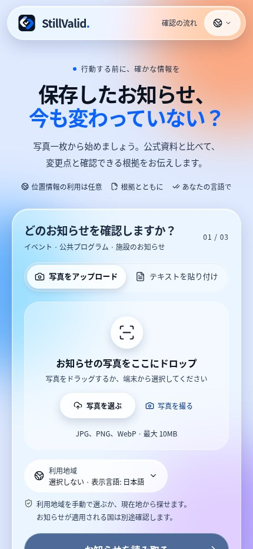
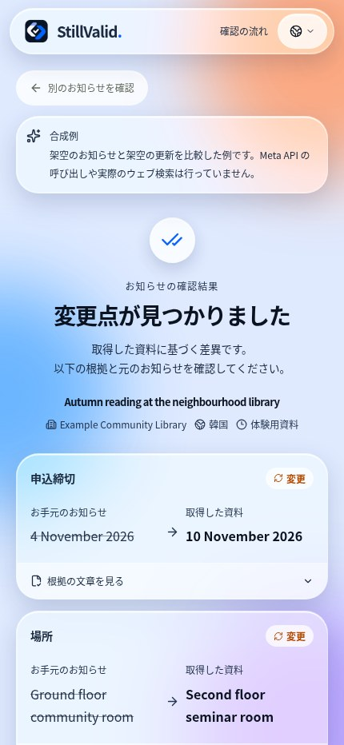
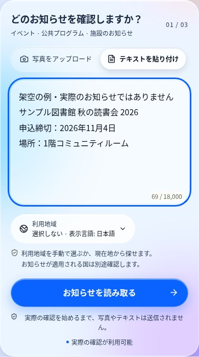
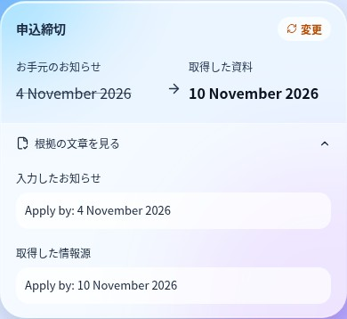
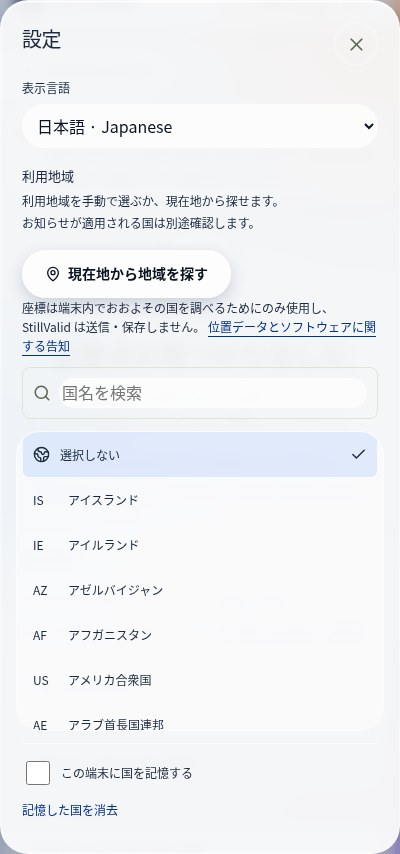
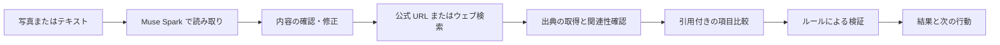

# StillValid

[](https://dev.meta.ai/docs/models) [](https://dev.meta.ai/docs/models) [](https://dev.meta.ai/docs) [](https://cerebralvalley.ai/e/meta-ai-developer-hackathon)

### 保存したお知らせは、今もそのままですか？

お知らせの写真やテキストを現在の公式資料と照らし合わせ、**変更点・原文の根拠・追加確認が必要な点**を表示するモバイル向けウェブアプリです。

[**アプリを開く**](https://stillvalid-beta.vercel.app) · [予備サイト](https://stillvalid-zoogom.vercel.app) · [English](README.en.md) · [한국어](README.ko.md) · [日本語](README.ja.md) · [デプロイガイド（英語）](../docs/deployment.md)

**Languages / 언어 / 言語 / اللغات:**

[English](README.en.md) · [한국어](README.ko.md) · [日本語](README.ja.md) · [简体中文](README.zh.md) · [Español](README.es.md) · [Français](README.fr.md) · [Deutsch](README.de.md) · [Português](README.pt.md) · [العربية](README.ar.md) · [Русский](README.ru.md)

Meta Global AI Developer Hackathon の **Indie developer 個人部門**、テーマ「Build for Your World」に向けて開発しました。インストールやアカウント登録は不要です。

## StillValid の特長

- **モデルは提案し、コードが判定します。** すべての変更は、お知らせと公式ページの両方に実在する引用で裏付けられる必要があり、[`compare.ts`](../src/lib/compare.ts) の決定的な検証器がそれ以外をすべて「要確認」に戻します。
- **公式情報源だけを根拠にします。** ブログ・SNS・検索の要約は根拠になりません。お知らせに印刷された `go.kr`/`gov` のリンクは自動入力され、なければ Meta 内蔵のウェブ検索が実在のページを提案します。
- **Meta のモデルで一貫して構築。** Muse Spark が読み取り・検索・比較を行い、SAM 3.1 が掲示板の中からお知らせを見つけ、結果は追加のモデル呼び出しなしで10言語で表示されます。

**デモ動画:** 制作中です。完成後にここと提出フォームへリンクを追加します。

## 目次

[利用例](#利用例-保存した申込期限) · [検証状況](#検証状況) · [画面](#画面を見る) · [使い方](#5つのステップ) · [機能](#現在の機能) · [結果の読み方](#結果の読み方) · [根拠の検証](#根拠の検証) · [開発者ノート](#開発者ノート) · [ローカル実行](#ローカル実行)

## 利用例: 保存した申込期限

1. **保存したお知らせ:** 架空の図書館案内には、申込期限が **11月4日**と記載されています。
2. **取得した資料:** アプリ内のサンプルが示す架空の更新案内では、期限が **11月10日**です。
3. **結果:** 変更前後の値と根拠の文章が表示されます。実際の確認では、出典の公式性・同一のお知らせか・引用の根拠も検証し、確認できなければ全体の結果は「確認が必要」になることがあります。

これはアプリ内の**合成サンプル**であり、実際の期限変更ではありません。ライブ検索やモデル呼び出しは行いません。

## 検証状況

| 項目 | 根拠と残っている作業 |
|---|---|
| 自動検査 | 最新の統合時に型チェック、**単体テスト205件**、**評価ハーネステスト7件**、本番ビルドが成功。ブラウザ検査7種類は、直前のアプリ版で固定レスポンスを使って成功しました。 |
| 実機 | 以前、利用者から iPhone の撮影・結果確認が1件報告されました。現在の iPhone・Android の総合検証、HEIC、地図アプリへの切り替えは未完了です。 |
| 実際のお知らせの精度 | 人手で正解を確認する10件の評価は未完了です。個別の観察結果は全体の精度を示しません。 |
| 速度 | 過去の少数サンプルでは結果にばらつきがありました。最新のリクエスト最適化後、実際のモデルによる再測定は行っていません。完了時間は保証できません。 |

[詳細な検証記録（英語）](../docs/validation.md) · [評価方法（英語）](../docs/evaluation.md) · [実装確認表（英語）](../docs/acceptance.md)

## 画面を見る

下の画像は実際の運用アプリを **2026年11月5日（KST）** に Chromium のモバイル幅で撮影したものです。結果は明示された**合成サンプル**であり、実際のお知らせをモデルで検証した結果ではありません。iPhone 実機の写真でもありません。[画像の出所](../docs/screenshots/readme/README.md)

<p align="center">
  
  
</p>

ホーム画面の3つのサンプルでは、変更・中止・別の回のお知らせをモデル呼び出しなしで試せます。

<details>
<summary><strong>テキスト入力と根拠の画面を見る</strong></summary>

入力欄は説明用の架空テキストです。根拠カードは別の組み込み合成サンプルであり、入力欄の内容をモデルで処理した結果ではありません。

<p align="center">
  
  
</p>

</details>

## 5つのステップ

1. **写真またはテキストを入力。** 撮影・画像選択、または18,000文字までのテキスト貼り付けができます。必要に応じて切り抜き・回転します。掲示板の写真では、任意の SAM 機能で対象領域を選べます。
2. **読み取った内容を確認。** タイトル、発行機関、回、国は直接修正できます。日付や場所などを直す場合は原文テキストを編集して再読み取りします。不鮮明な画像には追加確認の案内が出ます。
3. **出典を確認。** お知らせに印刷された公的機関のページが候補として入る場合があります。正しいか確認するか、発行元の HTTPS ページを入力します。URL がない場合は候補を検索します。
4. **結果と根拠を確認。** 変更前後を見て引用を開きます。確認が必要な場合は、理由を読み、公式ページを確認するか出典を変更してください。
5. **次の操作。** 出典を開く、場所を Google Maps で検索する、要約をコピーする、最新資料でもう一度確認する、結果を削除することができます。

> 鮮明に撮影し、発行元の正確なページ URL を指定すると検索を省略できます。URL を指定しても、同一性や根拠の検証は省略されません。

## 現在の機能

| 機能 | 動作 |
|---|---|
| 画像入力 | JPEG・PNG・WebP、最大10 MiB。ブラウザ内でプレビュー、切り抜き、回転、JPEG 再エンコード。HEIC/HEIF はブラウザがデコードできる場合のみ対応し、それ以外は JPEG を案内します。 |
| お知らせ領域の検出 | 任意の SAM 3.1 機能が**1枚の写真内**の領域を提案。複数候補の選択、元に戻す操作、手動切り抜きに対応します。複数写真の一括処理ではありません。 |
| 出典の検索 | Meta の内蔵ウェブ検索または入力された公式 URL。実際に返された・引用された候補を公式性と関連性で並べ、最大3ページを取得します。 |
| 出典の読み取り | HTML、プレーンテキスト、PDF のテキスト層。PDF は最大5 MB・20ページ。スキャン PDF の OCR は行わず、アクセス拒否、スクリプト専用、サイズ超過、時間切れを区別します。 |
| 根拠の比較 | 関連する最大2出典を対象に、項目別の変更、原文引用、出典リンク、確認時刻と不確実な理由を表示します。 |
| 地図 | ライブ結果の場所から Google Maps の**テキスト検索**を開けます。地図 API キーや埋め込み地図は不要です。アプリとウェブのどちらで開くかは端末次第で、地図検索は場所の正しさを保証しません。クリック時に選択した場所の文字列を送ります。 |
| 表示言語 | 日本語、韓国語、英語、簡体字中国語、スペイン語、フランス語、ドイツ語、ポルトガル語、アラビア語、ロシア語。アラビア語は RTL に対応。元の値や引用は翻訳しません。 |
| 任意の利用地域 | 249の国・地域を選択可能。言語やお知らせに書かれた国とは別です。現在地からの推定は明示的な操作と許可が必要で、座標はブラウザ内で処理します。世界中のお知らせの検証を保証するものではありません。 |
| 復旧と管理 | 進行状況、経過時間、キャンセル、保存済み結果の復旧、要約コピー、再確認、個別削除とセッション全体の削除。 |

<details>
<summary><strong>表示言語と利用地域の設定画面</strong></summary>

<p align="center"></p>

言語変更は表示とコピー用要約を切り替えます。同じ事実確認の再実行や引用の翻訳は行いません。地域の記憶は任意で、解除できます。現在地で推定した地域をお知らせの国には設定しません。

</details>

## 結果の読み方

| 状態 | 意味 | 次の操作 |
|---|---|---|
| 変更 | 少なくとも1件の変更が根拠検証を通過し、全体の結論を保留する理由がない。 | 両方の引用と最新の公式案内を確認します。 |
| 一致 | 確認した項目が取得資料と一致。 | 確認範囲と時刻を確認します。すべての詳細が不変である保証ではありません。 |
| 中止 | 同じお知らせに対する明示的で現在有効な中止が検証された。 | 予定を変更する前に出典を確認します。 |
| 期限経過 | 検証された明示的な期限が確認時刻より前。 | 最新の期限や延長情報を確認します。 |
| 確認が必要 | 同一性、公式性、表現、確認範囲、衝突や不完全な根拠により全体の結論を確定できない。 | 理由を確認し、URL を修正するか発行元へ問い合わせます。 |
| 確認できない | 使用可能な出典を取得できなかった。 | 発行元の正確なページを試すか、直接確認します。 |

個別の項目に検証済み根拠があっても、**全体は確認が必要**になることがあります。変更が見つからないことは、変更がない証明ではありません。

### うまく確認できないとき

- ページに情報があっても「確認が必要」なら、機関・回・引用の表現を確認してください。値が存在するだけでは、同じお知らせの公式情報とは限りません。
- ページを読めない場合は一覧ページではなく個別の公式ページ、またはテキスト選択可能な PDF を試してください。ログイン制限やスキャン PDF は迂回しません。
- 時間がかかる場合は正確な公式 URL を入力し、進行状況を確認してください。必要であればキャンセルできます。
- HEIC が開けない環境では JPEG を試してください。Google Maps のアプリ／ウェブ選択は端末やブラウザに依存します。

## 根拠の検証



Spark の既定モデルは `muse-spark-1.3-contributor` です。読み取りと比較は厳密な JSON スキーマを使う Chat Completions、検索は内蔵ウェブ検索を使う Responses を利用します。任意で SAM 3.1 による領域検出を先に実行できます。

モデルが比較を提案し、[`compare.ts`](../src/lib/compare.ts) が原文引用、登録された公式ドメイン、機関・タイトル・回・該当箇所を再検証します。住民投稿、別の回、アーカイブ・撤回表示は検証を妨げることがあります。欠けた年・時刻・タイムゾーンは補いません。中止は同じイベントに関する現在の明示的な記述が必要で、対応する文法は一部の英語・韓国語表現に限られます。

これらはモデル出力を制約する仕組みであり、一般的な正確性の証明や発行元への確認の代わりにはなりません。

## 速度と限界

- **先行確認:** 読み取り後350ミリ秒を経て、ユーザーの確認中に処理を開始できます。内容・地域・URL を変更すると古い要求を中止します。表示言語のみの変更では同じ事実確認を再利用できます。提供元に到達した呼び出しは課金される場合があります。
- **読み取りの再利用:** 同一入力・同一国の明確な読み取り結果を、タブ内メモリで10分間再利用できます。リセット・画面のアンマウント時に消去し、不確実な読み取りは保存しません。**最新の出典取得と最終判定はキャッシュしません。**
- **取得と比較:** DNS・リダイレクト・取得全体に15秒、個々の通信に12秒の上限があります。最初の2候補は関連資料の到着時に比較を開始できます。完全に同一のリダイレクト先は比較を共有します。
- **入力の削減:** 条件を満たす白い余白や明示的なナビゲーション要素を減らし、お知らせの本文を残します。安定したキャッシュキーと最小推論設定を使用します。

完了時間は保証できません。最新の最適化後の実モデル速度は未測定で、中央値15秒／90パーセンタイル30秒の目標達成は確認されていません。[性能説明（英語）](../docs/performance.md)

## プライバシーと利用上限

**既定の contributor モデルに送信した入力は、Meta の条件に従い、今後の Meta モデルの学習に使われます。** アプリは10言語で説明しています。StillValid で結果を削除しても、提供元が保持するデータまで削除されるわけではありません。

- 元の画像ファイルは StillValid に永続保存されません。結果と必要な原文・引用は匿名セッションに属し、24時間の有効期限と削除機能があります。
- モデルキーはサーバー専用です。HTTPS・公開 IP・リダイレクトの検証と DNS 固定を行います。アプリの診断ログにお知らせや出典の本文、認証情報、Cookie、元の IP は記録しません。
- 既定の上限は **UTC 1日300モデル呼び出し**、全体で同時3件・1分間10開始、セッションごとに1時間60読み取り・40確認、ネットワークごとに1時間200開始です。呼び出し数の制限であり、**金額の上限ではありません**。[上限定義](../src/lib/limits.ts)

スクリプト専用ページ、スキャン PDF、曖昧な同一性、未対応の中止表現は確認できない場合があります。本アプリは資格判断、緊急案内、医療・法律上の判断を行いません。

## 開発者ノート

ブラウザ → Next.js API → Meta Model API／公式 HTTPS 出典 → Redis または SQLite → ルールによる判定、という流れです。キーと利用上限はサーバーで扱い、結果の表示文は10言語の辞書から取得します。

| ステップ | 実装 | 主な制限 |
|---|---|---|
| 画像準備 | 長辺を最大2,400pxに縮小し、JPEG 品質 `0.92 → 0.80 → 0.68 → 0.55` を試します。条件を満たす白い外周だけを削除します。 | 入力10 MiB、エンコード文字列3,800,000文字。再エンコードで多くの EXIF を除去します。 |
| 任意の領域検出 | SAM 3.1 Responses の既定 `document`、必要に応じ `poster` を試します。 | 既定経路で最大2回のモデル呼び出し、各30秒。領域検出は文字の読み取り精度を保証しません。 |
| 読み取り | Spark Chat Completions の厳密な JSON。写真は `originalText` を転記し、テキスト入力は全文をモデルに再出力させません。抽出値は原文引用に含まれる必要があります。 | 最初の試行60秒、速い失敗に限る再試行、サーバー全体130秒。画像／テキストの出力上限6,000／4,500トークン。 |
| 検索 | URL がなければ Responses `web_search` の実際の結果・引用 URL を取得し、公式性とタイトル関連性で並べ替えます。 | 最大3ページ。検索要約を根拠にしません。`META_SEARCH_MAX_TOOL_CALLS` は既定で未設定。 |
| 取得 | 最大3候補を並列取得。HTML 表のセルを保ち、PDF テキスト層を読み、無関係なページは比較対象から除きます。 | 全体15秒、個別12秒、リダイレクト最大3回、HTML・テキスト600,000バイト、抽出テキスト22,000文字、PDF 5,000,000バイト・20ページ。 |
| 比較・判定 | 関連する最初の2候補は到着時に比較開始可能。最大2出典を優先順に選び、引用・公式性・同一性・範囲をコードで検証します。 | 比較ごとに100秒・12,000出力トークン。公式出典の結果等に応じ残りに30秒の猶予を与えます。取得と比較時間は重複します。 |

### モデルと API

| 機能 | 既定モデル | API | 上書き変数 |
|---|---|---|---|
| 読み取り | `muse-spark-1.3-contributor` | Chat Completions、厳密な JSON | `META_EXTRACTION_MODEL` |
| 出典検索 | 同上 | Responses + `web_search` | `META_SEARCH_MODEL` |
| 項目比較 | 同上 | Chat Completions、厳密な JSON | `META_COMPARISON_MODEL` |
| 任意の領域検出 | `sam-3.1` | Responses、概念プロンプト | `SAM_MODEL` |

Spark の優先順位は **ステップ別変数 → META_MODEL → 既定値**、推論強度の既定値は `minimal` です。本番ビルドはモデル一覧を読み取り専用で確認します。モデル変更には再デプロイと10言語のプライバシー案内の確認が必要です。

### 判定とセキュリティ

引用が原文と出典に存在し、それぞれの値を含むことを確認します。確認済み公式ドメインは必要ですが、それだけで同一のお知らせとは判定しません。機関、タイトル、回、引用の範囲、アーカイブ・撤回表示、日付や現在の中止表現を確認し、不完全・衝突・未検証の根拠は確認が必要な結果に残します。区分のない複数のお知らせが混在する場合は、範囲の判断にモデル解釈が影響する可能性があります。

出典は認証情報なしの HTTPS 443 に限定し、内部ホストや非公開・予約 IP を拒否します。DNS の結果に接続を固定し、リダイレクトごとに再検証します。書き込みは同一オリジンと HTTP-only の匿名セッションを使います。NDJSON の確認応答は10秒ごとに heartbeat を送り、45秒間データがない場合はブラウザが中止します。受信済み結果は後続の通信エラーで消えず、保存済み結果はモデルを再呼び出しせずに復旧できます。

### 過去の観察と残課題

過去の本番版における小規模な観察です。公開情報を再構成した入力を使用し、写真風の画像は実際の iPhone 撮影ではありません。最新最適化後の速度ではなく、一般的な精度・速度を保証しません。[詳細記録（英語）](../docs/validation.md#2026-11-04-production-with-muse-spark-13-contributor-f671f3b)

| 観察 | 結果 | 範囲 |
|---|---|---|
| contributor モデル、公式 URL、ソウルと Smithsonian 各2回 | 4回の中央値24.3秒 | ソウルは変更2/2、Smithsonian は確認が必要2/2 |
| 以前の Spark 1.3、最小推論、同じケース | 4回の中央値26.8秒 | 旧版の読み取りから結果まで |
| 旧モデルの既定推論／`low` | 中央値45.6秒／34.6秒 | 各4回。ソウルはそれぞれ確認が必要2/2、変更1/2 |
| 先行確認、ソウルのテキスト1回 | クリック後3.9秒、全体19.4秒 | 10秒のユーザー確認を含む。モデル自体が速くなったことを示すものではありません。 |
| 先行確認、URL なしの Smithsonian テキスト1回 | クリック後7.9秒、全体26.3秒、確認が必要 | 検索と15秒のユーザー確認を含む1回の観察。 |
| 別の読み取りモデル | Spark 1.2: 2.0–4.5秒、1.1: 2.4–7.9秒 | 各4回。ソウルのタイトル誤読があり、検索・比較の性能は未測定。 |

別のユーザー報告による iPhone カメラでの確認は約3分かかり、取得した日付が欠けて確認が必要となりました。後続の改善後に同じケースを再測定していません。10件の精度評価、代表的な速度分布、Android・HEIC・地図アプリの実機検証は未完了です。

## ローカル実行

Node.js **24** と npm が必要です。

```bash
git clone https://github.com/ZOOGOM/stillvalid.git
cd stillvalid
npm ci
cp .env.example .env.local
npm run dev
```

`http://localhost:3000` を開いてください。合成サンプルは Meta キーなしで利用できます。ライブ確認には `.env.local` に `META_API_KEY` を安全に設定します。ローカル単一サーバーは SQLite、Vercel では書き込み可能な Redis REST 設定を使用します。キーをコミットしないでください。

<details>
<summary><strong>環境変数とモデル選択</strong></summary>

| 変数 | 用途 |
|---|---|
| `META_API_KEY` / `MODEL_API_KEY` | サーバー専用 Meta 認証情報。 |
| `META_MODEL` | 3つの Spark ステップの共通モデル。既定は `muse-spark-1.3-contributor`。 |
| `META_EXTRACTION_MODEL`, `META_SEARCH_MODEL`, `META_COMPARISON_MODEL` | ステップ別の任意上書き。共通設定のみなら未設定にします。 |
| `SAM_MODEL` | 任意の領域検出モデル。既定 `sam-3.1`。 |
| `META_REASONING_EFFORT_EXTRACTION`, `META_REASONING_EFFORT_SEARCH`, `META_REASONING_EFFORT_COMPARISON` | 既定 `minimal`。`none` はパラメータの省略を意味し、提供元の「推論なし」モードではありません。 |
| `META_SEARCH_MAX_TOOL_CALLS` | 任意の検索ツール上限1〜5。変更・中止の検索を制限しないため既定は未設定。 |
| `UPSTASH_REDIS_REST_URL`, `UPSTASH_REDIS_REST_TOKEN` | 書き込み可能なホスト用ストレージ。`KV_REST_API_URL` / `KV_REST_API_TOKEN` の完全なペアも利用可能。混用不可。 |
| `APP_URL` | 外部からアクセスする正確な origin。 |
| `DAILY_MODEL_CALL_LIMIT` | UTC 1日あたりのモデル呼び出し数。既定300。 |
| `IP_RATE_LIMIT_SECRET` | ネットワーク単位の制限に用いる任意の専用秘密値。 |
| `VERIFIED_SOURCE_HOSTS` | 別途公式性を確認した追加機関ドメイン。 |
| `DATABASE_PATH` | 単一サーバーでの SQLite パス。 |
| `STILLVALID_VERIFY_DEPLOYMENT` | 任意のホスティング検証。`1` は有料の実モデル読み取りを1回実行します。意図的な検査以外は `0` にします。 |

環境変数の変更には再デプロイが必要です。モデル変更前に10言語のプライバシー案内を確認してください。`/api/status` はデプロイ SHA や有効なモデル設定を示しますが、推論成功の証明ではありません。[.env.example](../.env.example) · [デプロイガイド（英語）](../docs/deployment.md)

</details>

<details>
<summary><strong>検査コマンド・API・コード構成</strong></summary>

```bash
npm run check                 # 型チェック + 単体テスト + 評価フィクスチャ
npm run build
npm start
# ローカルサーバー起動と Chromium インストール後:
npm run test:browser
npm run test:browser-maps
npm run test:browser-locate
npm run test:browser-stream
npm run test:browser-prefill
npm run test:browser-early
npm run test:browser-image
```

基本 README と英語版は同じ内容で、相対リンクはファイルの場所に合わせています。変更後、コミット前に `node scripts/check-readme-sync.mjs` で確認します。リンクを解決した後に内容を比較し、差分がある場合は終了ステータスが0以外になります。これは手動確認であり、自動 CI ゲートではありません。

ブラウザ検査は固定レスポンスを使い、モデルを呼び出しません。実機テストや完全なアクセシビリティ準拠の証明にはなりません。`npm run verify:meta` はキーを必要とする読み取り専用モデル一覧確認です。ライブ評価と任意のホスティング検証には費用が発生する場合があります。

| API | 用途 |
|---|---|
| `GET /api/status`, `GET /api/demo` | 設定の準備状態、合成サンプル。 |
| `POST /api/extract`, `POST /api/locate` | 入力の読み取り、任意の領域検出。 |
| `POST /api/checks` | `created`・`phase`・`ping`・`result`・`error` を NDJSON で配信。 |
| `GET /api/checks/{id}`, `DELETE /api/checks/{id}` | セッション所有の結果取得、削除・キャンセル。 |
| `DELETE /api/session` | セッション結果の一括削除。 |

主なコードは [`app.tsx`](../src/components/app.tsx)、[`meta.ts`](../src/lib/meta.ts)、[`compare.ts`](../src/lib/compare.ts)、[`source-planning.ts`](../src/lib/source-planning.ts)、[`source.ts`](../src/lib/source.ts)、[`request-efficiency.ts`](../src/lib/request-efficiency.ts) です。ストレージ・制限・言語辞書は `src/lib`、テストとブラウザスクリプトは `tests`・`scripts` にあります。

</details>

## ライセンス

オリジナルのソースコードは [MIT](../LICENSE) です。外部ライブラリ、モデル、コンテンツにはそれぞれの条件が適用されます。アプリのフッターは **Copyright 2026 Zoogom. All rights reserved.** のままです。
