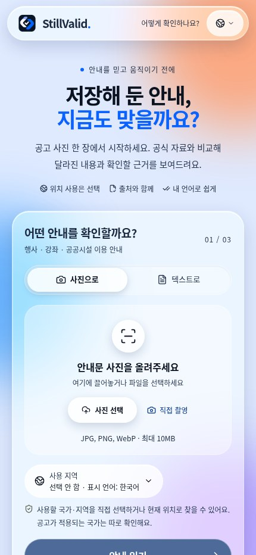
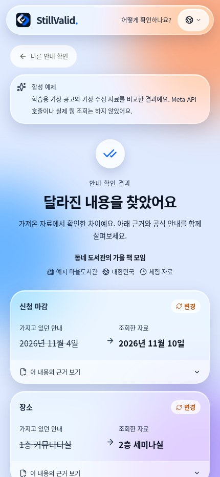
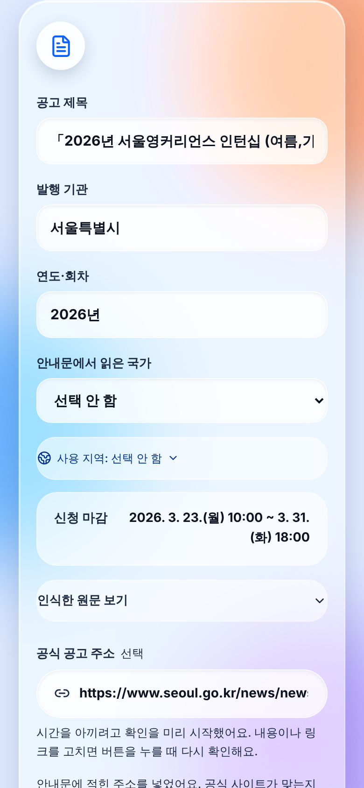
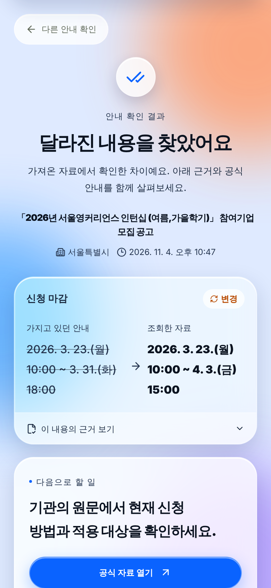
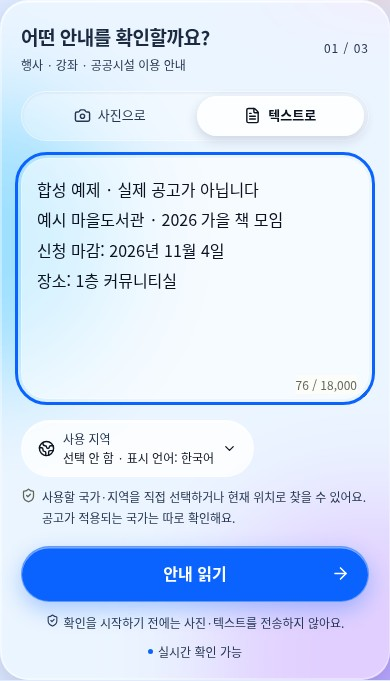
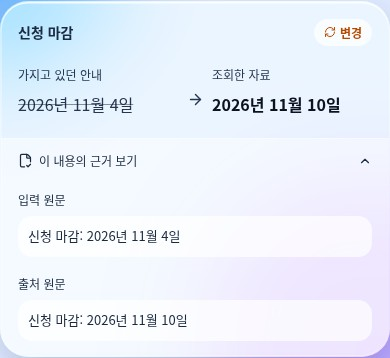
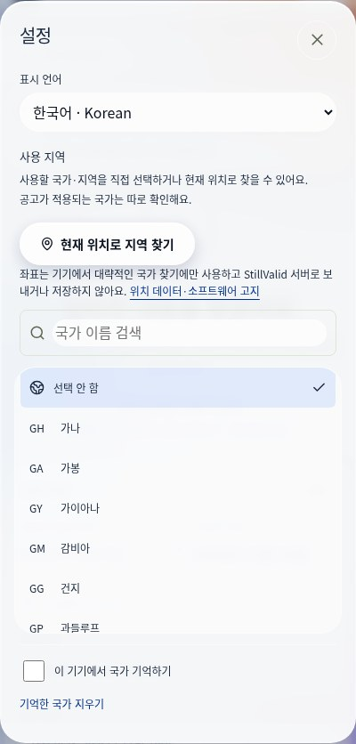
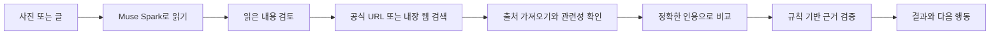

# StillValid · 지금도 맞나요

[](https://dev.meta.ai/docs/models) [](https://dev.meta.ai/docs/models) [](https://dev.meta.ai/docs) [](https://cerebralvalley.ai/e/meta-ai-developer-hackathon)

### 저장해 둔 공고, 지금도 그대로일까요?

공고 사진이나 붙여 넣은 글을 현재 공식 자료와 비교합니다. 행동하기 전에 **바뀐 내용, 원문 근거, 아직 확인해야 할 점**을 함께 살펴보세요.

[**앱 열기**](https://stillvalid-beta.vercel.app) · [English](README.en.md) · [日本語](README.ja.md) · [프로젝트 소개](../README.md) · [배포 가이드](../docs/deployment.md)

**Languages / 언어 / 言語 / اللغات:**

[English](README.en.md) · [한국어](README.ko.md) · [日本語](README.ja.md) · [简体中文](README.zh.md) · [Español](README.es.md) · [Français](README.fr.md) · [Deutsch](README.de.md) · [Português](README.pt.md) · [العربية](README.ar.md) · [Русский](README.ru.md)

Meta Global AI Developer Hackathon **Indie developer 개인 부문**, “Build for Your World” 주제로 개발했습니다. 설치나 회원가입 없이 사용할 수 있습니다.

## 왜 StillValid인가

- **모델은 제안하고, 코드가 판정합니다.** 모든 변경은 공고와 공식 페이지 양쪽에 실제로 존재하는 인용문으로 뒷받침되어야 하며, [`compare.ts`](../src/lib/compare.ts)의 결정적 검증기가 그 외는 전부 "확인 필요"로 돌려보냅니다.
- **공식 출처만 근거로 씁니다.** 블로그·SNS·검색 요약은 근거가 되지 않습니다. 공고에 적힌 `go.kr`/`gov` 링크는 자동으로 채워지고, 없으면 Meta 내장 웹 검색이 실제 페이지를 제안합니다.
- **Meta 모델로 끝까지 만들었습니다.** Muse Spark가 읽고, 찾고, 비교하며, SAM 3.1이 복잡한 게시판에서 공고를 찾고, 결과는 추가 모델 호출 없이 10개 언어로 보입니다.

**시연 영상:** 제작 중입니다. 완성되면 여기와 제출 양식에 링크를 추가합니다.

## 빠른 목차

[대표 사례](#대표-사례-저장해-둔-신청-마감) · [검증 현황](#한눈에-보는-검증-현황) · [화면](#화면으로-살펴보기) · [사용 방법](#다섯-단계로-확인하기) · [기능](#현재-사용할-수-있는-기능) · [결과 읽기](#결과를-읽는-방법) · [근거 검증](#근거를-확인하는-원리) · [개발자 노트](#개발자-노트-실제-처리-과정) · [직접 실행](#직접-실행하고-개발하기)

## 대표 사례: 저장해 둔 신청 마감

1. **가진 공고:** 가상의 도서관 안내에 신청 마감이 **11월 4일**로 적혀 있습니다.
2. **조회한 자료:** 앱의 예제가 제공하는 가상의 수정 안내에는 **11월 10일**로 적혀 있습니다.
3. **결과:** StillValid가 변경 전후 값과 근거 문구를 보여 줍니다. 실제 검사에서는 출처의 공식성·공고 동일성·근거도 검증해야 하며, 충족하지 못하면 전체 결과가 **확인 필요**가 될 수 있습니다.

이 사례는 앱에 포함된 **합성 예제**이며 실제 마감 변경이 아닙니다. 실시간 조회나 모델 호출을 하지 않습니다.

## 한눈에 보는 검증 현황

| 영역 | 근거와 남은 작업 |
|---|---|
| 자동 검사 | 최신 통합에서 타입 검사, **단위 시험 205개**, **평가 도구 시험 7개**, 운영 빌드가 통과했습니다. 브라우저 검사 7종은 직전 앱 릴리스에서 고정 응답으로 통과했습니다. |
| 실기기 | 이전 iPhone 촬영·결과 확인 사례가 사용자에게서 보고됐습니다. 현재 버전의 iPhone·Android 종합 검사, HEIC와 지도 앱 연결 검사는 미완료입니다. |
| 실제 공고 정확도 | 사람이 검토한 정답을 사용하는 10건 전체 평가는 미완료입니다. 개별 관찰만으로 전체 정확도를 나타낼 수 없습니다. |
| 속도 | 이전 소규모 측정의 편차가 컸습니다. 최신 요청 최적화 후 실제 모델로 다시 측정하지 않았으며 완료 시간은 보장되지 않습니다. |

[상세 검증 기록](../docs/validation.md) · [평가 방법](../docs/evaluation.md) · [구현 확인표](../docs/acceptance.md)

## 화면으로 살펴보기

**2026년 11월 5일(KST)에 직접 캡처한 실제 운영 앱 화면입니다.** 아래 결과는 화면에 표시된 앱 내 **합성 예제**이며, 실제 공고를 모델로 검증한 결과가 아닙니다. 휴대폰 너비의 Chromium 화면으로, iPhone 실기기 사진과는 구분합니다. [캡처 정보](../docs/screenshots/readme/README.md).

<p align="center">
  
  
</p>

**공고 넣기 → 변경 전후와 근거 확인.** 첫 화면의 세 가지 예제에서 변경·취소·다른 회차 사례를 체험할 수 있습니다. 예제는 모델을 호출하지 않습니다.

### 이전 실제 운영 검사의 화면

아래는 이전 운영 버전에서 서울시 공개 공고를 바탕으로 **재구성한 텍스트**와 공식 페이지를 비교했던 화면입니다. 공고의 이전 마감일은 비교 시험을 위해 인위적으로 바꾼 값이며, 실제 과거 마감 변경을 증명하지 않습니다. 이후 코드와 배포가 바뀌었으므로 현재 성능을 뜻하지 않습니다. [실험 기록](../docs/validation.md).

<p align="center">
  
  
</p>

## 다섯 단계로 확인하기

1. **사진이나 글을 넣습니다.** 직접 촬영하거나 기기에서 사진 한 장을 고르고, 또는 최대 18,000자의 글을 붙여 넣습니다. 글자가 잘 보이게 자르거나 회전하세요. 게시판 사진에서는 선택 기능인 SAM 공고 찾기로 영역을 제안받고 읽을 공고를 고를 수 있습니다.
2. **읽은 내용을 검토합니다.** 제목·기관·회차·공고 국가는 직접 고칠 수 있습니다. 날짜·장소 등 추출된 값을 고치려면 원문 텍스트를 수정하고 다시 읽어 주세요. 흐리거나 불완전하게 읽힌 공고에는 추가 검토 안내가 나옵니다.
3. **출처 주소를 확인합니다.** 공고에 적힌 공공기관 페이지 주소가 인식되면 링크가 제안될 수 있습니다. 맞는 주소인지 확인하거나 발행 기관의 정확한 HTTPS 페이지를 넣으세요. 링크가 없으면 후보를 검색합니다.
4. **비교 결과와 근거를 봅니다.** 변경 전후 값을 살펴보고 ‘이 내용의 근거 보기’를 펼칩니다. ‘확인 필요’라면 전체 결론을 확정할 근거가 충분하지 않다는 뜻이므로 이유와 원문을 확인하세요.
5. **다음 행동을 선택합니다.** 출처 열기, Google Maps에서 장소 검색, 결과 요약 복사, 최신 자료로 다시 확인, 결과 삭제를 할 수 있습니다.

> **더 빠르게 확인하려면:** 글자가 선명하고 공고가 크게 보이는 사진과 발행 기관의 정확한 공고 주소를 사용하세요. 직접 링크는 검색을 생략하지만, 공고 동일성·근거 검증까지 생략하지는 않습니다.

<details>
<summary><strong>텍스트 입력과 원문 인용 화면 보기</strong></summary>

입력 화면은 설명용 글입니다. 근거 카드는 앱 내 합성 예제에서 가져온 화면이며, 해당 입력을 모델로 처리한 결과가 아닙니다.

<p align="center">
  
  
</p>

</details>

## 현재 사용할 수 있는 기능

| 기능 | 현재 동작 |
|---|---|
| 사진 입력 | JPEG·PNG·WebP, 최대 10MB. 브라우저에서 미리보기·자르기·회전·JPEG 재인코딩을 합니다. HEIC/HEIF는 브라우저가 해독할 수 있을 때 변환하며, 지원하지 않으면 JPEG 사용 방법을 안내합니다. |
| 선택형 공고 찾기 | SAM 3.1이 **사진 한 장 안의** 공고 영역을 제안합니다. 여러 영역은 번호로 선택하며 되돌리기·직접 자르기가 가능합니다. 여러 사진을 한꺼번에 처리하는 기능은 아닙니다. |
| 출처 검색 | Meta 내장 웹 검색 또는 사용자가 제공한 공식 URL. 실제 반환·인용된 후보를 공식성·공고 관련성 순으로 정렬한 뒤 최대 3개 페이지를 선택합니다. |
| 자료 읽기 | HTML·일반 텍스트·PDF 텍스트층. PDF는 최대 5MB·20쪽이며 스캔 PDF에는 OCR을 하지 않습니다. 접근 차단·스크립트 전용·크기 초과·시간 초과를 구분해 안내합니다. |
| 근거 비교 | 관련 자료 최대 2개를 비교해 항목별 변경, 원문 인용, 출처 링크, 확인 시각과 불확실한 이유를 보여 줍니다. |
| 지도 연결 | 실제 검사 결과의 장소 카드에서 Google Maps **텍스트 검색**을 열 수 있습니다. 지도 API 키나 내장 지도는 쓰지 않습니다. 앱·웹 중 어디로 열리는지는 기기에 따라 다르며, 지도 검색이 장소의 정확성을 검증하지는 않습니다. 누른 장소 글자만 전달합니다. |
| 표시 언어 | 한국어·영어·중국어 간체·스페인어·프랑스어·독일어·일본어·포르투갈어·아랍어·러시아어. 아랍어는 RTL을 지원합니다. 원문 값과 인용은 번역하지 않습니다. |
| 선택형 사용 지역 | 249개 국가·지역 선택. 언어·공고 국가와 별개입니다. 현재 위치로 지역 찾기는 직접 누르고 브라우저 권한을 허용할 때만 작동하며, 좌표는 기기 안에서 처리합니다. 전 세계 공고 검증을 보장하는 기능은 아닙니다. |
| 복구와 관리 | 진행 단계·경과 시간·취소, 저장된 결과 복구, 요약 복사, 다시 확인, 개별 삭제와 세션 전체 삭제를 지원합니다. |

<details>
<summary><strong>언어·지역 설정 화면 보기</strong></summary>

<p align="center"></p>

언어를 바꾸면 화면과 복사할 요약의 표시가 바뀝니다. 근거를 번역하거나 같은 사실 검사를 다시 실행하지 않습니다. 지역 기억은 선택 사항이며 지울 수 있습니다. 위치로 찾은 지역을 공고 국가로 사용하지 않습니다.

</details>

## 결과를 읽는 방법

| 상태 | 의미 | 다음 행동 |
|---|---|---|
| **변경** | 하나 이상의 변경이 근거 검증을 통과했고, 전체 결과를 보류할 사유가 없습니다. | 양쪽 인용문을 읽고 현재 공식 안내를 확인하세요. |
| **일치** | 확인한 항목들이 조회한 자료와 같습니다. | 확인 범위와 시각을 보세요. 모든 세부 내용이 그대로라는 보장은 아닙니다. |
| **취소** | 같은 공고에 대한 명시적이고 현재 유효한 취소 안내가 검증됐습니다. | 계획을 바꾸기 전에 출처를 여세요. |
| **마감 경과** | 검증된 명시적 시각이 확인 시각보다 이전입니다. | 실제 마감과 연장 안내가 있는지 확인하세요. |
| **확인 필요** | 동일성·공식성·표현·확인 범위 또는 충돌·불완전한 근거 때문에 전체 결론을 확정하기 어렵습니다. | 이유를 살피고 출처를 수정하거나 발행 기관에 확인하세요. |
| **확인 불가** | 사용할 수 있는 출처를 가져오지 못했습니다. | 정확한 공식 페이지를 넣거나 직접 확인하세요. |

일부 항목의 근거가 검증됐더라도 **전체 결과는 확인 필요**일 수 있습니다. 변경을 찾지 못한 것과 변경이 없는 것은 다릅니다.

### 확인이 잘 안 될 때

| 보이는 상황 | 시도할 방법 |
|---|---|
| 페이지에 정보가 있는데도 ‘확인 필요’로 나옴 | 기관·회차와 정확한 인용 표현을 확인하세요. 값이 있다는 사실만으로 해당 공고의 정보이거나 공식 자료라는 점까지 확인되지는 않습니다. |
| 출처를 읽지 못함 | 포털·목록 대신 공고 자체의 페이지나 글자를 선택할 수 있는 PDF를 사용하세요. 로그인 제한·스크립트 전용 페이지·스캔 PDF를 우회하지 않습니다. |
| 확인이 오래 걸림 | 정확한 공식 URL을 제공하고 진행 단계·시간을 살펴보세요. 필요하면 취소할 수 있습니다. 같은 느린 검사를 반복 시작하면 공용 호출 한도를 더 사용할 수 있습니다. |
| HEIC가 열리지 않거나 지도가 웹으로 열림 | 이미지 해독을 지원하지 않는 환경에서는 JPEG를 사용하세요. 지도 앱·웹 선택은 기기·브라우저의 동작에 따르며 StillValid가 보장하지 않습니다. |

## 근거를 확인하는 원리



요청하면 읽기 전에 SAM 3.1로 공고 영역을 찾습니다. Spark 단계의 기본 모델은 `muse-spark-1.3-contributor`입니다. 읽기·비교는 엄격한 JSON 스키마를 사용하는 Chat Completions, 검색은 내장 웹 검색을 사용하는 Responses로 처리합니다.

모델이 비교 결과를 제안하면 [`compare.ts`](../src/lib/compare.ts)가 다시 검증합니다.

- **인용이 실제로 있어야 합니다.** 허용된 공백 정규화 범위 안에서 공고와 출처의 원문에 존재해야 합니다. 검색 요약이나 모델의 추측을 가져온 자료 대신 쓸 수 없습니다.
- **공식성과 공고 동일성을 확인합니다.** 등록된 공식 도메인은 필요조건일 뿐 충분조건은 아닙니다. 제목·기관·회차·해당 구간의 범위를 확인하며, 주민 게시물 경로·다른 회차·보관 또는 철회 표시가 있으면 검증을 보류할 수 있습니다.
- **날짜는 적힌 그대로 보존합니다.** 없는 연도·시각·시간대를 만들지 않고, 해석이 모호한 숫자 날짜는 불확실하게 남깁니다.
- **취소는 현재의 명시적 선언이어야 합니다.** 부정·조건·과거 사례·다른 행사의 취소는 인정하지 않습니다. 현재 취소 판정 문법은 일부 한국어·영어 표현으로 제한됩니다.
- **빠진 근거를 숨기지 않습니다.** 가져오기 실패, 미완료 비교, 누락 항목, 출처 간 충돌은 확인 필요 사유가 될 수 있습니다.

이 검증은 모델 출력을 제한하는 장치입니다. 일반적인 정확도를 입증하거나 발행 기관의 판단을 대신하지 않습니다.

## 속도 개선과 아직 확인하지 못한 점

| 개선 | 줄이는 작업·대기 |
|---|---|
| 350ms 후 선행 검사 시작 | 읽은 내용을 검토하는 동안 확인을 진행합니다. 공고·지역·링크 수정 시 이전 요청을 취소하고, 표시 언어만 바꾸면 기존 검사를 재사용할 수 있습니다. 이미 제공자에 도달한 호출은 과금될 수 있습니다. |
| 명확한 읽기 결과 한 건을 탭 메모리에 보관 | 같은 입력·국가의 추출을 10분 동안 재사용합니다. 초기화·화면 컴포넌트 종료 시 지우며, 불확실한 읽기는 보관하지 않습니다. **최신 출처 조회와 최종 유효성 검사는 캐시하지 않습니다.** |
| 출처 요청 전체 시간 제한 | DNS·리디렉션·자료 수신 전체에 15초 예산을 적용하고, 개별 요청의 12초 제한도 유지합니다. 시간 초과는 ‘변경 없음’이 아닌 실패 사유로 표시합니다. |
| 비교를 더 일찍 병렬 실행 | 처음 두 후보의 관련 자료가 도착하면 비교를 시작하되 최종 출처 선택 순서는 유지합니다. 동일 페이지로 연결된 정확한 중복은 비교를 재사용합니다. |
| 불필요한 입력 감소 | 공고 글자를 유지하면서 빈 흰 여백과 표시된 웹페이지 탐색 요소를 줄입니다. Spark 단계에 안정된 프롬프트 캐시 키와 최소 추론 설정을 적용합니다. |

**완료 시간을 보장하지 않습니다.** 이전 소규모 검사에서도 소요 시간이 크게 달랐습니다. 최신 요청 최적화는 오프라인 회귀 검사를 통과했지만, 이후 실제 모델 지연을 다시 측정하지는 않았습니다. 중앙값 15초·p90 30초 목표 달성도 입증되지 않았습니다. [성능 설명](../docs/performance.md) · [날짜별 검증 기록](../docs/validation.md).

시간이 초과돼도 입력을 유지합니다. 이미 받은 결과는 뒤늦은 연결 오류로 사라지지 않으며, 저장된 결과가 있으면 모델을 다시 부르지 않고 복구할 수 있습니다. 브라우저 대기 상한은 읽기 150초·확인 200초·영역 찾기 80초입니다. 이는 예상 소요 시간이 아니라 실패 처리 상한입니다.

## 개인정보·한도·검증 현황

**Meta 약관에 따라 기본 contributor 모델에 보낸 내용(사진·글과 모델 응답)은 향후 Meta 모델 학습에 사용됩니다.** 앱은 이를 10개 표시 언어로 안내합니다. StillValid에서 결과를 삭제해도 제공자가 보유한 데이터까지 삭제되지는 않습니다.

- StillValid는 원본 이미지 파일을 영구 저장하지 않습니다. 결과와 필요한 텍스트·인용은 익명 세션에 속하며 24시간 만료 정책과 삭제 기능을 적용합니다. 읽기 캐시는 탭 메모리만 사용합니다. [저장소 구현](../src/lib/redis-store.ts).
- 모델 키는 서버에만 둡니다. 자료를 가져올 때 HTTPS·공개 주소·모든 리디렉션을 검증하고 DNS 조회 결과와 연결 주소를 고정합니다. 앱 진단 로그에는 공고·출처 원문, 인증정보, 쿠키, 원본 IP 주소를 기록하지 않습니다.
- 기본 한도: **UTC 하루 모델 호출 300회**, 전체 동시 작업 3개·분당 시작 10회, 세션·시간당 읽기 60회·확인 40회, 네트워크·시간당 시작 200회입니다. 호출 횟수 제한이며 **금액 상한은 아닙니다.** [한도 정의](../src/lib/limits.ts).

| 검증 항목 | 2026년 11월 5일(KST) 기준 |
|---|---|
| 이 문서가 설명하는 앱 버전의 자동 검사 | 직전 릴리스 검사에서 타입 검사·**단위 시험 205개**·**평가 도구 시험 7개**·빌드·**브라우저 검사 7종** 통과. |
| 이 문서의 화면 | 현재 운영 UI와 앱 내 합성 예제. 이번 문서 갱신의 **모델 호출 0회**. |
| 실제 기기 | 이전에 사용자가 보고한 iPhone 촬영·결과 확인 사례가 있습니다. 현재 버전의 iPhone·Android 종합 검사, Safari HEIC, 지도 앱 연결·복귀 검사는 아직 완결되지 않았습니다. |
| 정확도·지연 | 통제된 과거 관찰은 있으나, 실제 공고 10건의 완성된 평가와 대표성 있는 속도 측정은 미완료입니다. 표시 언어 10개가 검증 정확도 10개 언어를 입증하지는 않습니다. |

스크립트 전용 페이지·스캔 PDF·모호한 동일성·지원하지 않는 취소 표현은 확인하지 못할 수 있습니다. 자격 판정, 긴급 안내, 의료·법률 판단을 제공하지 않습니다. [구현 확인표](../docs/acceptance.md) · [평가 방법](../docs/evaluation.md).

## 개발자 노트: 실제 처리 과정

브라우저 → Next.js API → Meta Model API / 공식 HTTPS 출처 → Redis 또는 SQLite → 규칙 기반 판정 순서입니다. 키와 제한 관리는 서버에서 처리하고, 화면의 결과 문구는 10개 언어의 사전에서 가져옵니다.

| 단계 | 구현과 선택 이유 | 주요 제한 |
|---|---|---|
| 이미지 준비 | 브라우저에서 긴 변을 최대 2,400px로 줄이고 JPEG 품질 `0.92 → 0.80 → 0.68 → 0.55`를 시도합니다. 빈 흰 가장자리는 조건에 맞을 때만 줄입니다. | 10MiB 입력 상한, 인코딩된 문자열 3,800,000자 상한. 재인코딩은 대부분의 EXIF를 제거하지만 원본 보관을 뜻하지 않습니다. |
| 공고 영역 찾기 | 선택 시 SAM 3.1 Responses에 기본 `document`를 요청하고, 결과가 없으면 `poster`를 시도합니다. 상자 하나는 바로 적용하고 여러 개는 선택·되돌리기를 지원합니다. | 기본 경로에서 최대 2회 모델 호출, 요청당 30초. 영역을 찾는 것은 글자를 정확히 읽었다는 뜻이 아닙니다. |
| 원문 읽기 | Spark Chat Completions의 엄격한 JSON 스키마를 사용합니다. 사진은 `originalText`를 옮겨 적고, 입력된 글은 모델이 원문 전체를 다시 출력하지 않습니다. 추출 값은 공고 원문 속 인용에 포함돼야 합니다. | 기본 시도 60초. 빠른 실패만 제한적으로 한 번 재시도하고 전체 서버 예산은 130초입니다. 이미지·텍스트 출력 예산은 각각 6,000·4,500토큰입니다. |
| 출처 탐색 | 직접 링크가 없으면 Responses의 `web_search` 결과·인용 URL을 수집합니다. 공식 도메인과 제목 관련성을 기준으로 정렬한 뒤 최대 3개를 가져옵니다. | 검색 요약은 근거가 아닙니다. `META_SEARCH_MAX_TOOL_CALLS`는 기본 미설정입니다. |
| 자료 가져오기 | 최대 3개를 병렬로 요청합니다. HTML 표의 셀을 보존하고, PDF는 텍스트층을 읽으며 관련성이 낮은 페이지는 비교 모델에 보내지 않습니다. | 전체 예산 15초, 개별 요청 12초, 리디렉션 최대 3회, HTML·텍스트 600,000바이트, 추출 텍스트 22,000자, PDF 5,000,000바이트·20쪽. 실패는 누락 이유로 남습니다. |
| 비교·판정 | 처음 두 후보의 관련 자료는 도착 즉시 비교를 시작할 수 있으며, 최대 두 출처를 우선순위대로 선택합니다. Spark가 인용과 관계를 제안하면 코드가 공식성·동일성·인용·범위를 검사합니다. | 비교당 100초·12,000토큰. 공식 출처 성공 또는 공식 비교 종료 등 조건에 따라 다른 비교에 30초 유예를 주고, 미완료는 확인 필요로 남깁니다. 가져오기와 비교 시간은 겹칠 수 있습니다. |

### 모델과 호출 경로

| 기능 | 기본 모델 | API | 설정 |
|---|---|---|---|
| 사진·글 읽기 | `muse-spark-1.3-contributor` | Chat Completions, 엄격한 JSON | `META_EXTRACTION_MODEL` |
| 공식 자료 검색 | 동일 | Responses + `web_search` | `META_SEARCH_MODEL` |
| 항목별 비교 | 동일 | Chat Completions, 엄격한 JSON | `META_COMPARISON_MODEL` |
| 선택형 영역 찾기 | `sam-3.1` | Responses, 개념 프롬프트 | `SAM_MODEL` |

세 Spark 단계는 `단계별 변수 → META_MODEL → 기본값` 순으로 선택하며 기본 추론 강도는 `minimal`입니다. 운영 빌드는 모델 목록을 읽기 전용으로 확인합니다. 모델 변경 시 재배포와 10개 언어 개인정보 안내 검토가 필요합니다. Meta 약관에 따라 기본 contributor 모델에 보낸 내용(사진·글과 모델 응답)은 향후 Meta 모델 학습에 사용됩니다.

### 결과가 만들어지는 기준

1. 인용문이 공고와 출처에 존재하는지, 각 인용이 해당 값을 포함하는지 확인합니다.
2. 등록 공식 도메인인지 확인하고 자유게시판·질의응답 등 주민 게시물 경로는 공식 공고로 취급하지 않습니다. 도메인 등록만으로 같은 공고임을 확정하지 않습니다.
3. 기관·제목·회차 및 인용 구간을 대조하고, 다른 행사·회차의 구간이나 문서의 보관·철회 표시는 검증을 막을 수 있습니다.
4. 불명확한 날짜·없는 연도·시각·시간대는 채워 넣지 않습니다. 취소는 같은 행사에 대한 현재의 명시적 선언이어야 합니다.
5. 읽을 수 있는 출처가 없으면 확인 불가, 검증되지 않은 항목·누락·출처 충돌 등으로 결론을 확정할 수 없으면 확인 필요로 표시합니다. 조건을 충족한 경우 취소·마감 경과·변경·일치 순으로 상태를 정합니다.

구역 구분은 페이지 구조와 텍스트에 의존합니다. 구분 표지가 없는 여러 공고가 한 구역에 섞이면 모델 해석이 영향을 줄 수 있습니다. 자세한 반례와 회귀 검사는 [검증 기록](../docs/validation.md)에 있습니다.

### 보안과 복구 설계

- 출처는 인증정보 없는 HTTPS 443만 허용하며 사설·예약 주소와 내부 호스트를 차단합니다. DNS 조회 결과를 연결에 고정하고 각 리디렉션을 다시 검증합니다. 일반 포워드 프록시 환경에서는 안전하게 실패합니다.
- 쓰기 요청은 동일 출처와 HTTP 전용 익명 세션으로 보호합니다. CSP·프레임 차단 등의 헤더는 [설정](../next.config.ts)에 정의돼 있습니다. 서버리스에서는 공유 Redis, 단일 서버에서는 SQLite를 사용합니다.
- 전체 작업에 동시 3개·분당 시작 10회의 제한이 있습니다. 세션당 시간 제한과 네트워크 기반 제한은 별도로 적용됩니다. 실행 lease는 실제 작업 종료 시 해제되며, 결과 삭제만으로 다른 작업이 아직 실행 중인 자리를 해제하지 않습니다.
- 확인 응답은 NDJSON이고 10초마다 heartbeat를 보냅니다. 브라우저가 45초 동안 데이터를 받지 못하면 연결을 중단합니다. 수신한 결과는 이후 스트림 오류로 지워지지 않고, 저장된 결과는 추가 모델 호출 없이 복구할 수 있습니다.

### 이전 실측과 현재 남은 과제

아래는 이전 운영 버전에서 **공개 공고를 재구성한 입력**으로 수행한 소규모 관찰입니다. 사진처럼 제작한 이미지이며 실제 iPhone 촬영 사진이 아닙니다. 표본이 작고, 현재의 마지막 요청 최적화 이후 속도를 다시 측정한 결과가 아니므로 일반적인 성능이나 정확도를 보장하지 않습니다. [원본 기록](../docs/validation.md#2026-11-04-production-with-muse-spark-13-contributor-f671f3b).

| 관찰 | 결과 | 범위 |
|---|---|---|
| contributor 모델·공식 링크, 서울과 Smithsonian 각 2회 | 4회 중앙값 24.3초 | 서울 `changed` 2/2, Smithsonian `review` 2/2 |
| 기존 Spark 1.3·최소 추론, 같은 두 사례 각 2회 | 4회 중앙값 26.8초 | 과거 버전의 읽기부터 결과까지; 현재 속도가 아님 |
| 기존 모델 기본 추론·같은 두 사례 각 2회 | 4회 중앙값 45.6초 | 서울 `review` 2/2; 과거 실험 설정 |
| 기존 모델 `low` 추론·같은 두 사례 각 2회 | 4회 중앙값 34.6초 | 서울 `changed` 1/2; 과거 실험 설정 |
| 검토 중 선행 확인, 서울 텍스트 1회 | 버튼 클릭 후 3.9초, 전체 19.4초 | 사용자가 검토한 10초가 포함된 총 시간; 모델 자체가 빨라졌다는 뜻은 아님 |
| 선행 확인, 링크 없는 Smithsonian 텍스트 1회 | 클릭 후 7.9초, 전체 26.3초, `review` | 검토 15초 포함; 자동 검색이 포함된 한 번의 사례 |
| 다른 읽기 모델 비교 | Spark 1.2는 2.0–4.5초, 1.1은 2.4–7.9초 | 각각 4회; 서울 제목 오독이 있어 현재 모델 선택 근거 중 하나였으며 검색·비교 성능은 측정하지 않음 |

사용자가 보고한 별도의 iPhone 촬영 사례에서는 약 3분이 걸렸고 날짜를 가져오지 못해 `review`가 나왔습니다. 이후 개선을 그 사례에 다시 적용해 재측정하지 않았습니다. 완료된 10건 정확도 평가, 대표성 있는 지연 분포, Android·HEIC·지도 앱 실기기 검사는 여전히 남아 있습니다.


## 직접 실행하고 개발하기

Node.js **24**와 npm이 필요합니다.

```bash
git clone https://github.com/ZOOGOM/stillvalid.git
cd stillvalid
npm ci
cp .env.example .env.local
npm run dev
```

`http://localhost:3000`을 여세요. Meta 키 없이도 합성 예제를 볼 수 있습니다. 실제 검사에는 `.env.local`에 `META_API_KEY`를 안전하게 넣어야 합니다. 로컬 단일 서버는 SQLite를 사용할 수 있고, Vercel에는 쓰기 가능한 Redis REST 설정 한 쌍이 필요합니다. 키는 커밋하지 마세요.

<details>
<summary><strong>환경변수와 모델 선택</strong></summary>

| 변수 | 용도 |
|---|---|
| `META_API_KEY` / `MODEL_API_KEY` | 서버 전용 Meta 인증정보. |
| `META_MODEL` | Spark 세 단계 공통 스위치. 기본값 `muse-spark-1.3-contributor`. |
| `META_EXTRACTION_MODEL`, `META_SEARCH_MODEL`, `META_COMPARISON_MODEL` | 선택형 단계별 설정. **단계 변수 → META_MODEL → 기본값** 순입니다. 공통 스위치만 쓰려면 비워 두세요. |
| `SAM_MODEL` | 별도 영역 찾기 모델. 기본값 `sam-3.1`. |
| `META_REASONING_EFFORT_EXTRACTION`, `META_REASONING_EFFORT_SEARCH`, `META_REASONING_EFFORT_COMPARISON` | 기본값 `minimal`. 앱의 `none` 설정은 **매개변수를 생략**하며, 제공자에게 ‘추론 없음’ 모드를 요청하는 값이 아닙니다. |
| `META_SEARCH_MAX_TOOL_CALLS` | 선택형 검색 도구 호출 상한 1~5. 변경·취소 검색을 제한하지 않도록 기본 미설정입니다. |
| `UPSTASH_REDIS_REST_URL`, `UPSTASH_REDIS_REST_TOKEN` | 쓰기 가능한 호스팅 저장소. 완전한 `KV_REST_API_URL` / `KV_REST_API_TOKEN` 쌍도 지원하며 서로 섞으면 안 됩니다. |
| `APP_URL` | 정확한 외부 접속 origin. |
| `DAILY_MODEL_CALL_LIMIT` | UTC 하루 호출 수. 기본 300. |
| `IP_RATE_LIMIT_SECRET` | 네트워크 기반 한도에 쓰는 선택형 전용 비밀값. |
| `VERIFIED_SOURCE_HOSTS` | 별도로 공식 관계를 확인한 추가 기관 도메인. |
| `DATABASE_PATH` | 단일 서버의 SQLite 경로. |
| `STILLVALID_VERIFY_DEPLOYMENT` | 선택형 호스팅 점검. `1`이면 실제 유료 추출을 한 번 수행합니다. 의도적으로 검사할 때 외에는 `0`을 유지하세요. |

환경변수를 바꾸면 재배포해야 합니다. 모델 종류를 바꾸기 전에는 10개 언어의 개인정보 안내를 검토하세요. `/api/status`는 배포 SHA·적용 모델·추론 설정을 보여 주며, 실제 추론 성공을 입증하지는 않습니다. [.env.example](../.env.example) · [배포 안내](../docs/deployment.md).

</details>

<details>
<summary><strong>검사 명령·API·코드 위치</strong></summary>

```bash
npm run check                 # 타입 + 단위 시험 + 평가 도구 고정 사례
npm run build
npm start
# 로컬 서버 실행 및 Chromium 설치 후:
npm run test:browser
npm run test:browser-maps
npm run test:browser-locate
npm run test:browser-stream
npm run test:browser-prefill
npm run test:browser-early
npm run test:browser-image
```

기본 README와 영문 안내는 같은 내용이며 상대 링크는 파일 위치에 맞게 다릅니다. 둘 중 하나를 수정한 뒤 커밋 전에 다음 명령으로 확인하세요.

```bash
node scripts/check-readme-sync.mjs
```

상대 링크를 해석한 후 내용이 같은지 알려 줍니다. 차이가 있으면 종료 상태가 0이 아닙니다. 이 확인은 수동 절차이며 자동 CI 검사는 아닙니다.

Chromium이 `/usr/bin/chromium`에 없다면 `CHROMIUM_PATH`를 지정하세요. 이 브라우저 검사들은 고정 응답을 사용하며 모델 호출을 하지 않습니다. 실기기 검사를 대신하거나 완전한 접근성 준수를 입증하지는 않습니다. `npm run verify:meta`는 키가 필요한 읽기 전용 모델 목록 확인입니다. 실제 평가와 선택형 호스팅 점검은 모델 비용이 발생할 수 있습니다.

| API | 용도 |
|---|---|
| `GET /api/status`, `GET /api/demo` | 설정 준비 상태, 합성 예제. |
| `POST /api/extract`, `POST /api/locate` | 입력 읽기, 선택형 공고 영역 찾기. |
| `POST /api/checks` | NDJSON으로 `created`·`phase`·`ping`·`result`·`error` 전달. |
| `GET /api/checks/{id}`, `DELETE /api/checks/{id}` | 세션 소유 결과 조회 또는 삭제·취소. |
| `DELETE /api/session` | 세션 결과 전체 삭제. |

주요 코드는 [`app.tsx`](../src/components/app.tsx), [`meta.ts`](../src/lib/meta.ts), [`compare.ts`](../src/lib/compare.ts), [`source-planning.ts`](../src/lib/source-planning.ts), [`source.ts`](../src/lib/source.ts), [`request-efficiency.ts`](../src/lib/request-efficiency.ts)입니다. 저장소 어댑터·한도·언어 사전은 `src/lib`, 시험과 브라우저 스크립트는 `tests`·`scripts`에 있습니다.

Vercel Git 연동은 연결된 브랜치의 push를 빌드합니다. 보호된 서버 API가 필요하므로 GitHub Pages만으로 운영할 수 없습니다. Dockerfile과 Compose 설정도 제공합니다. [배포 안내](../docs/deployment.md).

</details>

## 라이선스

원본 소스 코드는 [MIT](../LICENSE)입니다. 외부 라이브러리·모델·콘텐츠에는 각각의 조건이 적용됩니다. 앱 푸터의 **Copyright 2026 Zoogom. All rights reserved.** 문구는 유지합니다.
