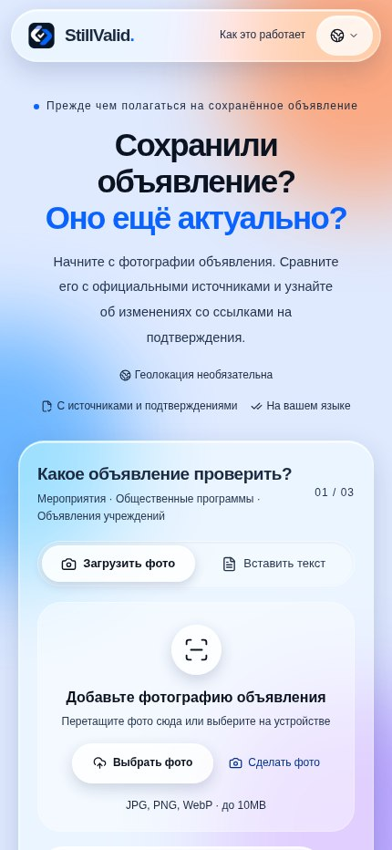
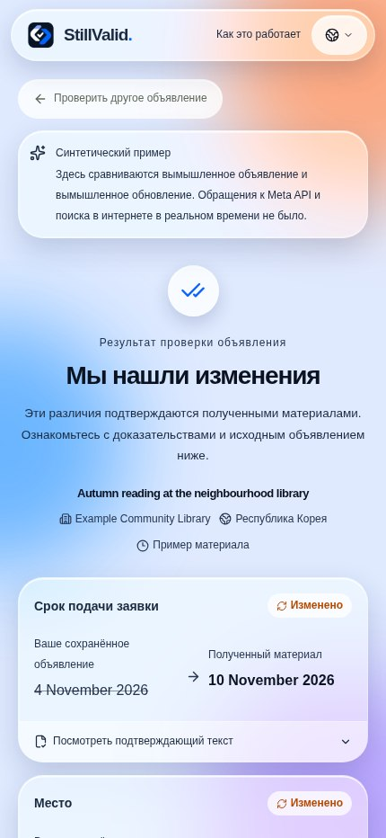

<div>


# StillValid

[](https://dev.meta.ai/docs/models) [](https://dev.meta.ai/docs/models) [](https://dev.meta.ai/docs) [](https://cerebralvalley.ai/e/meta-ai-developer-hackathon)

### Сохранённое объявление всё ещё актуально?

Сравните фотографию или текст объявления с текущими официальными источниками и посмотрите изменения, цитаты и то, что ещё нужно проверить. Установка и регистрация не требуются.

[Открыть приложение](https://stillvalid-beta.vercel.app) · [English](README.en.md) · [한국어](README.ko.md) · [日本語](README.ja.md) · [README](../README.md)

**Languages / 言語 / 언어 / اللغات:**

[English](README.en.md) · [한국어](README.ko.md) · [日本語](README.ja.md) · [简体中文](README.zh.md) · [Español](README.es.md) · [Français](README.fr.md) · [Deutsch](README.de.md) · [Português](README.pt.md) · [العربية](README.ar.md) · [Русский](README.ru.md)

## Почему StillValid

- **Модель предлагает, код решает.** Каждое изменение должно подтверждаться точными цитатами, которые есть и в объявлении, и на официальной странице; детерминированный проверяющий в [`compare.ts`](../src/lib/compare.ts) всё остальное помечает как «требует проверки».
- **Только официальные источники.** Блоги, соцсети и поисковые сниппеты никогда не считаются доказательством. Напечатанная в объявлении ссылка `go.kr`/`gov` подставляется автоматически; иначе встроенный веб-поиск Meta предлагает реальные страницы.
- **Построено целиком на моделях Meta.** Muse Spark читает, ищет и сравнивает; SAM 3.1 находит объявление на заполненной доске; результаты показываются на десяти языках без дополнительных вызовов модели.

**Демо-видео:** [Смотреть на YouTube](https://youtu.be/72v80uOubrU)

<p align="center"><a href="https://youtu.be/72v80uOubrU"></a></p>

## Пример использования

Синтетический пример: в вымышленном объявлении библиотеки указан срок 4 ноября, а в вымышленном обновлении — 10 ноября. Приложение показывает оба значения и цитаты. При реальной проверке также проверяются источник, идентичность объявления и доказательства; иначе результат может потребовать проверки. Пример не выполняет поиск или вызов модели и не доказывает реального переноса срока.

## Экраны приложения

Снимки реального рабочего интерфейса от 5 ноября 2026 года (KST), Chromium в мобильной ширине. Результат — обозначенный синтетический пример, а не реальная проверка и не фотография iPhone. Интерфейс на русском; исходные значения примера остаются на английском.

<p align="center"></p>

## Как пользоваться

1. Снимите или выберите одну фотографию либо вставьте до 18 000 символов. Обрежьте или поверните изображение в браузере; SAM может предложить области объявлений на одной фотографии.
2. Проверьте название, организацию, выпуск и страну. Чтобы исправить извлечённую дату или место, измените исходный текст и прочитайте его заново.
3. Подтвердите или укажите точную HTTPS-страницу организации; без ссылки приложение ищет источники-кандидаты.
4. Сравните значения и цитаты. Если требуется проверка, прочитайте причины и откройте официальный источник.
5. При желании найдите место в Google Maps, скопируйте сводку, выполните повторную проверку или удалите результат.

## Возможности и ограничения

- JPEG, PNG и WebP до 10 MiB; поддержка HEIC/HEIF зависит от браузера. SAM предлагает несколько областей на одном фото, но не обрабатывает несколько фотографий пакетом.
- Читает HTML, текст и текстовый слой PDF до 5 MB/20 страниц; OCR сканированных PDF не выполняется. Получает до трёх кандидатов и сравнивает до двух связанных источников.
- Десять языков интерфейса, арабский — справа налево. Даты, названия, места и цитаты не переводятся. Необязательный регион использования из 249 стран/регионов не равен стране объявления.
- Ссылка Maps передаёт только выбранный текст места при нажатии; она не проверяет адрес и не гарантирует открытие приложения карт.

## Как читать результат

- Изменено: хотя бы одно изменение подтверждено и нет общей причины отложить вывод.
- Совпадает: проверенные поля совпадают, но это не гарантирует неизменность всех деталей.
- Отменено или срок прошёл: требуется явная текущая отмена либо корректная явная дата и время.
- Требует проверки или недоступно: идентичность, источник, доказательства, конфликт или ошибка не позволяют сделать надёжный вывод.

## Состояние проверки

- Последняя интеграция прошла проверку типов, 205 модульных тестов, 7 тестов оценочного инструмента и сборку; семь браузерных наборов прошли на предыдущей версии с фиксированными ответами.
- Сообщалось об одном пользовательском сценарии с камерой iPhone: около трёх минут и результат «требует проверки». Полные текущие проверки iPhone/Android, HEIC и перехода в карты не завершены.
- Оценка десяти реальных объявлений с проверенными человеком эталонами не завершена. Исторические выборки малы; задержка реальной модели после последней оптимизации повторно не измерялась.

- Десять языков интерфейса не доказывают точность проверки фактов на каждом из них.

## Конфиденциальность и лимиты

По условиям Meta модель по умолчанию muse-spark-1.3-contributor использует отправленные данные для обучения будущих моделей Meta. Удаление результата в StillValid не удаляет данные у поставщика. Исходные файлы изображений не сохраняются постоянно; результаты и цитаты принадлежат анонимной сессии, имеют срок 24 часа и могут быть удалены. Ключи остаются на сервере. По умолчанию: 300 вызовов в сутки UTC, глобально 3 одновременные задачи и 10 запусков в минуту; это не денежный лимит.

## Заметки разработчика

- Браузер → API Next.js → модели Meta / HTTPS-источники → Redis или SQLite → детерминированная проверка. Чтение и сравнение используют Chat Completions со строгим JSON, поиск — Responses + web_search, необязательное выделение области — sam-3.1.
- Значения должны присутствовать в исходных цитатах. Подтверждение требует зарегистрированного официального домена и проверки организации, названия, выпуска, раздела и признаков архива/отзыва. Отсутствующие годы, часы и часовые пояса не выдумываются; грамматика отмены охватывает лишь некоторые английские и корейские формулировки.
- Прямая ссылка пропускает поиск. Бюджет источника: 15 секунд всего, 12 на запрос и до трёх перенаправлений; HTML/текст 600 000 байт, извлечённый текст 22 000 символов, PDF 5 000 000 байт/20 страниц. Ошибка не означает «без изменений».
- Чёткое чтение одинакового ввода и страны можно повторно использовать десять минут в памяти вкладки; актуальность источника и итоговое решение не кешируются. Предварительная проверка ждёт 350 мс и отменяется при изменении объявления, региона или ссылки; смена только языка позволяет её повторно использовать.
- Приоритет модели: переменная этапа → META_MODEL → muse-spark-1.3-contributor. По умолчанию SAM_MODEL — sam-3.1, усилие рассуждения минимальное. `none` опускает параметр, но не означает отсутствие рассуждений. До смены модели проверьте уведомления о конфиденциальности на десяти языках.

## Исторические наблюдения

Небольшие выборки старых версий с реконструированными публичными объявлениями; изображения, похожие на фото, не являются реальными снимками iPhone. Они не показывают текущую задержку или общую точность.

| Наблюдение | Результат |
|---|---|
| `muse-spark-1.3-contributor` · Seoul + Smithsonian · 4 runs | median 24.3 s; Seoul `changed` 2/2, Smithsonian `review` 2/2 |
| `muse-spark-1.3` · minimal · 4 runs | median 26.8 s |

[Validation record](../docs/validation.md#2026-11-04-production-with-muse-spark-13-contributor-f671f3b)

## API и настройки

| API | Результат |
|---|---|
| `GET /api/status`, `GET /api/demo` | Статус и синтетические примеры |
| `POST /api/extract`, `POST /api/locate` | Чтение и необязательное выделение области |
| `POST /api/checks` | Проверка потоком NDJSON |
| `GET /api/checks/{id}`, `DELETE /api/checks/{id}` | Прочитать или удалить результат сессии |
| `DELETE /api/session` | Удалить результаты сессии |

| Variable | Результат |
|---|---|
| `META_API_KEY`, `META_MODEL`, `META_EXTRACTION_MODEL`, `META_SEARCH_MODEL`, `META_COMPARISON_MODEL` | Ключ сервера; общая модель трёх этапов Spark, с переопределением по этапам |
| `SAM_MODEL`, `DAILY_MODEL_CALL_LIMIT` | Модель SAM; дневной лимит вызовов (по умолчанию 300) |
| `UPSTASH_REDIS_REST_URL`, `UPSTASH_REDIS_REST_TOKEN` | Записываемые учётные данные Redis REST или полная пара KV_REST |
| `VERIFIED_SOURCE_HOSTS`, `DATABASE_PATH` | Дополнительные проверенные домены; путь SQLite |

## Локальный запуск

Нужны Node.js 24 и npm. Примеры работают без ключа; для реальных проверок безопасно задайте META_API_KEY в .env.local. SQLite подходит одному серверу, размещённому приложению нужен Redis REST с записью. Не публикуйте ключи.

```bash
git clone https://github.com/ZOOGOM/stillvalid.git
cd stillvalid
npm ci
cp .env.example .env.local
npm run dev
```

## Тесты и ссылки

Браузерные тесты используют фикстуры без вызова модели и не заменяют проверку на устройствах или подтверждение полной доступности. Реальная оценка и необязательная проверка развёртывания могут быть платными.

```bash
npm run check
npm run build
npm run test:browser
npm run test:browser-maps
npm run test:browser-locate
npm run test:browser-stream
npm run test:browser-prefill
npm run test:browser-early
npm run test:browser-image
```

[Validation / 검증 기록](../docs/validation.md) · [Evaluation / 평가](../docs/evaluation.md) · [Deployment / 배포](../docs/deployment.md) · [Acceptance / 확인표](../docs/acceptance.md) · [Performance / 성능](../docs/performance.md) · [README screenshot provenance](../docs/screenshots/readme/README.md) · [.env.example](../.env.example) · [MIT](../LICENSE)

## Лицензия

Исходный код распространяется по MIT. Сторонние библиотеки, модели и материалы сохраняют собственные условия. В подвале приложения остаётся Copyright 2026 Zoogom. All rights reserved.

</div>
